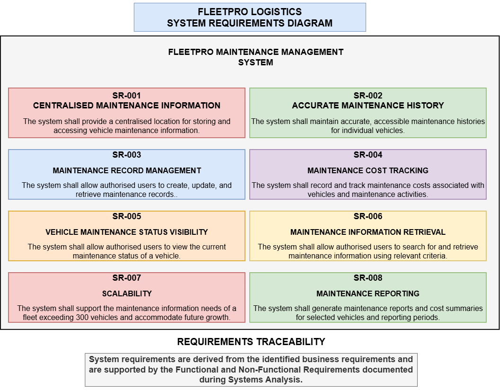

# FleetPro Logistics

# System Requirements

## 1. Purpose

The purpose of this document is to define the system requirements for the proposed FleetPro Logistics Vehicle Maintenance Management System.

The requirements are derived from the business requirements identified during the Business Analysis phase and translate the identified business needs into requirements that can be addressed by a software system.

This document establishes the foundation for the subsequent Systems Analysis and Design activities, including functional requirements, non-functional requirements, business rules, user stories, use cases, data requirements and system design.

The requirements will be used to guide the development, testing and evaluation of the proposed FleetPro solution.

## 2. System Overview

The proposed FleetPro Logistics Vehicle Maintenance Management System is a software solution designed to improve the way vehicle maintenance information is recorded, managed, accessed and reviewed.

The system will provide a centralised method for managing vehicle maintenance information and maintaining a maintenance history for each vehicle.

The system is intended to support the key activities identified during the Business Analysis phase, including recording completed maintenance, tracking maintenance costs, accessing maintenance history and supporting maintenance reporting.

The proposed system will support the stakeholders involved in the vehicle maintenance process, including Drivers, Fleet Administrators, Fleet Managers, Mechanics / Maintenance Teams and CEO / Senior Management.

The system is intended to replace the reliance on disconnected manual records and provide a more structured and scalable method of managing maintenance information as FleetPro's fleet grows.

The technical implementation of the proposed system will be defined during the later Systems Analysis, System Design and Development stages.

## 3. System Requirements

### SR-001 — Centralised Maintenance Information

**Requirement:**

The system shall provide a centralised method for storing and accessing vehicle maintenance information.

**System Reason:**

A centralised system is required to reduce reliance on disconnected physical records, spreadsheets and communication channels and provide users with a consistent location for managing maintenance information.

**Source:**

BR-001 — Centralised Maintenance Information.

---

### SR-002 — Accurate Maintenance History

**Requirement:**

The system shall maintain a maintenance history for each vehicle, including maintenance dates, maintenance details and associated costs.

**System Reason:**

Users need to be able to review previous maintenance performed on a vehicle to improve the accuracy and completeness of maintenance information and reduce the risk of unnecessary repeated maintenance.

**Source:**

BR-002 — Accurate Maintenance History.

---

### SR-003 — Maintenance Record Management

**Requirement:**

The system shall provide a standardised method for creating, recording and managing vehicle maintenance records.

**System Reason:**

A standardised recording method is required to ensure that maintenance information is captured consistently and can be managed using a defined process rather than relying on different manual recording methods.

**Source:**

BR-003 — Maintenance Record Management.

---

### SR-004 — Maintenance Cost Tracking

**Requirement:**

The system shall allow maintenance costs to be recorded and associated with the relevant vehicle and maintenance activity.

**System Reason:**

Recording maintenance costs against the relevant vehicle and maintenance activity will allow maintenance expenditure to be tracked more consistently and support the review of vehicle maintenance costs.

**Source:**

BR-004 — Maintenance Cost Tracking.

---

### SR-005 — Vehicle Maintenance Status Visibility

**Requirement:**

The system shall provide users with visibility of the maintenance status and maintenance history of individual vehicles.

**System Reason:**

Improved visibility will allow relevant users to determine the maintenance status and history of vehicles without relying on information gathered from multiple disconnected sources.

**Source:**

BR-005 — Vehicle Maintenance Status Visibility.

---

### SR-006 — Maintenance Information Retrieval

**Requirement:**

The system shall allow authorised users to retrieve maintenance information for individual vehicles when required.

**System Reason:**

Users need an efficient way to locate vehicle maintenance information without having to search through physical files, spreadsheets and communication channels.

**Source:**

BR-006 — Maintenance Information Retrieval.

---

### SR-007 — Scalable Maintenance-Recording Process

**Requirement:**

The system shall provide a maintenance-recording process capable of supporting the current fleet size and future growth in vehicles and maintenance information.

**System Reason:**

The existing process became increasingly difficult to manage as the fleet grew to more than 300 trucks. The proposed system therefore needs to support increasing volumes of vehicles and maintenance records without relying on processes that become impractical as the business grows.

**Source:**

BR-007 — Scalable Maintenance-Recording Process.

---

### SR-008 — Maintenance Reporting

**Requirement:**

The system shall provide structured maintenance information that can be used to support maintenance and financial reporting.

**System Reason:**

FleetPro requires structured maintenance information to review maintenance activity, maintenance history and associated costs and to support management decision-making and reporting.

**Source:**

BR-008 — Maintenance Reporting.

## 4. System Requirements Traceability Matrix

The following traceability matrix shows how each system requirement is derived from the corresponding business requirement identified during the Business Analysis phase.

This ensures that the proposed system capabilities remain connected to the original business needs identified during the analysis.

| System Requirement | System Requirement Description | Source Business Requirement |
|---|---|---|
| SR-001 — Centralised Maintenance Information | Provide a centralised method for storing and accessing vehicle maintenance information. | BR-001 — Centralised Maintenance Information |
| SR-002 — Accurate Maintenance History | Maintain a maintenance history for each vehicle, including maintenance dates, details and associated costs. | BR-002 — Accurate Maintenance History |
| SR-003 — Maintenance Record Management | Provide a standardised method for creating, recording and managing vehicle maintenance records. | BR-003 — Maintenance Record Management |
| SR-004 — Maintenance Cost Tracking | Allow maintenance costs to be recorded and associated with the relevant vehicle and maintenance activity. | BR-004 — Maintenance Cost Tracking |
| SR-005 — Vehicle Maintenance Status Visibility | Provide visibility of the maintenance status and maintenance history of individual vehicles. | BR-005 — Vehicle Maintenance Status Visibility |
| SR-006 — Maintenance Information Retrieval | Allow authorised users to retrieve maintenance information for individual vehicles when required. | BR-006 — Maintenance Information Retrieval |
| SR-007 — Scalable Maintenance-Recording Process | Provide a maintenance-recording process capable of supporting the current fleet size and future growth. | BR-007 — Scalable Maintenance-Recording Process |
| SR-008 — Maintenance Reporting | Provide structured maintenance information that can support maintenance and financial reporting. | BR-008 — Maintenance Reporting |

## 5. System Requirements Diagram

The following diagram provides a visual overview of the eight system requirements for the proposed FleetPro Logistics Vehicle Maintenance Management System.

It summarises the system's main responsibilities, including centralised maintenance information, vehicle maintenance history, maintenance record management, cost tracking, maintenance status visibility, information retrieval, scalability and reporting.

## 6. Traceability to the Business Analysis Phase

The system requirements were derived from the business requirements established during the Business Analysis phase.

The traceability relationship can be represented as:

**Business Requirement → System Requirement → Functional Requirement**

For example:

**BR-001 — Centralised Maintenance Information**

↓

**SR-001 — Centralised Maintenance Information**

↓

**FR-001 to FR-004 — Maintenance Information Functions**

This traceability ensures that the proposed system remains aligned with the original business problem and identified business needs.

## 7. Traceability Considerations

Not every system requirement will necessarily result in a direct functional requirement.

For example, **SR-007 — Scalable Maintenance-Recording Process** describes a quality and capacity characteristic of the proposed system. It will therefore be addressed primarily through Non-Functional Requirements relating to scalability, performance, capacity and maintainability.

This demonstrates that system requirements can be addressed through different types of requirements depending on the nature of the requirement.

## 8. Conclusion

The system requirements provide a clear link between the business needs identified during Business Analysis and the capabilities required from the proposed FleetPro system.

The traceability matrix ensures that each system requirement has a defined business source and provides a foundation for the functional and non-functional requirements developed during the next stages of Systems Analysis.