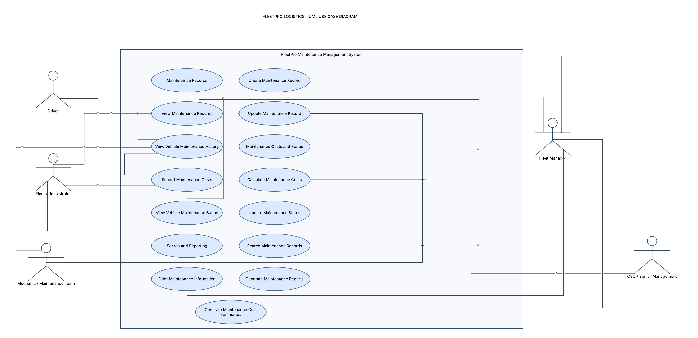

# FleetPro Logistics

# Use Cases

## 1. Purpose

This document describes how users interact with the proposed FleetPro Logistics Vehicle Maintenance Management System to complete key maintenance management tasks.

Each use case defines the primary actor, goal, preconditions, trigger, interaction flow, alternative outcomes and postconditions. The use cases expand the user stories and functional requirements into structured descriptions that can guide system design, development and testing.

The use cases are based on the proposed system requirements and the actor interactions represented in the Use Case Diagram. Details such as role permissions, mandatory fields, status values and reporting rules will require confirmation before implementation.

## 2. Use Case Overview

| Use Case ID | Use Case Name | Primary Actor | Related User Story |
|---|---|---|---|
| UC-001 | Create a Maintenance Record | Fleet Administrator | US-001 |
| UC-002 | View Maintenance Records | Fleet Administrator / Mechanic / Maintenance Team / Fleet Manager | US-002 |
| UC-003 | Update a Maintenance Record | Fleet Administrator / Mechanic / Maintenance Team | US-003 |
| UC-004 | View Vehicle Maintenance History | Driver / Mechanic / Maintenance Team / Fleet Manager | US-004 |
| UC-005 | Record Maintenance Costs | Fleet Administrator | US-005 |
| UC-006 | Calculate Maintenance Costs | Fleet Manager | US-006 |
| UC-007 | View Vehicle Maintenance Status | Driver / Fleet Manager | US-007 |
| UC-008 | Update Maintenance Status | Mechanic / Maintenance Team | US-008 |
| UC-009 | Search Maintenance Records | Fleet Administrator / Fleet Manager | US-009 |
| UC-010 | Filter Maintenance Information | Fleet Manager | US-010 |
| UC-011 | Generate Maintenance Reports | Fleet Manager | US-011 |
| UC-012 | Generate Maintenance Cost Summaries | Fleet Manager | US-012 |

## 2.1 Use Case Diagram

The following UML Use Case Diagram provides a visual representation of the proposed FleetPro Maintenance Management System. It identifies the five external actors, the twelve system use cases and their associations.

### Actors Represented

| Actor | System Responsibilities |
|---|---|
| Driver | Views vehicle maintenance status and maintenance history. |
| Fleet Administrator | Creates, views and updates maintenance records, records maintenance costs and searches maintenance information. |
| Mechanic / Maintenance Team | Views maintenance records and history, updates maintenance information and maintenance status. |
| Fleet Manager | Monitors maintenance information, reviews costs, searches and filters records, and generates reports and cost summaries. |
| CEO / Senior Management | Views generated maintenance reports and cost summaries to support management decisions. |

## 3. Detailed Use Cases

### UC-001 — Create a Maintenance Record

**Primary Actor:** Fleet Administrator

**Goal:** Create and save a maintenance record associated with the correct vehicle.

**Description:** The Fleet Administrator records a maintenance activity in the system so that the information can be retrieved and used for maintenance history and reporting.

**Preconditions:**
- The user has access to the system.
- The user is authorised to create maintenance records.
- The relevant vehicle can be identified in the system.

**Trigger:** The Fleet Administrator needs to record a completed maintenance activity.

**Main Success Flow:**

1. The Fleet Administrator opens the maintenance record creation function.
2. The system displays the maintenance record form.
3. The Fleet Administrator identifies the relevant vehicle.
4. The Fleet Administrator enters the maintenance date and maintenance details.
5. The Fleet Administrator enters other required information available for the activity.
6. The Fleet Administrator submits the record.
7. The system validates the mandatory information.
8. The system assigns a unique identifier to the record.
9. The system saves the record and associates it with the selected vehicle.
10. The system confirms that the record has been saved successfully.

**Alternative and Exception Flows:**

- **A1 — Missing required information:** The system identifies the missing fields and asks the user to correct them. The record is not saved as a complete record until validation succeeds.
- **A2 — Invalid information:** The system explains which fields need correction and allows the user to try again.
- **A3 — Vehicle cannot be identified:** The system informs the user and does not associate the record with an unrelated vehicle.
- **A4 — Save failure:** The system informs the user that saving was unsuccessful and does not report the record as successfully saved.

**Postconditions:**

Success:
- The maintenance record is saved.
- The record has a unique identifier.
- The record is associated with the correct vehicle.
- The saved information is available for authorised retrieval.

Failure:
- No successful save is reported.
- The user is informed that the record could not be completed or saved.

**Related Requirements:**
- US-001 — Create a Maintenance Record
- FR-001 — Create Maintenance Record
- FR-004 — Associate Maintenance Record with Vehicle
- FR-009 — Validate Required Maintenance Information
- FR-010 — Save Maintenance Record
- FR-011 — Identify Maintenance Record
- Business Rules: Vehicle Association, Unique Maintenance Record Identification and Required Maintenance Information.

---

### UC-002 — View Maintenance Records

**Primary Actors:** Fleet Administrator, Mechanic / Maintenance Team and Fleet Manager.

**Goal:** View existing maintenance records.

**Description:** Authorised users retrieve and review saved maintenance records to understand previously recorded maintenance activities.

**Preconditions:**
- The user can access the system.
- The user is authorised to view maintenance records.
- Maintenance records are available in the system, or the system can display an empty result.

**Trigger:** The user needs to review recorded maintenance information.

**Main Success Flow:**

1. The user opens the maintenance records section.
2. The system retrieves the records the user is permitted to view.
3. The system displays the available records.
4. The user selects a record for further details, if required.
5. The system displays the selected record's available information.

**Alternative and Exception Flows:**

- **A1 — No records available:** The system displays an appropriate message indicating that no maintenance records are available.
- **A2 — Record unavailable:** The system informs the user that the selected record could not be retrieved.
- **A3 — Access denied:** The system prevents unauthorised access and displays an appropriate message.

**Postconditions:**
- The user can review retrieved records.
- No maintenance information is changed by the viewing operation.

**Related Requirements:**
- US-002 — View Maintenance Records
- FR-002 — View Maintenance Records
- FR-004 — Associate Maintenance Record with Vehicle
- FR-011 — Identify Maintenance Record.

---

### UC-003 — Update a Maintenance Record

**Primary Actors:** Fleet Administrator and Mechanic / Maintenance Team.

**Goal:** Correct or update an existing maintenance record.

**Description:** An authorised user updates permitted information in a maintenance record while preserving its association with the correct vehicle.

**Preconditions:**
- The user is authorised to update maintenance records.
- The target record exists and can be retrieved.
- The user has identified the record to update.

**Trigger:** The user identifies information that requires correction or updating.

**Main Success Flow:**

1. The user locates and opens the maintenance record.
2. The system displays the current record information.
3. The user changes the permitted fields.
4. The user submits the changes.
5. The system validates the updated information.
6. The system saves the changes.
7. The system confirms that the update was successful.

**Alternative and Exception Flows:**

- **A1 — Invalid update:** The system identifies the invalid fields and requests correction.
- **A2 — Record not found:** The system informs the user that the record cannot be found.
- **A3 — Save failure:** The system reports that the update failed and does not claim that the changes were saved.
- **A4 — Unauthorised update:** The system prevents the user from making changes they are not permitted to make.

**Postconditions:**
- On success, the permitted changes are saved.
- The record remains associated with the correct vehicle.
- On failure, the system informs the user of the unsuccessful update.

**Related Requirements:**
- US-003 — Update a Maintenance Record
- FR-003 — Update Maintenance Record
- FR-004 — Associate Maintenance Record with Vehicle
- FR-009 — Validate Required Maintenance Information
- FR-010 — Save Maintenance Record.

---

### UC-004 — View Vehicle Maintenance History

**Primary Actors:** Driver, Mechanic / Maintenance Team and Fleet Manager.

**Goal:** Review the maintenance history of a selected vehicle.

**Description:** The user retrieves a vehicle's recorded maintenance history to understand previous maintenance activities, dates, details and associated costs.

**Preconditions:**
- The user is authorised to view the relevant vehicle's maintenance history.
- The relevant vehicle can be identified in the system.

**Trigger:** The user needs to review a vehicle's previous maintenance.

**Main Success Flow:**

1. The user opens the vehicle maintenance history function.
2. The system allows the user to identify a vehicle.
3. The user selects the relevant vehicle.
4. The system retrieves the maintenance records associated with that vehicle.
5. The system displays the records in chronological order.
6. The user reviews the available maintenance details and costs.

**Alternative and Exception Flows:**

- **A1 — No maintenance history:** The system indicates that no maintenance history is recorded for the selected vehicle.
- **A2 — Vehicle not found:** The system informs the user that the vehicle could not be identified.
- **A3 — Retrieval failure:** The system reports that the maintenance history could not be retrieved.
- **A4 — Access denied:** The system prevents access if the user does not have permission to view the selected vehicle's history.

**Postconditions:**
- The user can review the available maintenance history.
- The viewing operation does not change the maintenance records.

**Related Requirements:**
- US-004 — View Vehicle Maintenance History
- FR-004 — Associate Maintenance Record with Vehicle
- FR-005 — View Vehicle Maintenance History
- FR-006 — Record Maintenance Date
- FR-007 — Record Maintenance Details
- FR-008 — Display Maintenance History Chronologically.

---

### UC-005 — Record Maintenance Costs

**Primary Actor:** Fleet Administrator

**Goal:** Record maintenance costs against the relevant vehicle and maintenance activity.

**Description:** The Fleet Administrator records available cost information for a maintenance activity so that expenditure can be reviewed and included in reporting.

**Preconditions:**
- The Fleet Administrator is authorised to record maintenance costs.
- The relevant vehicle and maintenance activity can be identified.
- The cost information is available or can be entered when confirmed.

**Trigger:** The Fleet Administrator needs to record or update a maintenance cost.

**Main Success Flow:**

1. The Fleet Administrator opens the relevant maintenance record or cost-entry function.
2. The system displays the vehicle and maintenance information.
3. The Fleet Administrator identifies the relevant maintenance activity.
4. The Fleet Administrator enters the maintenance cost.
5. The Fleet Administrator submits the information.
6. The system validates the entered cost and required fields.
7. The system saves the cost against the relevant maintenance activity.
8. The system confirms that the cost information was saved.

**Alternative and Exception Flows:**

- **A1 — Invalid cost:** The system rejects invalid cost information and asks the user to correct it.
- **A2 — Missing maintenance activity:** The system informs the user that the cost cannot be associated with an unidentified activity.
- **A3 — Save failure:** The system reports that the cost information was not saved.
- **A4 — Cost not yet available:** The user cannot enter an unconfirmed amount as though it were verified. The treatment of unknown or pending costs requires confirmation.

**Postconditions:**
- On success, the cost is stored against the relevant maintenance activity and vehicle.
- On failure, the user is informed that the cost was not saved.

**Related Requirements:**
- US-005 — Record Maintenance Costs
- FR-004 — Associate Maintenance Record with Vehicle
- FR-012 — Record Maintenance Cost
- FR-014 — View Maintenance Cost Information.

---

### UC-006 — Calculate Maintenance Costs

**Primary Actor:** Fleet Manager

**Goal:** Calculate maintenance expenditure for selected vehicles and reporting periods.

**Description:** The Fleet Manager requests a calculation of recorded maintenance costs to support monitoring and financial review.

**Preconditions:**
- The Fleet Manager is authorised to view maintenance cost information.
- Relevant maintenance cost records are available, if any.
- The reporting period and vehicle selection can be defined.

**Trigger:** The Fleet Manager needs to review maintenance expenditure.

**Main Success Flow:**

1. The Fleet Manager opens the maintenance cost calculation function.
2. The system requests or provides selection criteria for vehicles and reporting periods.
3. The Fleet Manager selects the relevant criteria.
4. The system retrieves the matching maintenance cost records.
5. The system calculates the total recorded cost for the selection.
6. The system displays the result and identifies the selected period and vehicle scope.

**Alternative and Exception Flows:**

- **A1 — No matching costs:** The system indicates that no matching cost records were found.
- **A2 — Invalid reporting criteria:** The system asks the Fleet Manager to correct the selection.
- **A3 — Calculation failure:** The system informs the Fleet Manager that the calculation could not be completed.
- **A4 — Incomplete cost information:** The system makes the limitations of the available data clear rather than implying that unrecorded costs are included.

**Postconditions:**
- The Fleet Manager can review the calculated total for the selected scope.
- The calculation does not change the underlying maintenance cost records.

**Related Requirements:**
- US-006 — Calculate Maintenance Costs
- FR-013 — Calculate Maintenance Costs
- FR-020 — Generate Maintenance Cost Summary.

---

### UC-007 — View Vehicle Maintenance Status

**Primary Actors:** Driver and Fleet Manager.

**Goal:** View the current recorded maintenance status of a vehicle.

**Description:** The user checks a vehicle's maintenance status to understand its recorded maintenance condition and support operational or fleet management decisions.

**Preconditions:**
- The user is authorised to view the relevant vehicle's maintenance status.
- The vehicle can be identified in the system.

**Trigger:** The user needs to check a vehicle's maintenance status.

**Main Success Flow:**

1. The user opens the vehicle status function.
2. The system displays the available vehicles or provides a way to select one.
3. The user selects the relevant vehicle.
4. The system retrieves the vehicle's recorded maintenance status.
5. The system displays the status and relevant available maintenance information.

**Alternative and Exception Flows:**

- **A1 — Vehicle not found:** The system informs the user that the vehicle could not be identified.
- **A2 — Status unavailable:** The system indicates that no status has been recorded or that the status cannot be retrieved.
- **A3 — Retrieval failure:** The system reports that the status could not be loaded.
- **A4 — Access denied:** The system prevents access if the user does not have permission to view the selected vehicle.

**Postconditions:**
- The user can review the available status information.
- The viewing operation does not change the vehicle's status.

**Related Requirements:**
- US-007 — View Vehicle Maintenance Status
- FR-015 — View Vehicle Maintenance Status.

---

### UC-008 — Update Maintenance Status

**Primary Actor:** Mechanic / Maintenance Team.

**Goal:** Update the recorded maintenance status of a vehicle or maintenance activity.

**Description:** The Mechanic or Maintenance Team updates a maintenance status when a change has been confirmed and the user is permitted to make that change.

**Preconditions:**
- The user is authorised to update the relevant status.
- The vehicle or maintenance activity exists.
- The new status is supported by the system's agreed status rules.

**Trigger:** A confirmed change in maintenance status needs to be recorded.

**Main Success Flow:**

1. The Mechanic or Maintenance Team opens the relevant vehicle or maintenance activity.
2. The system displays its current recorded status.
3. The user selects or enters the new status.
4. The user submits the update.
5. The system validates the status change.
6. The system saves the updated status.
7. The system confirms that the update was successful.

**Alternative and Exception Flows:**

- **A1 — Invalid status:** The system rejects a status value that is not permitted.
- **A2 — Unauthorised update:** The system prevents the user from changing the status.
- **A3 — Record unavailable:** The system informs the user that the relevant vehicle or activity cannot be found.
- **A4 — Save failure:** The system reports that the update was unsuccessful.

**Postconditions:**
- On success, the new status is saved.
- On failure, the previously saved status remains unchanged if the update was not committed, and the user is informed of the outcome.

**Related Requirements:**
- US-008 — Update Maintenance Status
- FR-015 — View Vehicle Maintenance Status
- FR-016 — Update Maintenance Status.

---

### UC-009 — Search Maintenance Records

**Primary Actors:** Fleet Administrator and Fleet Manager.

**Goal:** Locate maintenance records using relevant search criteria.

**Description:** The Fleet Administrator or Fleet Manager searches recorded maintenance information to locate a particular record or a set of records.

**Preconditions:**
- The user is authorised to search maintenance records.
- The system contains searchable maintenance information or can return an empty result.

**Trigger:** The user needs to locate specific maintenance information.

**Main Success Flow:**

1. The user opens the maintenance search function.
2. The system provides the available search fields.
3. The user enters the search criteria.
4. The user submits the search.
5. The system retrieves records matching the criteria.
6. The system displays the matching results.
7. The user opens a result, if required.

**Alternative and Exception Flows:**

- **A1 — No matches:** The system informs the user that no records match the search.
- **A2 — Invalid search criteria:** The system asks the user to correct the criteria.
- **A3 — Search failure:** The system informs the user that the search could not be completed.

**Postconditions:**
- Matching records are displayed when available.
- The search does not change stored maintenance information.

**Related Requirements:**
- US-009 — Search Maintenance Records
- FR-017 — Search Maintenance Records.

---

### UC-010 — Filter Maintenance Information

**Primary Actor:** Fleet Manager

**Goal:** Narrow displayed maintenance information using selected criteria.

**Description:** The Fleet Manager applies filters to maintenance information to focus on relevant vehicles, dates or other supported criteria.

**Preconditions:**
- The Fleet Manager is authorised to view the relevant maintenance information.
- The system has maintenance information to filter, or can return an empty result.

**Trigger:** The Fleet Manager needs to narrow a set of maintenance records to a relevant subset.

**Main Success Flow:**

1. The Fleet Manager opens the maintenance information view.
2. The system displays available filtering options.
3. The Fleet Manager selects the required criteria.
4. The Fleet Manager applies the filters.
5. The system retrieves or filters the matching information.
6. The system displays the filtered results.

**Alternative and Exception Flows:**

- **A1 — No matching results:** The system indicates that no records match the selected criteria.
- **A2 — Invalid filter values:** The system asks the Fleet Manager to correct the selected values.
- **A3 — Clear filters:** The Fleet Manager removes the filters and returns to the unfiltered view.
- **A4 — Filtering failure:** The system informs the Fleet Manager that the results could not be filtered.

**Postconditions:**
- The Fleet Manager can review the filtered information.
- Filtering does not alter the underlying records.

**Related Requirements:**
- US-010 — Filter Maintenance Information
- FR-018 — Filter Maintenance Information.

---

### UC-011 — Generate Maintenance Reports

**Primary Actor:** Fleet Manager

**Secondary Actor:** CEO / Senior Management

**Goal:** Generate a report from recorded maintenance information for operational and management review.

**Description:** The Fleet Manager generates a maintenance report to review maintenance activity and support operational decision-making. The CEO / Senior Management can access the generated report for management-level review.

**Preconditions:**
- The Fleet Manager is authorised to generate reports.
- The CEO / Senior Management is authorised to view the relevant reports.
- Relevant maintenance information is available.
- The reporting criteria can be specified.

**Trigger:** The Fleet Manager needs a report of maintenance activity, or the CEO / Senior Management needs to review an available report.

**Main Success Flow:**

1. The Fleet Manager opens the maintenance reporting function.
2. The system presents the supported report criteria.
3. The Fleet Manager selects the required vehicles, reporting period or other available criteria.
4. The Fleet Manager requests the report.
5. The system retrieves the matching maintenance information.
6. The system compiles the report.
7. The system displays the generated report.
8. The Fleet Manager reviews the report.
9. The CEO / Senior Management accesses the generated report when required and authorised.

**Alternative and Exception Flows:**

- **A1 — No matching data:** The system indicates that the selected criteria returned no maintenance information.
- **A2 — Invalid criteria:** The system asks the Fleet Manager to correct the selection.
- **A3 — Report generation failure:** The system informs the Fleet Manager that the report could not be generated.
- **A4 — Report access denied:** The system prevents the CEO / Senior Management from accessing reports they are not authorised to view.
- **A5 — Export unavailable:** If exporting is not supported, the system does not present an export option as though it were available.

**Postconditions:**
- On success, the report is available for authorised review.
- The underlying maintenance records remain unchanged.
- The CEO / Senior Management can review the report if access is permitted.

**Related Requirements:**
- US-011 — Generate Maintenance Reports
- FR-019 — Generate Maintenance Report
- FR-021 — Filter Maintenance Reports.

---

### UC-012 — Generate Maintenance Cost Summaries

**Primary Actor:** Fleet Manager

**Secondary Actor:** CEO / Senior Management

**Goal:** Generate a summary of recorded maintenance costs for selected vehicles and reporting periods.

**Description:** The Fleet Manager requests a cost summary to review recorded expenditure and compare maintenance costs across a selected scope. The CEO / Senior Management can access the generated cost summary to support financial and management decisions.

**Preconditions:**
- The Fleet Manager is authorised to generate cost summaries.
- The CEO / Senior Management is authorised to view the relevant summaries.
- Relevant maintenance cost information is available, if any.
- The vehicle selection and reporting period can be specified.

**Trigger:** The Fleet Manager needs a summary of maintenance expenditure, or the CEO / Senior Management needs to review an available cost summary.

**Main Success Flow:**

1. The Fleet Manager opens the maintenance cost summary function.
2. The system provides the available vehicle and reporting-period criteria.
3. The Fleet Manager selects the required criteria.
4. The Fleet Manager requests the summary.
5. The system retrieves matching maintenance cost records.
6. The system calculates totals for the selected scope.
7. The system presents the cost summary and its reporting criteria.
8. The Fleet Manager reviews the results.
9. The CEO / Senior Management accesses the generated cost summary when required and authorised.

**Alternative and Exception Flows:**

- **A1 — No matching cost records:** The system indicates that no cost records match the selection.
- **A2 — Invalid reporting period:** The system requests a valid reporting period.
- **A3 — Incomplete cost data:** The system identifies relevant data limitations where supported, rather than implying that missing costs have been included.
- **A4 — Summary generation failure:** The system informs the Fleet Manager that the summary could not be generated.
- **A5 — Summary access denied:** The system prevents unauthorised access to the cost summary.

**Postconditions:**
- On success, the cost summary is available for authorised review.
- The underlying maintenance records remain unchanged.
- The CEO / Senior Management can review the summary if access is permitted.

**Related Requirements:**
- US-012 — Generate Maintenance Cost Summaries
- FR-013 — Calculate Maintenance Costs
- FR-020 — Generate Maintenance Cost Summary
- FR-021 — Filter Maintenance Reports.

---

## 4. Traceability

The use cases expand the user stories into detailed interaction flows and connect the proposed system behaviour to the functional requirements.

| Use Case | Related User Story | Main Functional Requirements |
|---|---|---|
| UC-001 — Create a Maintenance Record | US-001 | FR-001, FR-004, FR-009, FR-010, FR-011 |
| UC-002 — View Maintenance Records | US-002 | FR-002, FR-004, FR-011 |
| UC-003 — Update a Maintenance Record | US-003 | FR-003, FR-004, FR-009, FR-010 |
| UC-004 — View Vehicle Maintenance History | US-004 | FR-004, FR-005, FR-006, FR-007, FR-008 |
| UC-005 — Record Maintenance Costs | US-005 | FR-004, FR-012, FR-014 |
| UC-006 — Calculate Maintenance Costs | US-006 | FR-013, FR-020 |
| UC-007 — View Vehicle Maintenance Status | US-007 | FR-015 |
| UC-008 — Update Maintenance Status | US-008 | FR-015, FR-016 |
| UC-009 — Search Maintenance Records | US-009 | FR-017 |
| UC-010 — Filter Maintenance Information | US-010 | FR-018 |
| UC-011 — Generate Maintenance Reports | US-011 | FR-019, FR-021 |
| UC-012 — Generate Maintenance Cost Summaries | US-012 | FR-013, FR-020, FR-021 |

## 5. Outstanding Clarifications

The following details require confirmation before implementation. They should not be treated as final business decisions until agreed by the relevant stakeholders.

- **Record fields:** Which fields are mandatory when creating or updating a maintenance record?
- **Permissions:** Which roles may create, view, update and report on maintenance information? Should Drivers, Fleet Administrators, Mechanics, Fleet Managers and CEO / Senior Management have separate access permissions?
- **Status values:** Which vehicle and maintenance statuses will the system support, and which status transitions are permitted?
- **Cost handling:** How should missing, pending, corrected or unconfirmed maintenance costs be represented?
- **Search and filters:** Which search fields and filtering criteria are required?
- **Reporting periods:** How should the start and end of reporting periods be defined?
- **Reporting access:** Should CEO / Senior Management have read-only access to generated maintenance reports and cost summaries?
- **Reporting output:** Are reports only displayed in the system, or must they also be exportable or printable?
- **Audit history:** Should the system record who created or changed a maintenance record and when? This needs to be agreed as a requirement.

These clarifications should be resolved through stakeholder review and requirements validation before the system is implemented.

## 6. Conclusion

The use cases describe how the five proposed actor groups interact with the FleetPro Logistics Vehicle Maintenance Management System. They cover maintenance record creation, viewing and updating, vehicle maintenance history, cost tracking, status management, searching, filtering and reporting.

Each use case links user interactions to the documented user stories and functional requirements, providing a foundation for use case diagrams, activity diagrams, system design and test-case development.

The documented flows represent the proposed system behaviour. Further stakeholder clarification is required for unresolved business rules, permissions, data validation and reporting details.