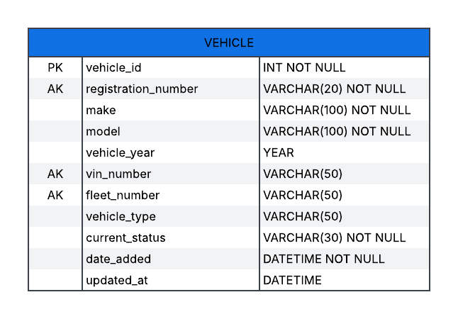
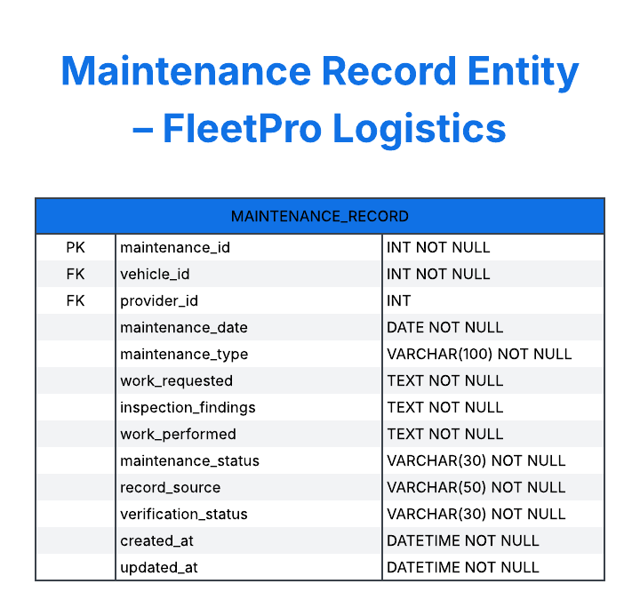
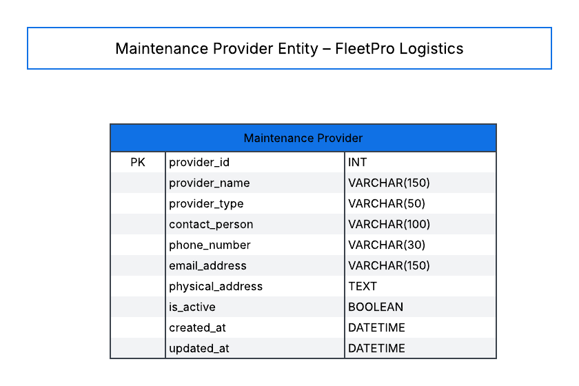
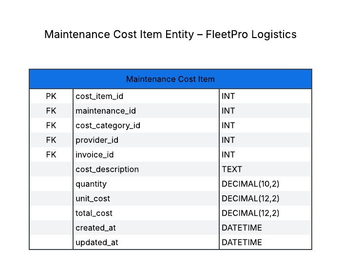
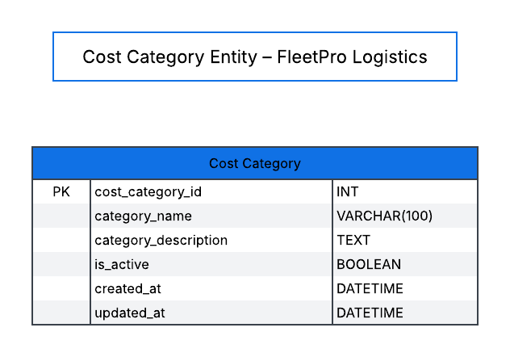
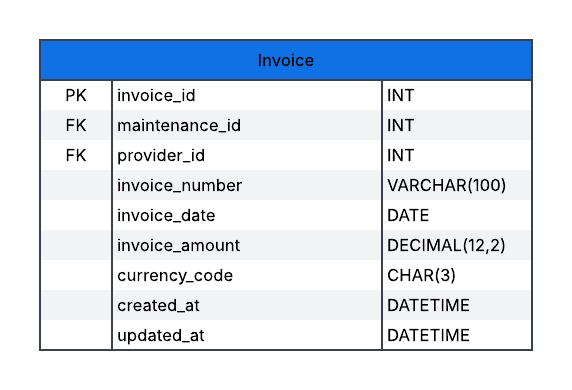
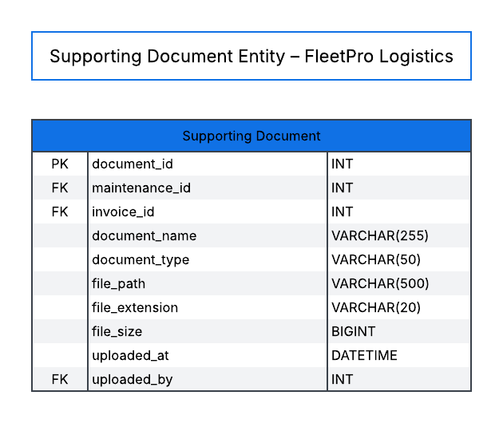
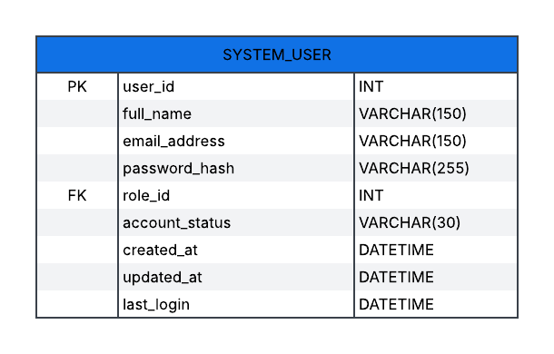
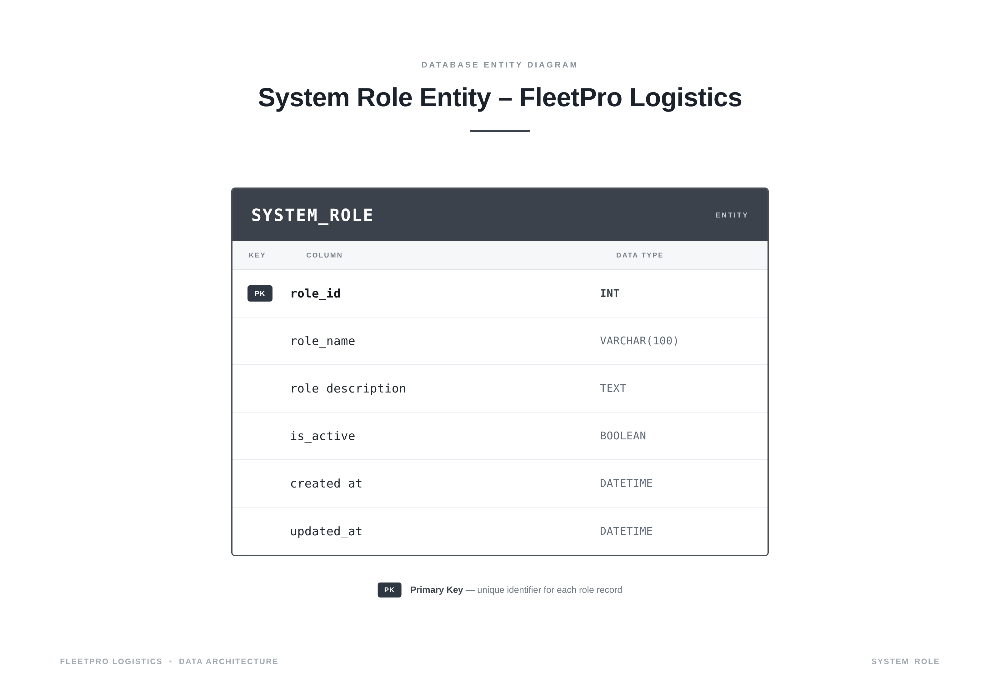
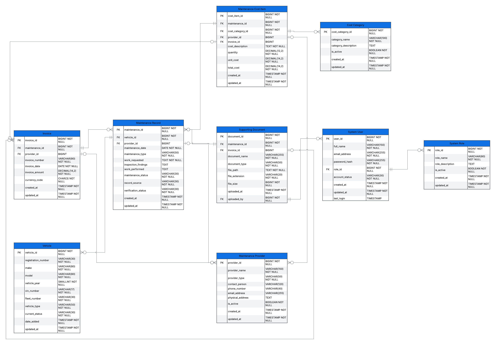

# FleetPro Logistics

# Data Dictionary

## 1. Introduction

### 1.1 Purpose

The purpose of this document is to define the data fields required by the proposed FleetPro Logistics Vehicle Maintenance Management System.

The Data Dictionary provides detailed descriptions of the information stored within the system, including field names, data types, descriptions, mandatory requirements and relevant validation rules.

It establishes a consistent definition of the data used throughout the system and provides a reference for database design, development and testing.

### 1.2 Scope

This document covers the data entities and fields required to support the FleetPro vehicle maintenance management system.

It includes:

- Vehicle information.
- Maintenance records.
- Maintenance provider information.
- Maintenance cost items.
- Cost category information.
- Invoice information.
- Supporting documentation.
- System user information.
- System role information.
- Calculated maintenance expenditure.

### 1.3 Objectives

The objectives of the Data Dictionary are to:

- Define the data fields required by each system entity.
- Specify appropriate database data types.
- Identify mandatory and optional fields.
- Establish consistent naming conventions.
- Define data validation and integrity requirements.
- Support the development of the system database.
- Provide a reference for developers and testers.

## 2. Data Dictionary Conventions

### 2.1 Field Naming Conventions

The system will use consistent naming conventions for database fields to improve readability, maintainability and consistency.

The following conventions will apply:

- Field names will use lowercase letters.
- Multiple words will be separated using underscores (snake_case).
- Field names will clearly describe the information being stored.
- Duplicate or unclear field names will be avoided.
- Primary key fields will use the entity name followed by `_id`.

Examples include:

- `vehicle_id`
- `registration_number`
- `maintenance_date`
- `work_performed`
- `cost_category_id`
- `cost_description`
- `total_cost`
- `provider_id`

### 2.2 Data Types

Each field will be assigned an appropriate data type based on the information it stores.

The proposed database will use MySQL-compatible data types.

| Data Type | Purpose |
|---|---|
| INT | Whole numbers and record identifiers |
| BIGINT | Large whole numbers, such as file sizes |
| VARCHAR(n) | Text with a defined maximum length |
| CHAR(n) | Fixed-length text, such as three-letter currency codes |
| TEXT | Longer descriptions and detailed written information |
| DATE | Calendar dates |
| DATETIME | Date and time information |
| YEAR | Stores a calendar year |
| DECIMAL(10,2) | Numeric values requiring two decimal places, such as quantities |
| DECIMAL(12,2) | Monetary values requiring two decimal places |
| BOOLEAN | True or false values |

Data types will be selected according to the purpose and expected contents of each field.

### 2.3 Primary Keys

Each database entity must have a primary key (PK) that uniquely identifies every record.

Primary keys must:

- Contain a unique value.
- Never contain NULL values.
- Be automatically generated where appropriate.
- Provide a reliable way to identify and reference records.

Examples include:

- `vehicle_id`
- `maintenance_id`
- `provider_id`
- `cost_item_id`
- `invoice_id`

Internal identifiers will support database relationships. However, the system interface must display meaningful information, such as vehicle registration numbers, maintenance dates and work descriptions, rather than relying on internal IDs alone.

### 2.4 Foreign Keys

Foreign keys (FK) will establish relationships between database entities and maintain referential integrity.

Examples include:

- A maintenance record references the vehicle to which the work relates through `vehicle_id`.
- A maintenance record references the maintenance provider through `provider_id`, where applicable.
- A maintenance cost item references its associated maintenance record through `maintenance_id`.
- A maintenance cost item references its cost category through `cost_category_id`.
- A maintenance cost item references the maintenance provider responsible for the expense through `provider_id`, where applicable.
- An invoice references its associated maintenance record.
- Supporting documents reference the relevant maintenance record.

Foreign keys must reference valid records in their respective entities.

### 2.5 Mandatory and Optional Fields

Each field will be identified as either mandatory or optional.

**Mandatory fields** must contain valid information before a record can be saved or completed, according to the applicable business rules.

**Optional fields** may be left NULL when information is unavailable or not applicable.

Historical records may contain incomplete information. The system must allow unavailable historical details to be identified without requiring users to invent or assume information.

### 2.6 NULL Values

NULL will represent information that is unknown, unavailable or not applicable.

NULL must not be treated as equivalent to:

- Zero.
- An empty text value.
- An assumed value.

For example:

- An unknown historical maintenance cost must not automatically be recorded as R0.
- An unknown maintenance provider must not be assigned an invented provider.
- An unavailable historical maintenance date must not be replaced with the date the information was entered.

This distinction is important for maintaining accurate historical records and financial reports.

### 2.7 Unique Constraints

Unique constraints will be applied to fields that must not contain duplicate values.

Examples may include:

- System usernames.
- Maintenance provider identification details, where available.
- Other identifiers that must remain unique within the system.

Vehicle registration numbers must be handled carefully because a vehicle's registration may change over time. The database design must preserve the accuracy of historical vehicle information rather than assuming that a registration number will remain unchanged.

### 2.8 Auto-Increment Fields

Primary key fields will generally use auto-increment functionality where appropriate.

This allows the database to generate a unique identifier whenever a new record is created.

Examples include:

- `vehicle_id`
- `maintenance_id`
- `provider_id`
- `cost_item_id`

These identifiers will be used internally to establish relationships between records.

The system must still present meaningful maintenance and financial information to users.

### 2.9 Monetary Values and Calculations

All monetary fields will use the appropriate `DECIMAL` data type to support accurate financial calculations.

The system must follow a consistent approach to recording and calculating maintenance expenditure to prevent duplicate counting.

**Invoice-Based Expenditure**

- When an invoice exists, the recorded `invoice_amount` must be treated as the authoritative expenditure amount for that invoice.
- Individual maintenance cost items associated with the invoice must be retained to provide a detailed breakdown of the work, parts, labour and other expenses.
- The invoice total and its associated itemised cost items must never be added together as separate expenditure.
- The system should compare the sum of the itemised cost items against the invoice amount and identify any differences for review.
- Differences must not be silently adjusted or allocated to cost categories.

**Expenditure Without an Invoice**

- Where no invoice exists, the system must use the recorded `total_cost` of the applicable maintenance cost items.
- Each expense must be counted only once.

**Expenditure Reporting**

The system must support expenditure calculations by:

- Vehicle.
- Maintenance activity.
- Cost category.
- Maintenance provider.
- Month.
- Year.
- Selected date range.
- Overall fleet.

The system must also support combined filters, such as calculating tyre expenditure for a specific vehicle and maintenance provider during a selected year.

Overall expenditure reports must use invoice totals where invoices exist and cost item totals where no invoice exists.

Category-based reports must use the actual recorded itemised cost items for category attribution.

Provider-based reports must use the Maintenance Provider recorded on the invoice when an invoice exists. The full invoice amount must be attributed to that provider and counted only once. Where no invoice exists, provider attribution must use the provider recorded against the relevant maintenance cost item.

Where provider information is missing, the expenditure must remain identifiable as an unassigned provider amount rather than being attributed to an assumed provider.

Where an invoice has no itemised breakdown, the system must not invent a category allocation. Any difference between an invoice total and its itemised costs must remain identifiable for review.

Where the sum of itemised cost items is lower than the invoice amount, the difference must be identified and displayed separately as an unallocated invoice difference. Category-based reports must use the actual recorded itemised amounts and must not distribute the unallocated difference across categories. The full invoice amount must still be included in overall expenditure calculations.

All expenditure reports must avoid double counting and must preserve the original recorded financial information.

### 2.10 Date and Time Conventions

The system must distinguish between the actual date maintenance work took place and the date a record was entered into the system.

The following fields will be used where appropriate:

- `maintenance_date`: The actual date the maintenance work was performed.
- `created_at`: The date and time the maintenance record was created.
- `updated_at`: The date and time the record was last updated.

Historical maintenance information must retain its original maintenance date, even when entered into the system at a later date.

Maintenance expenditure reports must use the actual maintenance date rather than the record creation date.

### 2.11 Data Validation and Integrity

All stored information must comply with the applicable validation and integrity rules.

Examples include:

- Required fields must contain valid information.
- Monetary amounts must use the correct numeric format.
- Dates must be valid.
- Foreign keys must reference existing records.
- Cost categories must follow a consistent controlled list.
- Cost descriptions must provide meaningful details about the expense.
- Maintenance provider information must be linked correctly to the relevant maintenance, invoice and cost records.
- Duplicate cost entries must be prevented where possible.
- Historical information must be distinguishable from current records and must not be presented as verified when its accuracy is unknown.

These conventions will guide the definition of individual entities and fields in the following sections.

## 3. Vehicle Entity

### 3.1 Purpose

The Vehicle entity stores identifying and operational information about each vehicle managed by FleetPro Logistics.

Each vehicle must have a unique database record. The entity provides the information required to identify vehicles, link maintenance records and retrieve vehicle-specific maintenance histories and expenditure reports.

### 3.2 Vehicle Fields

| Field Name | Data Type | Key | Mandatory | Description |
|---|---|---|---|---|
| vehicle_id | INT | PK | Yes | Unique identifier automatically generated for each vehicle. |
| registration_number | VARCHAR(20) | Unique where applicable | Yes | Official vehicle registration number. |
| make | VARCHAR(100) | - | Yes | Manufacturer of the vehicle. |
| model | VARCHAR(100) | - | Yes | Model of the vehicle. |
| vehicle_year | YEAR | - | No | Year the vehicle was manufactured. |
| vin_number | VARCHAR(50) | Unique where available | No | Vehicle Identification Number used to identify the vehicle. |
| fleet_number | VARCHAR(50) | Unique where applicable | No | Internal fleet reference assigned to the vehicle by FleetPro. |
| vehicle_type | VARCHAR(50) | - | No | Classification of the vehicle, such as truck, trailer or other fleet vehicle. |
| current_status | VARCHAR(30) | - | Yes | Current operational status of the vehicle, such as Active, Inactive, Under Maintenance or Retired. |
| date_added | DATETIME | - | Yes | Date and time the vehicle was registered in the system. |
| updated_at | DATETIME | - | No | Date and time the vehicle record was last updated. |

### 3.3 Field Validation Rules

The following validation rules will apply:

- Each vehicle must have a unique `vehicle_id`.
- Registration numbers must be recorded in a consistent format.
- A registration number must not be assigned to multiple active vehicle records.
- VIN numbers must be unique where provided.
- Fleet numbers must be unique where FleetPro uses them as internal identifiers.
- Vehicle year must contain a valid year.
- Current status must be selected from an approved list of statuses.
- Mandatory identifying information must be provided before a vehicle record can be saved.
- The system must retain the vehicle's maintenance history when its operational status changes.

### 3.4 Data Relationships

The Vehicle entity will have a one-to-many relationship with the Maintenance Record entity.

This means:

- One vehicle can have multiple maintenance records.
- Each maintenance record must belong to one vehicle.

The relationship will be established through `vehicle_id` in the Maintenance Record entity.

This relationship will allow FleetPro to retrieve the complete maintenance history and calculate the total maintenance expenditure associated with an individual vehicle.

### 3.5 Vehicle Entity Diagram

The following diagram provides a visual representation of the Vehicle entity within the proposed FleetPro Logistics Vehicle Maintenance Management System.

It illustrates the vehicle fields identified in this Data Dictionary, including the primary key, field names and associated data types.

The diagram provides a visual reference for the structure of the Vehicle entity and will contribute to the development of the overall Entity Relationship Diagram (ERD).

**Diagram: Vehicle Entity – FleetPro Logistics**

## 4. Maintenance Record Entity

### 4.1 Purpose

The Maintenance Record entity stores detailed information about maintenance, servicing, inspections and repairs performed on FleetPro Logistics vehicles.

Each maintenance record must be linked to a specific vehicle and must preserve a clear history of the maintenance activity.

The entity must capture the actual maintenance date, the reason for maintenance, inspection findings, detailed work performed, maintenance status and relevant record-management information.

The system must display maintenance information in a human-readable format so that authorised users can understand what work was carried out without relying only on internal record identifiers.

### 4.2 Maintenance Record Fields

| Field Name | Data Type | Key | Mandatory | Description |
|---|---|---|---|---|
| `maintenance_id` | INT | PK | Yes | Unique identifier automatically assigned to each maintenance record. |
| `vehicle_id` | INT | FK | Yes | Identifies the vehicle associated with the maintenance activity. References the Vehicle entity. |
| `provider_id` | INT | FK | No | References the main maintenance provider associated with the maintenance activity. This field may be left empty if the provider is unknown or not yet recorded. |
| `maintenance_date` | DATE | | Yes | Actual date on which the maintenance, inspection, servicing or repair took place. |
| `maintenance_type` | VARCHAR(100) | | Yes | Identifies the general type of maintenance, such as scheduled service, repair, inspection, emergency repair or preventative maintenance. |
| `work_requested` | TEXT | | Yes | Describes the problem reported or the maintenance work initially requested. |
| `inspection_findings` | TEXT | | No | Records issues, defects or observations identified during inspection or assessment. |
| `work_performed` | TEXT | | Conditional | Detailed description of the actual work completed, including repairs, replacements, servicing and other maintenance activities. Required before a record can be marked as Completed. |
| `maintenance_status` | VARCHAR(30) | | Yes | Indicates the current progress of the maintenance activity, such as Pending, In Progress, Completed or Cancelled. |
| `record_source` | VARCHAR(50) | | No | Identifies the source of the information, such as a new system entry, historical spreadsheet, paper invoice or other historical document. |
| `verification_status` | VARCHAR(30) | | Yes | Indicates whether the maintenance information has been verified, is unverified or requires further review. |
| `created_at` | DATETIME | | Yes | Date and time when the maintenance record was first entered into the system. |
| `updated_at` | DATETIME | | No | Date and time when the maintenance record was last updated. |

### 4.3 Field Validation Rules

The following validation rules must apply to the Maintenance Record entity:

1. Each maintenance record must have a unique `maintenance_id`.
2. Every maintenance record must reference an existing vehicle through `vehicle_id`.
3. The `provider_id` field must reference an existing Maintenance Provider record when a provider is specified.
4. The `provider_id` field may remain NULL when the maintenance provider is unknown or has not yet been recorded.
5. `maintenance_date` must contain a valid date.
6. The actual maintenance date must be stored separately from the date and time the record was entered into the system.
7. `maintenance_type` must contain a recognised maintenance type.
8. `work_requested` must describe the reason for the maintenance activity.
9. `inspection_findings` may remain empty when no inspection findings are available or applicable.
10. `work_performed` must contain a meaningful description before the maintenance status can be changed to Completed.
11. A maintenance record must not be marked as Completed solely because a cost or invoice has been recorded.
12. `maintenance_status` must contain an accepted status value.
13. `verification_status` must contain an accepted verification value.
14. Historical maintenance information must retain its original maintenance date where that date is available.
15. Missing historical information must be identified as unavailable or unverified rather than estimated or invented.
16. Changes to a maintenance record must update the `updated_at` field.

### 4.4 Data Relationships

The Maintenance Record entity has the following relationships with the Vehicle and Maintenance Provider entities:

- One Vehicle can have multiple Maintenance Records.
- Each Maintenance Record must belong to one Vehicle.
- The `vehicle_id` field acts as a foreign key referencing the Vehicle entity.
- A maintenance record must remain associated with its vehicle so that the vehicle's maintenance history can be retrieved.
- One Maintenance Provider can be associated with multiple Maintenance Records.
- Each Maintenance Record may reference one main Maintenance Provider through the optional `provider_id` foreign key.
- The `provider_id` field references the Maintenance Provider entity and may remain empty when the provider is unknown or has not yet been recorded.

The Maintenance Record entity will also be connected to other entities in the overall database design:

- One Maintenance Record can have multiple Maintenance Cost Items.
- One Maintenance Record can have multiple Invoice records.
- One Maintenance Record can have multiple Supporting Documents.

These relationships will be defined in greater detail in the Data Relationships and Constraints section.

### 4.5 Maintenance Record Entity Diagram

The following diagram provides a visual representation of the Maintenance Record entity within the proposed FleetPro Logistics Vehicle Maintenance Management System.

It illustrates the fields required to capture detailed vehicle maintenance information, including the primary key, foreign key, field names and associated data types.

The diagram provides a visual reference for the structure of a maintenance record and will contribute to the development of the overall Entity Relationship Diagram (ERD).

**Diagram: Maintenance Record Entity – FleetPro Logistics**

## 5. Maintenance Provider Entity

### 5.1 Purpose

The Maintenance Provider entity stores information about external businesses or individuals that provide maintenance, repair, servicing, inspection or other vehicle-related services to FleetPro Logistics.

Each provider must have a unique record so that maintenance activities and associated costs can be consistently linked to the correct provider.

This entity will support provider-based maintenance history, supplier expenditure reporting and the identification of maintenance providers used by FleetPro Logistics.

### 5.2 Maintenance Provider Fields

| Field Name | Data Type | Key | Mandatory | Description |
|---|---|---|---|---|
| `provider_id` | INT | PK | Yes | Unique identifier automatically assigned to each maintenance provider. |
| `provider_name` | VARCHAR(150) | | Yes | Registered or commonly used name of the maintenance provider. |
| `provider_type` | VARCHAR(50) | | Yes | Identifies the type of provider, such as Workshop, Service Centre, Tyre Supplier, Parts Supplier or Independent Mechanic. |
| `contact_person` | VARCHAR(100) | | No | Name of the main contact person at the provider. |
| `phone_number` | VARCHAR(30) | | No | Provider's contact telephone number. |
| `email_address` | VARCHAR(150) | | No | Provider's contact email address. |
| `physical_address` | TEXT | | No | Physical address of the provider. |
| `is_active` | BOOLEAN | | Yes | Indicates whether the provider is currently active and available for selection in new records. |
| `created_at` | DATETIME | | Yes | Date and time when the provider record was created. |
| `updated_at` | DATETIME | | No | Date and time when the provider record was last updated. |

### 5.3 Field Validation Rules

The following validation rules must apply to the Maintenance Provider entity:

1. Each provider must have a unique `provider_id`.
2. `provider_name` is mandatory and must not be left blank.
3. `provider_type` must contain a recognised provider type.
4. Phone numbers must be stored as text to accommodate different formats and international dialing codes.
5. Email addresses must follow a valid email address format when provided.
6. Optional contact details may remain empty when they are unavailable.
7. `is_active` must contain a valid Boolean value.
8. Inactive providers must remain available in historical maintenance records and expenditure reports.
9. A provider must not be deleted if historical maintenance cost records refer to it. It should instead be marked as inactive.
10. Changes to provider information must update the `updated_at` field.

### 5.4 Data Relationships

The Maintenance Provider entity will be associated with maintenance and cost information.

The proposed relationships are:

- One Maintenance Provider can be associated with multiple Maintenance Records.
- Each Maintenance Record may reference one main Maintenance Provider through the optional `provider_id` foreign key.
- One Maintenance Provider can be associated with multiple Maintenance Cost Items.
- Each Maintenance Cost Item may reference one provider where the provider responsible for that cost is known.
- One Maintenance Provider can be associated with multiple Invoice records.
- Each Invoice may reference one Maintenance Provider where the provider that issued the invoice is known.

The provider linked to an individual cost item will allow FleetPro to identify the provider responsible for expenses that are not associated with an invoice. Where a cost item is linked to an invoice, provider-based expenditure reporting must use the Maintenance Provider recorded on the invoice and count the invoice amount once. The provider recorded on the individual cost item may still be retained for detailed cost information but must not cause the expense to be counted again or attributed to a different provider in overall expenditure calculations.

The `provider_id` field will act as the primary key in the Maintenance Provider entity and as a foreign key in the Maintenance Record, Maintenance Cost Item and Invoice entities.

These relationships will be finalised in the overall Entity Relationship Diagram (ERD).

### 5.5 Maintenance Provider Entity Diagram

The following diagram provides a visual representation of the Maintenance Provider entity within the proposed FleetPro Logistics Vehicle Maintenance Management System.

It illustrates the provider information required by the system, including the primary key, field names and associated data types.

The diagram provides a visual reference for the structure of the Maintenance Provider entity and will contribute to the development of the overall Entity Relationship Diagram (ERD).

**Diagram: Maintenance Provider Entity – FleetPro Logistics**

## 6. Maintenance Cost Item Entity

### 6.1 Purpose

The Maintenance Cost Item entity stores individual expenses associated with vehicle maintenance, servicing, inspections and repairs.

Each cost item must be recorded separately and linked to the relevant Maintenance Record. This allows FleetPro Logistics to maintain detailed expenditure information instead of relying only on a single combined maintenance amount.

The entity will support cost calculations and reporting by vehicle, maintenance activity, cost category, maintenance provider and selected date range.

It will also support searching and filtering cost descriptions so that users can identify specific expenses and calculate the total expenditure associated with matching items.

### 6.2 Maintenance Cost Item Fields

| Field Name | Data Type | Key | Mandatory | Description |
|---|---|---|---|---|
| `cost_item_id` | INT | PK | Yes | Unique identifier automatically assigned to each maintenance cost item. |
| `maintenance_id` | INT | FK | Yes | Identifies the maintenance record to which the cost item belongs. |
| `cost_category_id` | INT | FK | Yes | Identifies the category assigned to the expense, such as tyres, brakes, engine repairs, labour, parts or materials. |
| `provider_id` | INT | FK | No | Identifies the maintenance provider or supplier responsible for the expense, where known. |
| `invoice_id` | INT | FK | No | References the invoice associated with the cost item, where applicable. |
| `cost_description` | TEXT | | Yes | Describes the specific expense, such as replacement of two tyres, engine oil purchase or mechanic labour. |
| `quantity` | DECIMAL(10,2) | | No | Records the quantity of items, units or services associated with the expense, where applicable. |
| `unit_cost` | DECIMAL(12,2) | | No | Records the cost per unit where quantity-based pricing applies. |
| `total_cost` | DECIMAL(12,2) | | Yes | Records the total monetary value of the individual cost item. |
| `created_at` | DATETIME | | Yes | Date and time when the cost item was entered into the system. |
| `updated_at` | DATETIME | | No | Date and time when the cost item was last updated. |

### 6.3 Field Validation Rules

The following validation rules must apply to the Maintenance Cost Item entity:

1. Each cost item must have a unique `cost_item_id`.
2. Every cost item must reference an existing Maintenance Record through `maintenance_id`.
3. Every cost item must be assigned a valid cost category through `cost_category_id`.
4. `provider_id` may remain empty when the responsible supplier or provider is unknown or unavailable.
5. `invoice_id` may remain empty when no invoice is available or applicable.
6. `cost_description` must contain a meaningful description of the expense.
7. `quantity`, where provided, must be greater than zero.
8. `unit_cost`, where provided, must not be negative.
9. `total_cost` must be a valid monetary value and must not be negative.
10. Monetary values must be stored using an appropriate decimal data type to preserve currency accuracy.
11. Where both `quantity` and `unit_cost` are provided, the system must validate the relationship between them and `total_cost`, allowing for appropriate rounding.
12. Every cost item must be counted only once in expenditure calculations.
13. Invoice totals must not be added to itemised costs when those same expenses have already been recorded as individual cost items.
14. Changes to a cost item must update the `updated_at` field.

### 6.4 Data Relationships

The Maintenance Cost Item entity has the following relationships:

- One Maintenance Record can have multiple Maintenance Cost Items.
- Each Maintenance Cost Item must belong to one Maintenance Record.
- One Cost Category can be assigned to multiple Maintenance Cost Items.
- Each Maintenance Cost Item must reference one Cost Category.
- One Maintenance Provider can be associated with multiple Maintenance Cost Items.
- Each Maintenance Cost Item may reference one Maintenance Provider where known.
- One Invoice can be associated with multiple Maintenance Cost Items.
- Each Maintenance Cost Item may reference one Invoice where applicable.

The following foreign keys will be used:

- `maintenance_id` references the Maintenance Record entity.
- `cost_category_id` references the Cost Category entity.
- `provider_id` references the Maintenance Provider entity.
- `invoice_id` references the Invoice entity.

These relationships will allow FleetPro to retrieve detailed expenditure information and calculate totals using the relevant vehicle, maintenance activity, category, provider and maintenance date.

### 6.5 Maintenance Cost Item Entity Diagram

The following diagram provides a visual representation of the Maintenance Cost Item entity within the proposed FleetPro Logistics Vehicle Maintenance Management System.

It illustrates the fields required to capture individual maintenance expenses, including the primary key, foreign keys, field names and associated data types.

The diagram provides a visual reference for the structure of maintenance cost items and will contribute to the development of the overall Entity Relationship Diagram (ERD).

**Diagram: Maintenance Cost Item Entity – FleetPro Logistics**

## 7. Cost Category Entity

### 7.1 Purpose

The Cost Category entity stores the standard categories used to classify individual vehicle maintenance expenses within the FleetPro Logistics Vehicle Maintenance Management System.

Each maintenance cost item must be assigned to an appropriate category. This will allow the system to group, filter and calculate expenditure consistently.

The entity will support reporting on expenditure categories such as tyres, brakes, engine repairs, labour, parts, materials and additional expenses.

Using a controlled list of categories will prevent inconsistent category names and improve the accuracy of maintenance expenditure reports.

### 7.2 Cost Category Fields

| Field Name | Data Type | Key | Mandatory | Description |
|---|---|---|---|---|
| `cost_category_id` | INT | PK | Yes | Unique identifier automatically assigned to each cost category. |
| `category_name` | VARCHAR(100) | | Yes | Name of the cost category, such as Tyres, Brakes, Engine Repairs, Labour, Parts or Materials. |
| `category_description` | TEXT | | No | Explains which types of maintenance expenses belong to the category. |
| `is_active` | BOOLEAN | | Yes | Indicates whether the category is currently available for selection when capturing new cost items. |
| `created_at` | DATETIME | | Yes | Date and time when the category was created. |
| `updated_at` | DATETIME | | No | Date and time when the category was last updated. |

### 7.3 Suggested Cost Categories

The system should initially support the following cost categories:

| Category | Description |
|---|---|
| Tyres | Purchase, replacement, repair and related tyre expenses. |
| Brakes | Brake pads, brake discs, brake repairs and related components. |
| Engine Repairs | Engine repairs, engine components and related maintenance work. |
| Labour | Mechanic labour, technician charges and other maintenance service fees. |
| Parts | Replacement vehicle parts and mechanical components. |
| Materials | Engine oil, lubricants, fluids and other maintenance materials. |
| Additional Expenses | Other maintenance-related expenses that do not fall under the existing categories. |

The category list should be maintained by authorised users so that new categories can be introduced when necessary.

### 7.4 Field Validation Rules

The following validation rules must apply to the Cost Category entity:

1. Each cost category must have a unique `cost_category_id`.
2. `category_name` is mandatory and must not be left blank.
3. Category names must be unique to prevent duplicate categories.
4. Category names must follow consistent naming conventions.
5. `category_description` may remain empty where no additional explanation is required.
6. `is_active` must contain a valid Boolean value.
7. Inactive categories must remain associated with historical cost records.
8. A category must not be deleted if existing Maintenance Cost Items reference it. It should instead be marked as inactive.
9. Only authorised users may create, update or deactivate cost categories.
10. Changes to category information must update the `updated_at` field.

### 7.5 Data Relationships

The Cost Category entity has the following relationship with the Maintenance Cost Item entity:

- One Cost Category can be associated with multiple Maintenance Cost Items.
- Each Maintenance Cost Item must belong to one Cost Category.
- The `cost_category_id` field acts as the primary key in the Cost Category entity.
- The `cost_category_id` field in the Maintenance Cost Item entity acts as a foreign key referencing the Cost Category entity.

This relationship allows FleetPro to group maintenance expenses by category and calculate expenditure for individual categories across vehicles, maintenance activities and selected reporting periods.

### 7.6 Cost Category Entity Diagram

The following diagram provides a visual representation of the Cost Category entity within the proposed FleetPro Logistics Vehicle Maintenance Management System.

It illustrates the standard cost categories used to classify maintenance expenses, including the primary key, field names and associated data types.

The diagram provides a visual reference for the structure of cost categories and will contribute to the development of the overall Entity Relationship Diagram (ERD).

**Diagram: Cost Category Entity – FleetPro Logistics**

## 8. Invoice Entity

### 8.1 Purpose

The Invoice entity stores information about invoices received from maintenance providers and suppliers for vehicle-related maintenance, repairs, servicing, parts and other expenses.

Each invoice must be associated with the relevant maintenance activity and, where known, the provider that issued it.

The entity will allow FleetPro Logistics to maintain a digital record of invoice references, invoice dates and invoice amounts.

Invoices will provide supporting financial evidence for recorded maintenance expenses and assist with reviewing and reconciling cost information.

The system must support multiple invoices for a single maintenance activity.

### 8.2 Invoice Fields

| Field Name | Data Type | Key | Mandatory | Description |
|---|---|---|---|---|
| `invoice_id` | INT | PK | Yes | Unique identifier automatically assigned to each invoice record. |
| `maintenance_id` | INT | FK | Yes | Identifies the maintenance activity associated with the invoice. |
| `provider_id` | INT | FK | No | Identifies the provider or supplier that issued the invoice, where known. |
| `invoice_number` | VARCHAR(100) | | No | Invoice number or reference printed on the original invoice. |
| `invoice_date` | DATE | | No | Date shown on the original invoice. |
| `invoice_amount` | DECIMAL(12,2) | | Yes | Total amount shown on the invoice. |
| `currency_code` | CHAR(3) | | Yes | Three-letter currency code identifying the invoice currency, such as ZAR. |
| `created_at` | DATETIME | | Yes | Date and time when the invoice record was entered into the system. |
| `updated_at` | DATETIME | | No | Date and time when the invoice record was last updated. |

### 8.3 Field Validation Rules

The following validation rules must apply to the Invoice entity:

1. Each invoice record must have a unique `invoice_id`.
2. Every invoice must reference an existing Maintenance Record through `maintenance_id`.
3. `provider_id` may remain empty when the issuing provider cannot be identified from the available information.
4. `invoice_number` may remain empty when the original invoice does not contain a readable or available reference number.
5. `invoice_date` must contain a valid date when provided.
6. `invoice_amount` must contain a valid monetary value and must not be negative.
7. `currency_code` must contain a valid three-letter currency code.
8. Historical invoice information must retain the original invoice date where available.
9. The invoice amount must be stored separately from individual Maintenance Cost Item amounts.
10. The system must not add the invoice amount to itemised cost totals when the same expenses have already been captured as individual cost items.
11. Where invoice details and recorded cost items are available, the system should support comparison between the invoice amount and the total of its linked cost items.
12. Missing historical invoice information must remain unidentified or unavailable rather than being estimated.
13. Changes to an invoice record must update the `updated_at` field.

### 8.4 Data Relationships

The Invoice entity has the following relationships:

- One Maintenance Record can have multiple Invoices.
- Each Invoice must belong to one Maintenance Record.
- One Maintenance Provider can issue multiple Invoices.
- Each Invoice may reference one Maintenance Provider where known.
- One Invoice can be associated with multiple Maintenance Cost Items.
- Each Maintenance Cost Item may reference one Invoice where applicable.

The following foreign keys will be used:

- `maintenance_id` references the Maintenance Record entity.
- `provider_id` references the Maintenance Provider entity.

The `invoice_id` field acts as the primary key in the Invoice entity and is referenced as a foreign key by the Maintenance Cost Item entity where a cost item is associated with a particular invoice.

These relationships will allow FleetPro to retrieve invoice information alongside maintenance activities and their individual recorded expenses.

### 8.5 Invoice Entity Diagram

The following diagram provides a visual representation of the Invoice entity within the proposed FleetPro Logistics Vehicle Maintenance Management System.

It illustrates the information required to maintain invoice records, including the primary key, foreign keys, field names and associated data types.

The diagram provides a visual reference for the structure of invoice records and will contribute to the development of the overall Entity Relationship Diagram (ERD).

**Diagram: Invoice Entity – FleetPro Logistics**

## 9. Supporting Document Entity

### 9.1 Purpose

The Supporting Document entity stores information about digital files uploaded to the FleetPro Logistics Vehicle Maintenance Management System as evidence of vehicle maintenance activities.

Documents may include invoices, receipts, service reports, inspection checklists, repair reports, photographs and historical maintenance records.

Each supporting document must be associated with the relevant maintenance activity. Where applicable, a document may also be linked to a specific invoice.

The entity will allow authorised users to retrieve and review supporting evidence alongside the relevant maintenance history.

The system must support multiple supporting documents for a single maintenance record.

### 9.2 Supporting Document Fields

| Field Name | Data Type | Key | Mandatory | Description |
|---|---|---|---|---|
| `document_id` | INT | PK | Yes | Unique identifier automatically assigned to each supporting document record. |
| `maintenance_id` | INT | FK | Yes | Identifies the maintenance record associated with the document. |
| `invoice_id` | INT | FK | No | Identifies the invoice associated with the document, where applicable. |
| `document_name` | VARCHAR(255) | | Yes | Original or assigned name of the uploaded document. |
| `document_type` | VARCHAR(50) | | Yes | Identifies the document category, such as Invoice, Receipt, Service Report, Inspection Checklist, Repair Report or Photograph. |
| `file_path` | VARCHAR(500) | | Yes | Stores the file location or storage reference used by the system to retrieve the uploaded document. |
| `file_extension` | VARCHAR(20) | | Yes | Records the file extension, such as PDF, JPG, PNG or DOCX. |
| `file_size` | BIGINT | | No | Records the size of the uploaded file in bytes. |
| `uploaded_at` | DATETIME | | Yes | Date and time when the document was uploaded to the system. |
| `uploaded_by` | INT | FK | Yes | Identifies the system user who uploaded the document. |

### 9.3 Field Validation Rules

The following validation rules must apply to the Supporting Document entity:

1. Each supporting document must have a unique `document_id`.
2. Every supporting document must reference an existing Maintenance Record through `maintenance_id`.
3. `invoice_id` may remain empty when the document is not associated with a specific invoice.
4. `document_name` must not be left blank.
5. `document_type` must contain a recognised document category.
6. Only permitted file formats should be accepted for upload.
7. The system must enforce appropriate file-size limits.
8. `file_path` must reference a valid stored file location.
9. `file_extension` must correspond to the uploaded file format.
10. `uploaded_at` must record the actual date and time of upload.
11. `uploaded_by` must reference an existing system user.
12. Documents associated with historical maintenance records must remain accessible to authorised users.
13. The system must apply appropriate access controls to uploaded documents.

### 9.4 Data Relationships

The Supporting Document entity has the following relationships:

- One Maintenance Record can have multiple Supporting Documents.
- Each Supporting Document must belong to one Maintenance Record.
- One Invoice can have multiple associated Supporting Documents.
- Each Supporting Document may reference one Invoice where applicable.
- One System User can upload multiple Supporting Documents.
- Each Supporting Document must identify the System User who uploaded it.

The following foreign keys will be used:

- `maintenance_id` references the Maintenance Record entity.
- `invoice_id` references the Invoice entity.
- `uploaded_by` references the System User entity.

These relationships will allow FleetPro to retrieve relevant documents alongside maintenance records and invoice information, while maintaining a record of which system user uploaded each document.

### 9.5 Supporting Document Entity Diagram

The following diagram provides a visual representation of the Supporting Document entity within the proposed FleetPro Logistics Vehicle Maintenance Management System.

It illustrates the information required to manage uploaded maintenance evidence, including the primary key, foreign keys, field names and associated data types.

The diagram provides a visual reference for the structure of supporting document records and will contribute to the development of the overall Entity Relationship Diagram (ERD).

**Diagram: Supporting Document Entity – FleetPro Logistics**

## 10. System User Entity

### 10.1 Purpose

The System User entity stores information about individuals authorised to access the FleetPro Logistics Vehicle Maintenance Management System.

Each user must have a unique account and an assigned role that determines which system functions and information they are permitted to access.

The entity will support user identification, account management, role-based access control and accountability for activities performed within the system.

The proposed system will support the following user roles:

- **Fleet Administrator:** Responsible for capturing and maintaining vehicle maintenance records, cost items, invoices, supporting documents and historical maintenance information.
- **Fleet Manager:** Responsible for reviewing maintenance records, monitoring vehicle maintenance activities and accessing relevant fleet information.
- **Senior Management:** Responsible for accessing authorised management reports and reviewing maintenance expenditure.

### 10.2 System User Fields

| Field Name | Data Type | Key | Mandatory | Description |
|---|---|---|---|---|
| `user_id` | INT | PK | Yes | Unique identifier automatically assigned to each system user. |
| `full_name` | VARCHAR(150) | | Yes | Full name of the individual using the system. |
| `email_address` | VARCHAR(150) | | Yes | Unique email address used to identify the user's account. |
| `password_hash` | VARCHAR(255) | | Yes | Stores the securely hashed password rather than the original password. |
| `role_id` | INT | FK | Yes | Identifies the role assigned to the user and determines their access permissions. |
| `account_status` | VARCHAR(30) | | Yes | Indicates whether the user account is Active, Inactive or Suspended. |
| `created_at` | DATETIME | | Yes | Date and time when the user account was created. |
| `updated_at` | DATETIME | | No | Date and time when the user account was last updated. |
| `last_login` | DATETIME | | No | Records the date and time of the user's most recent successful login. |

### 10.3 Field Validation Rules

The following validation rules must apply to the System User entity:

1. Each system user must have a unique `user_id`.
2. `full_name` is mandatory and must not be left blank.
3. `email_address` is mandatory and must follow a valid email address format.
4. Each email address must be unique within the system.
5. Passwords must never be stored as readable plain text.
6. `password_hash` must contain the securely generated password hash.
7. Every system user must be assigned a valid role through `role_id`.
8. `account_status` must contain an accepted status value.
9. Inactive or suspended accounts must not be permitted to access protected system functions.
10. `last_login` must be updated following a successful login.
11. User account information must be protected from unauthorised access or modification.
12. Changes to user information must update the `updated_at` field.

### 10.4 Data Relationships

The System User entity will have the following relationships:

- One System User can upload multiple Supporting Documents.
- Each Supporting Document must identify the System User who uploaded it.
- One System Role can be assigned to multiple System Users.
- Each System User must be assigned one System Role.

The following foreign keys will be used:

- `role_id` references the System Role entity.
- `uploaded_by` in the Supporting Document entity references the System User entity.

These relationships will support role-based access control and provide accountability for documents uploaded to the system.

### 10.5 System User Entity Diagram

The following entity diagram provides a visual representation of the System User entity and its database structure. It illustrates the attributes associated with each system user, including the primary key used to uniquely identify user accounts and the foreign key used to associate each user with a system role.

The diagram supports the database design by showing how user account information is organised and how the System User entity connects to the System Role entity through the `role_id` foreign key.

**Diagram: System User Entity Diagram – FleetPro Logistics**

## 11. System Role Entity

### 11.1 Purpose

The System Role entity stores the different roles available within the FleetPro Vehicle Maintenance Management System.

Each role defines a user's general responsibilities and determines which system functions and information the user is authorised to access.

Separating system roles from user accounts allows roles to be managed centrally and assigned to multiple users without duplicating role information.

The initial system roles are:

- **Fleet Administrator:** Responsible for capturing and maintaining vehicle maintenance records, cost information, invoices, supporting documents and historical maintenance information.
- **Fleet Manager:** Responsible for reviewing maintenance records, monitoring fleet maintenance activities and accessing relevant operational information.
- **Senior Management:** Responsible for accessing authorised management reports and reviewing maintenance expenditure and overall fleet maintenance performance.

The system must apply role-based access control to ensure that users can only access functions and information permitted by their assigned role.

### 11.2 Entity Fields

| Field Name | Data Type | Key | Mandatory | Description |
|---|---|---|---|---|
| `role_id` | INT | PK | Yes | Unique identifier assigned to each system role. |
| `role_name` | VARCHAR(100) | | Yes | Name of the role, such as Fleet Administrator, Fleet Manager or Senior Management. |
| `role_description` | TEXT | | No | Description of the role's responsibilities and purpose. |
| `is_active` | BOOLEAN | | Yes | Indicates whether the role is active and available for assignment. |
| `created_at` | DATETIME | | Yes | Date and time when the role was created. |
| `updated_at` | DATETIME | | No | Date and time when the role was last updated. |

### 11.3 Data Validation Rules

The following validation rules apply to the System Role entity:

- Each role must have a unique `role_id`.
- A role name must be provided.
- Each `role_name` must be unique to prevent duplicate role definitions.
- A role description may be provided to explain its responsibilities.
- The `is_active` field must contain a valid Boolean value.
- Inactive roles must not be available for assignment to new users.
- Existing user accounts must retain their role references unless an authorised role reassignment takes place.
- The `updated_at` field must be updated when an existing role is modified.

### 11.4 Entity Relationships

The System Role entity has the following relationships:

- One System Role can be assigned to many System Users.
- Each System User must be assigned one System Role.
- The `role_id` field in the System User entity references the `role_id` primary key in the System Role entity.

**Relationship Type:** One-to-Many (System Role to System User).

### 11.5 System Role Entity Diagram

The following entity diagram provides a visual representation of the System Role entity and its database structure. It illustrates the attributes used to identify and manage system roles, including the primary key that uniquely identifies each role.

The diagram complements the System User entity diagram by representing the entity referenced through the `role_id` foreign key in the System User table.

**Entity Diagram:**

## 12. Data Relationships and Constraints

### 12.1 Introduction

This section describes the relationships between the entities within the proposed FleetPro Logistics Vehicle Maintenance Management System database.

It explains how the different entities are connected through primary keys and foreign keys, and how these relationships support the storage, retrieval and management of vehicle maintenance information.

The section also defines the relationship types, optional and mandatory associations, and data integrity constraints required to maintain accurate and consistent information across the system.

The overall Entity Relationship Diagram (ERD) will provide a visual representation of how the database entities are connected.

### 12.2 Entity Relationships Overview

The FleetPro database consists of nine main entities that work together to store and manage vehicle maintenance information.

The entities are connected through primary keys and foreign keys to maintain relationships between vehicles, maintenance activities, providers, costs, invoices, supporting documents and system users.

The following relationships are proposed:

| Parent Entity | Related Entity | Relationship | Description |
|---|---|---|---|
| Vehicle | Maintenance Record | One-to-Many | One vehicle can have multiple maintenance records, while each maintenance record belongs to one vehicle. |
| Maintenance Provider | Maintenance Record | One-to-Many (Optional) | One provider can be associated with multiple maintenance records. Each maintenance record may reference one main provider. |
| Maintenance Record | Maintenance Cost Item | One-to-Many | One maintenance record can contain multiple cost items, while each cost item belongs to one maintenance record. |
| Cost Category | Maintenance Cost Item | One-to-Many | One cost category can be assigned to multiple cost items, while each cost item must reference one category. |
| Maintenance Provider | Maintenance Cost Item | One-to-Many (Optional) | One provider can be associated with multiple cost items. Each cost item may reference one provider. |
| Invoice | Maintenance Cost Item | One-to-Many (Optional) | One invoice can be associated with multiple cost items. Each cost item may reference one invoice. |
| Maintenance Record | Invoice | One-to-Many | One maintenance record can have multiple invoices, while each invoice belongs to one maintenance record. |
| Maintenance Provider | Invoice | One-to-Many (Optional) | One provider can issue multiple invoices. Each invoice may reference one provider. |
| Maintenance Record | Supporting Document | One-to-Many | One maintenance record can have multiple supporting documents, while each document belongs to one maintenance record. |
| Invoice | Supporting Document | One-to-Many (Optional) | One invoice can have multiple supporting documents. Each supporting document may reference one invoice. |
| System User | Supporting Document | One-to-Many | One system user can upload multiple supporting documents, while each document must identify its uploader. |
| System Role | System User | One-to-Many | One system role can be assigned to multiple users, while each user must have one system role. |

These relationships provide a structured connection between the system's operational data and user account information.

They also support the retrieval of complete maintenance histories, detailed expenditure records, supplier information and supporting evidence.

### 12.3 Primary Key and Foreign Key Constraints

Primary keys and foreign keys are used to establish and maintain relationships between the entities within the FleetPro database.

**Primary Key Constraints**

Each entity must have a primary key that uniquely identifies every record stored in that entity.

The following primary keys are defined:

| Entity | Primary Key |
|---|---|
| Vehicle | `vehicle_id` |
| Maintenance Record | `maintenance_id` |
| Maintenance Provider | `provider_id` |
| Maintenance Cost Item | `cost_item_id` |
| Cost Category | `cost_category_id` |
| Invoice | `invoice_id` |
| Supporting Document | `document_id` |
| System User | `user_id` |
| System Role | `role_id` |

Primary key constraints must ensure that:

- Each primary key value is unique.
- Primary key values cannot be NULL.
- Every record can be identified independently.

**Foreign Key Constraints**

Foreign keys establish connections between related entities by referencing the primary key of another entity.

The following foreign key relationships are defined:

| Entity | Foreign Key | References |
|---|---|---|
| Maintenance Record | `vehicle_id` | Vehicle.`vehicle_id` |
| Maintenance Record | `provider_id` | Maintenance Provider.`provider_id` |
| Maintenance Cost Item | `maintenance_id` | Maintenance Record.`maintenance_id` |
| Maintenance Cost Item | `cost_category_id` | Cost Category.`cost_category_id` |
| Maintenance Cost Item | `provider_id` | Maintenance Provider.`provider_id` |
| Maintenance Cost Item | `invoice_id` | Invoice.`invoice_id` |
| Invoice | `maintenance_id` | Maintenance Record.`maintenance_id` |
| Invoice | `provider_id` | Maintenance Provider.`provider_id` |
| Supporting Document | `maintenance_id` | Maintenance Record.`maintenance_id` |
| Supporting Document | `invoice_id` | Invoice.`invoice_id` |
| Supporting Document | `uploaded_by` | System User.`user_id` |
| System User | `role_id` | System Role.`role_id` |

Foreign key constraints must ensure that:

- A foreign key must reference an existing record in the related entity when a value is provided.
- Mandatory foreign keys cannot be NULL.
- Optional foreign keys may contain NULL when the relationship is not available or applicable.
- Foreign key values must reference valid primary key values.
- Related records must maintain referential integrity.

These constraints help prevent invalid relationships, disconnected records and inconsistent information within the FleetPro database.

### 12.4 Relationship Cardinality and Optionality

Relationship cardinality defines the number of records that can be associated between two entities. Optionality determines whether a relationship is mandatory or optional.

The FleetPro database uses one-to-many relationships. This means that one record in a parent entity can be associated with multiple records in a related child entity.

The following rules define the cardinality and optionality of each relationship:

| Relationship | Parent-to-Child | Child-to-Parent | Optionality |
|---|---|---|---|
| Vehicle to Maintenance Record | One vehicle can have zero or many maintenance records. | Each maintenance record must belong to exactly one vehicle. | Mandatory for Maintenance Record. |
| Maintenance Provider to Maintenance Record | One provider can be associated with zero or many maintenance records. | Each maintenance record may reference zero or one provider. | Optional for Maintenance Record. |
| Maintenance Record to Maintenance Cost Item | One maintenance record can contain zero or many cost items. | Each cost item must belong to exactly one maintenance record. | Mandatory for Maintenance Cost Item. |
| Cost Category to Maintenance Cost Item | One category can be assigned to zero or many cost items. | Each cost item must reference exactly one category. | Mandatory for Maintenance Cost Item. |
| Maintenance Provider to Maintenance Cost Item | One provider can be associated with zero or many cost items. | Each cost item may reference zero or one provider. | Optional for Maintenance Cost Item. |
| Invoice to Maintenance Cost Item | One invoice can be associated with zero or many cost items. | Each cost item may reference zero or one invoice. | Optional for Maintenance Cost Item. |
| Maintenance Record to Invoice | One maintenance record can have zero or many invoices. | Each invoice must belong to exactly one maintenance record. | Mandatory for Invoice. |
| Maintenance Provider to Invoice | One provider can issue zero or many invoices. | Each invoice may reference zero or one provider. | Optional for Invoice. |
| Maintenance Record to Supporting Document | One maintenance record can have zero or many supporting documents. | Each supporting document must belong to exactly one maintenance record. | Mandatory for Supporting Document. |
| Invoice to Supporting Document | One invoice can have zero or many supporting documents. | Each supporting document may reference zero or one invoice. | Optional for Supporting Document. |
| System User to Supporting Document | One system user can upload zero or many supporting documents. | Each supporting document must identify exactly one uploading user. | Mandatory for Supporting Document. |
| System Role to System User | One system role can be assigned to zero or many users. | Each system user must be assigned exactly one system role. | Mandatory for System User. |

**Important Design Considerations**

- A parent record does not have to have child records immediately after creation. For example, a newly registered vehicle may not yet have any maintenance history.
- Mandatory relationships require the child record to reference an existing parent record.
- Optional relationships allow the foreign key to remain NULL when the related information is unavailable or not applicable.
- Optional relationships must not result in invented information. For example, a historical maintenance record can be captured without a provider if the original provider cannot be established.
- The database must enforce mandatory and optional relationships through appropriate foreign key and NULL constraints.

These rules ensure that the database supports incomplete historical information where necessary while maintaining valid relationships between records.

### 12.5 Referential Integrity Rules

Referential integrity ensures that relationships between entities remain accurate and consistent. The FleetPro database must enforce rules that prevent invalid references, accidental loss of important maintenance information and inconsistent records.

The following rules must be applied:

**1. Valid Foreign Key References**

- Every non-NULL foreign key must reference an existing primary key in the related entity.
- Mandatory foreign keys must contain valid references and cannot be NULL.
- Optional foreign keys may contain NULL when the relationship is unknown or not applicable.
- The system must prevent records from referencing entities that do not exist.

**2. Record Deletion Rules**

- Vehicle records linked to maintenance history must not be physically deleted. Vehicles should instead be marked as inactive or assigned an appropriate status.
- Maintenance records containing historical maintenance information must not be physically deleted through normal system operations.
- Maintenance providers linked to historical records should be marked as inactive rather than deleted.
- Cost categories already used by maintenance cost items should not be deleted. They should be marked as inactive when no longer required.
- System roles assigned to existing users should not be deleted until the affected users have been reassigned to valid roles.
- Supporting documents and invoices associated with maintenance history must be protected from accidental deletion.

**3. Foreign Key Update Rules**

- Primary key values should remain stable and should not normally be changed after records have been created.
- Changes to descriptive information, such as vehicle details or provider contact information, must not break existing relationships.
- Foreign key references must remain valid whenever related records are updated.

**4. Historical Information Protection**

- Historical maintenance dates and recorded work descriptions must be preserved.
- Missing historical information must remain identifiable as unavailable or unverified rather than being replaced with assumed information.
- Updating a vehicle, provider or other related record must not automatically overwrite historical maintenance information.
- Records containing supporting evidence must retain their relationships to the relevant maintenance activity.

**5. Database Deletion Behaviour**

The database should use restrictive deletion rules for important historical records. Where an optional relationship is removed, the system may allow the relevant foreign key to be set to NULL, provided the record remains meaningful and its history is preserved.

Automatic cascading deletion should not be used for maintenance records, cost items, invoices or supporting documents because deleting one record could unintentionally remove important historical and financial information.

These referential integrity rules will help protect the accuracy, reliability and traceability of FleetPro's maintenance history and financial records.

### 12.6 Overall Entity Relationship Diagram (ERD)

The overall Entity Relationship Diagram (ERD) provides a visual representation of the FleetPro Logistics Vehicle Maintenance Management System database structure.

It combines all nine entities into one diagram and illustrates how they are connected through primary keys and foreign keys.

The diagram shows the one-to-many relationships between entities, including mandatory and optional associations. It also demonstrates how vehicle maintenance records connect to maintenance providers, cost items, cost categories, invoices, supporting documents and system users.

This ERD provides an overall view of the proposed database design and serves as a reference during database development and implementation.

**FleetPro - Overall Entity Relationship Diagram**

### 13.1 Introduction and Calculation Principles

The FleetPro Logistics Vehicle Maintenance Management System must calculate and report vehicle maintenance expenditure using recorded invoice totals and detailed maintenance cost information.

Each invoice must be captured with its relevant information, including the invoice number, invoice date, maintenance provider, invoice amount and associated maintenance activity.

The system must also support the detailed capture of individual expenses listed on each invoice. These may include labour, replacement parts, tyres, materials, repairs and additional charges.

The invoice total must be recorded separately from its individual cost items. The invoice total will be used for financial expenditure calculations, while individual cost items will provide a detailed breakdown of how the expenditure was incurred.

The following calculation principles must be applied:

- The system must use the recorded `invoice_amount` for expenditure calculations when an invoice is available.
- Individual maintenance cost items must provide a detailed breakdown of the expenses associated with each invoice.
- Individual cost items associated with an invoice must not be added to the invoice total when calculating expenditure.
- The system must compare the combined cost items against the recorded invoice amount and identify differences for review.
- Expenses without an associated invoice must be included in expenditure calculations using their recorded `total_cost` values.
- Each expense must only be counted once.
- Maintenance expenditure must be linked to the correct vehicle through its associated maintenance record.
- The system must support monthly, yearly and selected date-range expenditure reporting.
- All financial calculations must retain the recorded currency, with South African Rand (ZAR) as the initial system currency.

The calculated expenditure information must support financial reporting at individual vehicle level as well as across the entire fleet.

### 13.2 Maintenance Expenditure Calculations

The system must automatically calculate maintenance expenditure using recorded invoice totals or individual maintenance cost items, depending on whether an expense is associated with an invoice.

The following calculation rules must be applied:

**1. Expenditure per Invoice**

- The system must use the recorded `invoice_amount` as the expenditure amount for an invoice.
- Individual cost items associated with that invoice must not be added to the invoice total.
- Detailed cost items must be retained for expenditure breakdowns and reconciliation purposes.

**2. Expenditure per Maintenance Activity**

The system must calculate the total expenditure associated with a maintenance activity using:
- The invoice totals associated with the maintenance activity.
- Individual `total_cost` values for expenses that are not associated with an invoice.

Each expense must only be counted once.

**3. Expenditure per Vehicle**

The system must calculate total maintenance expenditure for each vehicle using the expenditure recorded against all its maintenance activities.

**4. Monthly Expenditure per Vehicle**

The system must calculate total maintenance expenditure for each vehicle within a selected month and year.

**5. Yearly Expenditure per Vehicle**

The system must calculate total maintenance expenditure for each vehicle within a selected calendar year.

**6. Overall Fleet Expenditure**

The system must calculate total maintenance expenditure across all vehicles within a selected reporting period.

**7. Expenditure by Selected Date Range**

The system must allow authorised users to select a start date and end date to calculate expenditure for a specific reporting period.

The default reporting date must be based on the actual `maintenance_date` recorded against the maintenance activity.

**8. Calculation Accuracy and Reconciliation**

- Invoice totals must be used instead of their associated individual cost items when calculating expenditure.
- Individual cost items must be used for expenditure calculations only when they are not associated with an invoice.
- The system must never add an invoice total and its associated cost items together.
- The system must compare the sum of detailed cost items against the invoice total and identify any differences, whether the itemised total is higher or lower than the invoice amount. These discrepancies must be flagged for review without automatically changing either recorded amount or allocating the difference to a cost category.
- Calculations must update when authorised users add or correct financial records.

### 13.3 Vehicle Financial Reports

The FleetPro Logistics Vehicle Maintenance Management System must allow authorised users to generate financial reports for individual vehicles.

These reports must provide a detailed overview of maintenance expenditure associated with a selected vehicle over a specified reporting period.

The following information must be included in vehicle financial reports:

**1. Vehicle Information**

- Vehicle registration number.
- Fleet number, where available.
- Vehicle make and model.
- Reporting period.

**2. Maintenance Expenditure Summary**

- Total maintenance expenditure for the selected reporting period.
- Total expenditure for the selected month or year.
- Total number of maintenance activities recorded.
- Total number of invoices associated with the vehicle.
- Overall maintenance expenditure for the vehicle across its recorded history.

**3. Detailed Maintenance and Invoice Information**

The report must provide a breakdown of maintenance activities and their associated financial information, including:

- Actual maintenance date.
- Maintenance type.
- Description of work performed.
- Maintenance provider or supplier, where recorded.
- Invoice number, where available.
- Invoice date, where available.
- Invoice total.
- Individual cost breakdowns, where available.
- Itemised cost total, where available.
- Any difference between the invoice amount and the itemised cost total, clearly identified for review.

**4. Monthly Financial Reports**

The system must allow authorised users to generate a financial report for an individual vehicle for a selected month and year.

The report must display the maintenance expenditure recorded during that month, together with the associated maintenance activities and invoice information.

**5. Yearly Financial Reports**

The system must allow authorised users to generate a financial report for an individual vehicle for a selected calendar year.

The report must display total maintenance expenditure for the year, together with a breakdown of monthly expenditure and the associated maintenance activities.

**6. Historical Financial Reports**

The system must allow authorised users to view and generate financial reports covering the available historical maintenance information for a selected vehicle.

Historical reports must reflect the information recorded in the system, including any incomplete or unverified historical records.

**7. Report Generation**

- Authorised users must be able to select a vehicle and reporting period.
- The system must automatically calculate the relevant expenditure totals.
- Users must be able to generate and view the financial report when required.
- Reports must present financial totals separately from detailed cost breakdowns to prevent double-counting.
- Reports must clearly identify the reporting period and the vehicle to which the information relates.

### 13.4 Fleet-Wide Financial Reports

The FleetPro Logistics Vehicle Maintenance Management System must allow authorised users to generate financial reports covering the entire vehicle fleet.

These reports must provide an overview of total maintenance expenditure across all registered vehicles within a selected reporting period.

The following information must be included:

**1. Overall Fleet Expenditure**

- Total maintenance expenditure across the fleet.
- Total expenditure for a selected month.
- Total expenditure for a selected calendar year.
- Total number of vehicles with recorded maintenance expenditure.
- Total number of maintenance activities recorded.
- Total number of invoices recorded.

**2. Monthly Fleet Expenditure**

The system must allow authorised users to generate monthly financial reports showing:

- Total maintenance expenditure for the selected month.
- Expenditure per vehicle.
- Maintenance activities recorded during the month.
- Invoice totals associated with each vehicle.
- Monthly expenditure comparisons between vehicles.

**3. Yearly Fleet Expenditure**

The system must allow authorised users to generate yearly financial reports showing:

- Total maintenance expenditure for the selected calendar year.
- Total expenditure per vehicle.
- Monthly expenditure breakdowns across the year.
- Total maintenance activities recorded.
- Total invoices recorded.
- Comparisons of maintenance expenditure between vehicles.

**4. Vehicle Expenditure Comparison**

The system must allow authorised users to compare maintenance expenditure across vehicles.

This must help management identify vehicles with higher maintenance expenditure and understand how maintenance costs are distributed across the fleet.

**5. Report Generation**

- Authorised users must be able to select a reporting period.
- The system must automatically calculate expenditure across the selected fleet.
- Reports must include relevant financial summaries and supporting maintenance information.
- Users must be able to generate and view reports when required.
- Financial summaries and detailed cost breakdowns must remain separate to prevent double-counting.
- Where invoice discrepancies exist, reports must identify the affected invoices and display the invoice amount, itemised cost total and difference for review.
- Reports must clearly identify the reporting period and the vehicles included.

### 13.5 Expenditure Filtering and Search

The FleetPro Logistics Vehicle Maintenance Management System must provide filtering and search functionality to help authorised users locate maintenance expenditure and analyse financial information.

Users must be able to filter and search maintenance cost information using relevant criteria.

**1. Cost Category Filtering**

The system must allow users to filter expenditure by maintenance cost category, including:

- Tyres.
- Brakes.
- Engine Repairs.
- Labour.
- Parts.
- Materials.
- Additional Expenses.

The system must calculate the total expenditure for the selected category within the chosen reporting period.

Category-based expenditure totals must be calculated using the actual recorded itemised cost items associated with the selected category.

Where the invoice amount differs from the sum of its itemised cost items, whether the itemised total is higher or lower, the difference must be displayed separately as an unallocated invoice difference. It must not be included in any specific cost category unless the difference is subsequently verified and recorded against that category.

The system must retain the full invoice amount in overall expenditure calculations while preventing the invoice total and its associated itemised cost items from being counted twice.

**2. Maintenance Description Search**

The system must allow users to search maintenance cost descriptions using relevant keywords.

For example, users must be able to search for terms such as tyre replacement, brake repairs or engine servicing.

The system must display matching records and calculate the total expenditure associated with the search results.

**3. Maintenance Provider Filtering**

The system must allow users to filter expenditure by a selected maintenance provider, supplier or workshop.

The system must calculate the total expenditure associated with the selected provider within a specified reporting period.

Provider-based expenditure reports must use the recorded provider information associated with the relevant maintenance cost items and invoices.

Where an invoice exists, its full invoice amount must be counted only once and attributed to the Maintenance Provider recorded on the invoice. Its associated itemised cost items must be used for detailed breakdowns and must not be added again to the invoice total.

Where no invoice exists, expenditure must be attributed using the provider recorded against the relevant maintenance cost item.

Where provider information is missing, the expenditure must be identified as an unassigned provider amount rather than attributed to an assumed provider.

**4. Vehicle Filtering**

The system must allow users to filter expenditure by an individual vehicle using its registration number or fleet number, where available.

The system must display the relevant maintenance activities, invoices and expenditure totals for the selected vehicle.

**5. Date and Reporting Period Filtering**

Users must be able to filter expenditure using:

- A selected month and year.
- A selected calendar year.
- A custom start date and end date.
- The available historical maintenance period.

**6. Combined Filtering**

The system must support multiple filters at the same time.

For example, users must be able to select:

- A specific vehicle.
- A maintenance category such as tyres.
- A particular maintenance provider.
- A selected month or date range.

The system must display records matching all selected criteria and automatically calculate the corresponding expenditure total.

**7. Filtered Results and Reporting**

- Search results must display relevant maintenance descriptions, dates, providers, invoices and cost information.
- The system must calculate expenditure totals based on the records matching the selected filters.
- Users must be able to adjust or clear filters.
- Filtered expenditure results must be available for reporting.
- Invoice totals and their associated detailed cost items must not be counted twice in filtered expenditure calculations.
- Where filtered results include invoices with discrepancies, the system must identify the affected invoices and display their invoice amounts, itemised cost totals and differences for review.

### 13.6 Financial Report Export and Record Retention

The FleetPro Logistics Vehicle Maintenance Management System must allow authorised users to generate, view and export financial reports for record-keeping, financial analysis and management purposes.

**1. Financial Report Export**

The system should support exporting generated financial reports into commonly used formats, including:

- PDF for formal financial reports and record-keeping.
- Excel (XLSX) for further financial analysis and spreadsheet-based reporting.

**2. Report Content**

Exported financial reports must retain the relevant information displayed in the system, including:

- Vehicle identification details, where applicable.
- Selected reporting period.
- Maintenance expenditure summaries.
- Invoice information and totals.
- Detailed maintenance cost breakdowns, where available.
- Invoice discrepancy information, including invoice amounts, itemised cost totals and differences requiring review, where applicable.
- Monthly and yearly expenditure summaries.
- Relevant filter criteria applied when generating the report.

**3. Report Identification**

Each generated report must clearly identify:

- The report type.
- The vehicle or fleet covered by the report.
- The reporting period.
- The date and time the report was generated.

**4. Historical Record Retention**

The system must preserve recorded maintenance and financial information so that authorised users can access historical records and generate reports when required.

Previously generated reports must not replace or override the underlying maintenance and financial records.

**5. Access and Security**

- Only authorised users must be able to generate and export financial reports.
- Access to financial reports must follow the user's assigned system role and permissions.
- Exported reports must contain only information the requesting user is authorised to access.

## 14. Conclusion

This Data Dictionary defines the proposed database structure for the FleetPro Logistics Vehicle Maintenance Management System.

It provides a detailed specification of the nine database entities, their attributes, data types, primary keys, foreign keys, validation rules and relationships.

The document establishes how vehicle information, maintenance records, maintenance providers, cost items, cost categories, invoices, supporting documents, system users and system roles will be organised and connected within the database.

It also defines the data requirements necessary to maintain accurate maintenance histories, preserve supporting financial information and ensure that historical records remain accessible.

The calculated data requirements establish how the system will determine maintenance expenditure at individual vehicle level and across the entire fleet. This includes monthly and yearly financial reporting, expenditure filtering, cost analysis and financial report generation.

The Data Dictionary will serve as a reference during the database design and development stages. It will help ensure that the database structure supports the previously documented business requirements, functional requirements, use cases and system specifications.

Together, these definitions provide a foundation for developing a structured, consistent and reliable Vehicle Maintenance Management System for FleetPro Logistics.