# FleetPro Logistics

## Vehicle Maintenance Management System

### System Analysis Document

---

**Project Type:** Business Analysis + Systems Analysis + Software Development

**Current Stage:** Business Analysis Complete — System Analysis Complete

**Prepared by:** Caleb Nayager

---

## Table of Contents

1. [System Requirements Specification](#1-system-requirements-specification)
2. [Functional Requirements](#2-functional-requirements)
3. [Non-Functional Requirements](#3-non-functional-requirements)
4. [User Stories](#4-user-stories)
5. [Use Cases](#5-use-cases)
6. [Data Requirements Specification](#data-requirements-specification)
7. [Data Dictionary](#data-dictionary)
---

# 1. System Requirements Specification

## 1.1. Purpose

The purpose of this document is to define the system requirements for the proposed FleetPro Logistics Vehicle Maintenance Management System.

The requirements are derived from the business requirements identified during the Business Analysis phase and translate the identified business needs into requirements that can be addressed by a software system.

This document establishes the foundation for the subsequent Systems Analysis and Design activities, including functional requirements, non-functional requirements, business rules, user stories, use cases, data requirements and system design.

The requirements will be used to guide the development, testing and evaluation of the proposed FleetPro solution.

## 1.2. System Overview

The proposed FleetPro Logistics Vehicle Maintenance Management System is a software solution designed to improve the way vehicle maintenance information is recorded, managed, accessed and reviewed.

The system will provide a centralised method for managing vehicle maintenance information and maintaining a maintenance history for each vehicle.

The system is intended to support the key activities identified during the Business Analysis phase, including recording completed maintenance, tracking maintenance costs, accessing maintenance history and supporting maintenance reporting.

The proposed system will support the stakeholders involved in the vehicle maintenance process, including Drivers, Fleet Administrators, Fleet Managers, Mechanics / Maintenance Teams and CEO / Senior Management.

The system is intended to replace the reliance on disconnected manual records and provide a more structured and scalable method of managing maintenance information as FleetPro's fleet grows.

The technical implementation of the proposed system will be defined during the later Systems Analysis, System Design and Development stages.

## 1.3. System Requirements

### SR-001 — Centralised Maintenance Information

**Requirement:**

The system shall provide a centralised method for storing and accessing vehicle maintenance information.

**System Reason:**

A centralised system is required to reduce reliance on disconnected physical records, spreadsheets and communication channels and provide users with a consistent location for managing maintenance information.

**Source:**

BR-001 — Centralised Maintenance Information.

---

### SR-002 — Accurate Maintenance History

**Requirement:**

The system shall maintain a maintenance history for each vehicle, including maintenance dates, maintenance details and associated costs.

**System Reason:**

Users need to be able to review previous maintenance performed on a vehicle to improve the accuracy and completeness of maintenance information and reduce the risk of unnecessary repeated maintenance.

**Source:**

BR-002 — Accurate Maintenance History.

---

### SR-003 — Maintenance Record Management

**Requirement:**

The system shall provide a standardised method for creating, recording and managing vehicle maintenance records.

**System Reason:**

A standardised recording method is required to ensure that maintenance information is captured consistently and can be managed using a defined process rather than relying on different manual recording methods.

**Source:**

BR-003 — Maintenance Record Management.

---

### SR-004 — Maintenance Cost Tracking

**Requirement:**

The system shall allow maintenance costs to be recorded and associated with the relevant vehicle and maintenance activity.

**System Reason:**

Recording maintenance costs against the relevant vehicle and maintenance activity will allow maintenance expenditure to be tracked more consistently and support the review of vehicle maintenance costs.

**Source:**

BR-004 — Maintenance Cost Tracking.

---

### SR-005 — Vehicle Maintenance Status Visibility

**Requirement:**

The system shall provide users with visibility of the maintenance status and maintenance history of individual vehicles.

**System Reason:**

Improved visibility will allow relevant users to determine the maintenance status and history of vehicles without relying on information gathered from multiple disconnected sources.

**Source:**

BR-005 — Vehicle Maintenance Status Visibility.

---

### SR-006 — Maintenance Information Retrieval

**Requirement:**

The system shall allow authorised users to retrieve maintenance information for individual vehicles when required.

**System Reason:**

Users need an efficient way to locate vehicle maintenance information without having to search through physical files, spreadsheets and communication channels.

**Source:**

BR-006 — Maintenance Information Retrieval.

---

### SR-007 — Scalable Maintenance-Recording Process

**Requirement:**

The system shall provide a maintenance-recording process capable of supporting the current fleet size and future growth in vehicles and maintenance information.

**System Reason:**

The existing process became increasingly difficult to manage as the fleet grew to more than 300 trucks. The proposed system therefore needs to support increasing volumes of vehicles and maintenance records without relying on processes that become impractical as the business grows.

**Source:**

BR-007 — Scalable Maintenance-Recording Process.

---

### SR-008 — Maintenance Reporting

**Requirement:**

The system shall provide structured maintenance information that can be used to support maintenance and financial reporting.

**System Reason:**

FleetPro requires structured maintenance information to review maintenance activity, maintenance history and associated costs and to support management decision-making and reporting.

**Source:**

BR-008 — Maintenance Reporting.

## 1.4. System Requirements Traceability Matrix

The following traceability matrix shows how each system requirement is derived from the corresponding business requirement identified during the Business Analysis phase.

This ensures that the proposed system capabilities remain connected to the original business needs identified during the analysis.

| System Requirement | System Requirement Description | Source Business Requirement |
|---|---|---|
| SR-001 — Centralised Maintenance Information | Provide a centralised method for storing and accessing vehicle maintenance information. | BR-001 — Centralised Maintenance Information |
| SR-002 — Accurate Maintenance History | Maintain a maintenance history for each vehicle, including maintenance dates, details and associated costs. | BR-002 — Accurate Maintenance History |
| SR-003 — Maintenance Record Management | Provide a standardised method for creating, recording and managing maintenance records. | BR-003 — Maintenance Record Management |
| SR-004 — Maintenance Cost Tracking | Allow maintenance costs to be recorded and associated with the relevant vehicle and maintenance activity. | BR-004 — Maintenance Cost Tracking |
| SR-005 — Vehicle Maintenance Status Visibility | Provide visibility of the maintenance status and maintenance history of individual vehicles. | BR-005 — Vehicle Maintenance Status Visibility |
| SR-006 — Maintenance Information Retrieval | Allow authorised users to retrieve maintenance information for individual vehicles when required. | BR-006 — Maintenance Information Retrieval |
| SR-007 — Scalable Maintenance-Recording Process | Provide a maintenance-recording process capable of supporting the current fleet size and future growth. | BR-007 — Scalable Maintenance-Recording Process |
| SR-008 — Maintenance Reporting | Provide structured maintenance information that can support maintenance and financial reporting. | BR-008 — Maintenance Reporting |

## 1.5. System Requirements Diagram

The following diagram provides a visual overview of the eight system requirements for the proposed FleetPro Logistics Vehicle Maintenance Management System.

It summarises the system's main responsibilities, including centralised maintenance information, vehicle maintenance history, maintenance record management, cost tracking, maintenance status visibility, information retrieval, scalability and reporting.

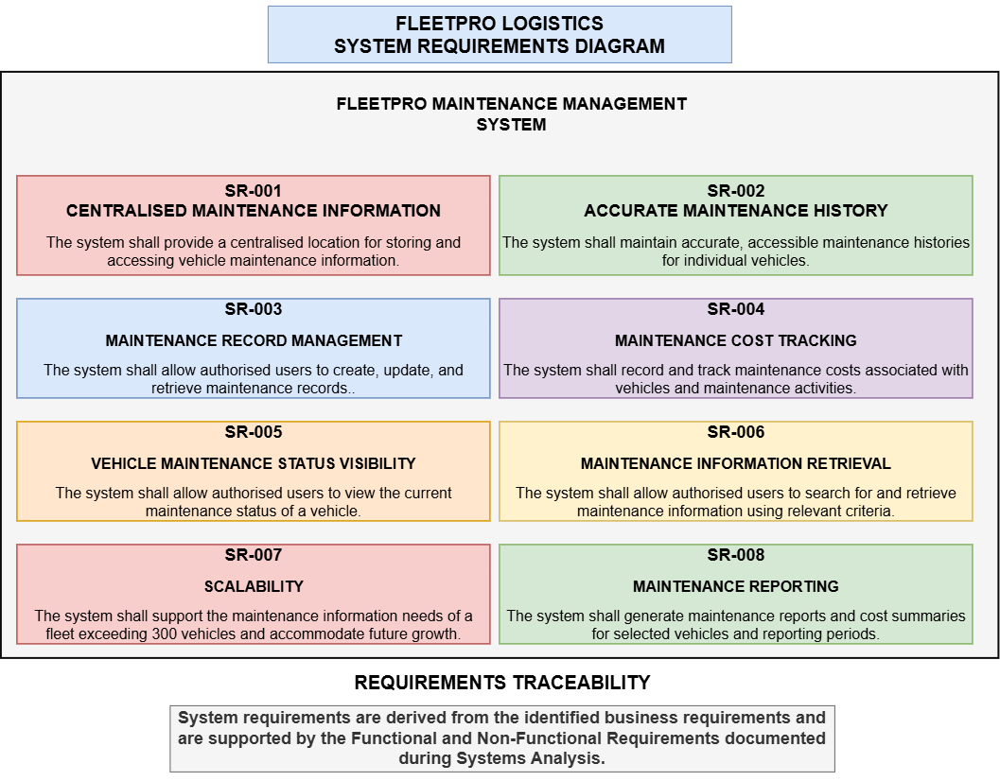

## 1.6. Traceability to the Business Analysis Phase

The system requirements were derived from the business requirements established during the Business Analysis phase.

The traceability relationship can be represented as:

**Business Requirement → System Requirement → Functional Requirement**

For example:

**BR-001 — Centralised Maintenance Information**

↓

**SR-001 — Centralised Maintenance Information**

↓

**FR-001 to FR-004 — Maintenance Information Functions**

This traceability ensures that the proposed system remains aligned with the original business problem and identified business needs.

## 1.7. Traceability Considerations

Not every system requirement will necessarily result in a direct functional requirement.

For example, **SR-007 — Scalable Maintenance-Recording Process** describes a quality and capacity characteristic of the proposed system. It will therefore be addressed primarily through Non-Functional Requirements relating to scalability, performance, capacity and maintainability.

This demonstrates that system requirements can be addressed through different types of requirements depending on the nature of the requirement.

## 1.8. Conclusion

The system requirements provide a clear link between the business needs identified during Business Analysis and the capabilities required from the proposed FleetPro system.

The traceability matrix ensures that each system requirement has a defined business source and provides a foundation for the functional and non-functional requirements developed during the next stages of Systems Analysis.

---

# 2. Functional Requirements

## 2.1. Purpose

The purpose of this document is to define the functional requirements for the proposed FleetPro Logistics Vehicle Maintenance Management System.

The functional requirements describe the specific functions and behaviours that the system must provide to satisfy the system requirements identified during the Systems Analysis phase.

These requirements are derived from the system requirements and business requirements established during the previous analysis stages.

The functional requirements will provide a foundation for the development of user stories, use cases, system design, development and testing activities.

## 2.2. Functional Requirement Structure

Each functional requirement identifies a specific function or behaviour that the system must provide.

The requirements are linked to their corresponding system requirements to maintain traceability throughout the project.

### 2.2.1. Centralised Maintenance Information

#### FR-001 — Create Maintenance Record

**Requirement:**

The system shall allow authorised users to create a maintenance record for a vehicle.

**Reason:**

Users require a structured method of recording completed maintenance information within the centralised system.

**Source:**

SR-001 — Centralised Maintenance Information.

---

#### FR-002 — View Maintenance Records

**Requirement:**

The system shall allow authorised users to view maintenance records stored within the system.

**Reason:**

Users need to access recorded maintenance information without relying on disconnected physical records, spreadsheets or communication channels.

**Source:**

SR-001 — Centralised Maintenance Information.

---

#### FR-003 — Update Maintenance Record

**Requirement:**

The system shall allow authorised users to update maintenance records when corrections or additional information are required.

**Reason:**

Maintenance information may require correction or additional details after a record has been created.

**Source:**

SR-001 — Centralised Maintenance Information.

---

#### FR-004 — Associate Maintenance Record with Vehicle

**Requirement:**

The system shall associate each maintenance record with the relevant vehicle.

**Reason:**

Maintenance information must be linked to a specific vehicle so that users can maintain and retrieve the correct maintenance history.

**Source:**

SR-001 — Centralised Maintenance Information.

---

### 2.2.2. Accurate Maintenance History

#### FR-005 — View Vehicle Maintenance History

**Requirement:**

The system shall allow authorised users to view the maintenance history of a selected vehicle.

**Reason:**

Users need to review previous maintenance performed on a vehicle to understand its maintenance history and support informed maintenance decisions.

**Source:**

SR-002 — Accurate Maintenance History.

---

#### FR-006 — Record Maintenance Date

**Requirement:**

The system shall allow authorised users to record the date on which maintenance was performed.

**Reason:**

The maintenance date is required to establish when maintenance occurred and maintain an accurate chronological maintenance history.

**Source:**

SR-002 — Accurate Maintenance History.

---

#### FR-007 — Record Maintenance Details

**Requirement:**

The system shall allow authorised users to record details of the maintenance or repair performed on a vehicle.

**Reason:**

Maintenance details are required to provide a clear record of the work performed on each vehicle.

**Source:**

SR-002 — Accurate Maintenance History.

---

#### FR-008 — Display Maintenance History Chronologically

**Requirement:**

The system shall display maintenance records for a vehicle in chronological order.

**Reason:**

A chronological maintenance history will allow users to understand the sequence of maintenance activities performed on a vehicle.

**Source:**

SR-002 — Accurate Maintenance History.

---

### 2.2.3. Maintenance Record Management

#### FR-009 — Validate Required Maintenance Information

**Requirement:**

The system shall require specified maintenance information to be provided before a maintenance record can be saved.

**Reason:**

Required information helps ensure that maintenance records are complete and consistently captured.

**Source:**

SR-003 — Maintenance Record Management.

---

#### FR-010 — Save Maintenance Record

**Requirement:**

The system shall save completed maintenance records so that they can be accessed after they have been recorded.

**Reason:**

Maintenance information must be retained so that it becomes part of the vehicle's maintenance history and can be retrieved when required.

**Source:**

SR-003 — Maintenance Record Management.

---

#### FR-011 — Identify Maintenance Record

**Requirement:**

The system shall assign a unique identifier to each maintenance record.

**Reason:**

A unique identifier will allow individual maintenance records to be distinguished and referenced within the system.

**Source:**

SR-003 — Maintenance Record Management.

---

### 2.2.4. Maintenance Cost Tracking

#### FR-012 — Record Maintenance Cost

**Requirement:**

The system shall allow authorised users to record the cost associated with a maintenance activity.

**Reason:**

Maintenance costs need to be associated with the relevant maintenance activity and vehicle to support accurate cost tracking.

**Source:**

SR-004 — Maintenance Cost Tracking.

---

#### FR-013 — Calculate Maintenance Costs

**Requirement:**

The system shall calculate maintenance costs for selected vehicles and defined reporting periods.

**Reason:**

The system should reduce reliance on manual spreadsheet calculations and provide a consistent method of calculating maintenance expenditure.

**Source:**

SR-004 — Maintenance Cost Tracking.

---

#### FR-014 — View Maintenance Cost Information

**Requirement:**

The system shall allow authorised users to view maintenance cost information associated with vehicles and maintenance activities.

**Reason:**

Users require access to maintenance cost information to monitor expenditure and support maintenance and financial decision-making.

**Source:**

SR-004 — Maintenance Cost Tracking.

---

### 2.2.5. Vehicle Maintenance Status Visibility

#### FR-015 — View Vehicle Maintenance Status

**Requirement:**

The system shall allow authorised users to view the current maintenance status of a vehicle.

**Reason:**

Users need visibility of vehicle maintenance status to understand whether a vehicle has outstanding or completed maintenance activity.

**Source:**

SR-005 — Vehicle Maintenance Status Visibility.

---

#### FR-016 — Update Maintenance Status

**Requirement:**

The system shall allow authorised users to update the maintenance status of a vehicle or maintenance activity.

**Reason:**

Maintenance status needs to reflect changes as maintenance requests are reviewed, performed or completed.

**Source:**

SR-005 — Vehicle Maintenance Status Visibility.

---

### 2.2.6. Maintenance Information Retrieval

#### FR-017 — Search Maintenance Records

**Requirement:**

The system shall allow authorised users to search for maintenance records using vehicle information.

**Reason:**

Users need an efficient method of locating maintenance information without searching through multiple physical and digital sources.

**Source:**

SR-006 — Maintenance Information Retrieval.

---

#### FR-018 — Filter Maintenance Information

**Requirement:**

The system shall allow authorised users to filter maintenance information using relevant criteria such as vehicle and maintenance date.

**Reason:**

Filtering will allow users to narrow maintenance information and locate relevant records more efficiently.

**Source:**

SR-006 — Maintenance Information Retrieval.

---

## 2.3. Scalability

The scalability requirement is primarily addressed through non-functional requirements rather than additional functional requirements.

SR-007 describes the system's ability to support the current fleet and future growth. This will therefore be addressed through requirements relating to system capacity, performance, maintainability and scalability in the **Non-Functional Requirements** document.

---

## 2.4. Maintenance Reporting

#### FR-019 — Generate Maintenance Report

**Requirement:**

The system shall allow authorised users to generate maintenance reports based on recorded maintenance information.

**Reason:**

Structured reports will allow management and relevant users to review maintenance activity and support operational decision-making.

**Source:**

SR-008 — Maintenance Reporting.

---

#### FR-020 — Generate Maintenance Cost Summary

**Requirement:**

The system shall allow authorised users to generate summaries of maintenance costs for selected vehicles and reporting periods.

**Reason:**

Cost summaries will provide structured financial information for monitoring maintenance expenditure and supporting management decisions.

**Source:**

SR-008 — Maintenance Reporting.

---

#### FR-021 — Filter Maintenance Reports

**Requirement:**

The system shall allow authorised users to filter maintenance reports using relevant criteria such as vehicle and reporting period.

**Reason:**

Filtering reports will allow users to obtain information relevant to specific vehicles or periods without reviewing unrelated maintenance information.

**Source:**

SR-008 — Maintenance Reporting.

---

## 2.5. Functional Requirements Traceability

The functional requirements provide a detailed representation of the system behaviour required to support the system requirements.

| Functional Requirement | System Requirement | Business Requirement |
|---|---|---|
| FR-001 — Create Maintenance Record | SR-001 — Centralised Maintenance Information | BR-001 — Centralised Maintenance Information |
| FR-002 — View Maintenance Records | SR-001 — Centralised Maintenance Information | BR-001 — Centralised Maintenance Information |
| FR-003 — Update Maintenance Record | SR-001 — Centralised Maintenance Information | BR-001 — Centralised Maintenance Information |
| FR-004 — Associate Maintenance Record with Vehicle | SR-001 — Centralised Maintenance Information | BR-001 — Centralised Maintenance Information |
| FR-005 — View Vehicle Maintenance History | SR-002 — Accurate Maintenance History | BR-002 — Accurate Maintenance History |
| FR-006 — Record Maintenance Date | SR-002 — Accurate Maintenance History | BR-002 — Accurate Maintenance History |
| FR-007 — Record Maintenance Details | SR-002 — Accurate Maintenance History | BR-002 — Accurate Maintenance History |
| FR-008 — Display Maintenance History Chronologically | SR-002 — Accurate Maintenance History | BR-002 — Accurate Maintenance History |
| FR-009 — Validate Required Maintenance Information | SR-003 — Maintenance Record Management | BR-003 — Maintenance Record Management |
| FR-010 — Save Maintenance Record | SR-003 — Maintenance Record Management | BR-003 — Maintenance Record Management |
| FR-011 — Identify Maintenance Record | SR-003 — Maintenance Record Management | BR-003 — Maintenance Record Management |
| FR-012 — Record Maintenance Cost | SR-004 — Maintenance Cost Tracking | BR-004 — Maintenance Cost Tracking |
| FR-013 — Calculate Maintenance Costs | SR-004 — Maintenance Cost Tracking | BR-004 — Maintenance Cost Tracking |
| FR-014 — View Maintenance Cost Information | SR-004 — Maintenance Cost Tracking | BR-004 — Maintenance Cost Tracking |
| FR-015 — View Vehicle Maintenance Status | SR-005 — Vehicle Maintenance Status Visibility | BR-005 — Vehicle Maintenance Status Visibility |
| FR-016 — Update Maintenance Status | SR-005 — Vehicle Maintenance Status Visibility | BR-005 — Vehicle Maintenance Status Visibility |
| FR-017 — Search Maintenance Records | SR-006 — Maintenance Information Retrieval | BR-006 — Maintenance Information Retrieval |
| FR-018 — Filter Maintenance Information | SR-006 — Maintenance Information Retrieval | BR-006 — Maintenance Information Retrieval |
| FR-019 — Generate Maintenance Report | SR-008 — Maintenance Reporting | BR-008 — Maintenance Reporting |
| FR-020 — Generate Maintenance Cost Summary | SR-008 — Maintenance Reporting | BR-008 — Maintenance Reporting |
| FR-021 — Filter Maintenance Reports | SR-008 — Maintenance Reporting | BR-008 — Maintenance Reporting |

## 2.6. Functional Requirements Conclusion

The functional requirements define the specific functions that the proposed FleetPro Vehicle Maintenance Management System must provide.

The requirements cover the creation, management, retrieval and reporting of vehicle maintenance information, including maintenance history, maintenance costs and vehicle maintenance status.

The functional requirements are traceable to the system requirements and the original business requirements established during the Business Analysis phase.

These requirements provide the foundation for the next Systems Analysis activities, including non-functional requirements, business rules, user stories and use cases.

---

# 3. Non-Functional Requirements

## 3.1. Purpose

The purpose of this document is to define the non-functional requirements for the proposed FleetPro Logistics Vehicle Maintenance Management System.

Non-functional requirements describe the quality attributes, constraints and operational characteristics that the system must satisfy.

Unlike functional requirements, which describe what the system must do, non-functional requirements describe how well the system should perform and the characteristics it should maintain while providing its functions.

These requirements will guide the System Design, Development, Testing and Deployment stages of the FleetPro project.

## 3.2. Non-Functional Requirement Categories

The following non-functional requirement categories have been identified for the FleetPro system:

- Performance
- Security
- Usability
- Availability
- Reliability
- Scalability
- Maintainability
- Data Integrity

## 3.3. Non-Functional Requirements

### 3.3.1. Performance

#### NFR-001 — System Response Time

**Requirement:**

The system should provide an acceptable response time for normal operations under expected operating conditions.

**Reason:**

Users need to work with maintenance information efficiently without unnecessary delays when using the system.

**Source:**

SR-006 — Maintenance Information Retrieval.

---

#### NFR-002 — Performance Under Normal Load

**Requirement:**

The system should maintain acceptable performance while handling the expected number of vehicles, maintenance records and concurrent users during normal business operations.

**Reason:**

The system must remain responsive as FleetPro users access and manage increasing amounts of maintenance information.

**Source:**

SR-007 — Scalable Maintenance-Recording Process.

---

### 3.3.2. Security

#### NFR-003 — Protection of Maintenance Information

**Requirement:**

The system shall protect stored maintenance information against unauthorised access, modification and disclosure.

**Reason:**

Vehicle maintenance information is business information and should only be accessed or modified by appropriately authorised users.

**Source:**

SR-001 — Centralised Maintenance Information.

---

#### NFR-004 — Secure Data Transmission

**Requirement:**

Maintenance information transmitted between system components should be protected against unauthorised interception or modification.

**Reason:**

Protecting information during transmission reduces the risk of sensitive business information being exposed or altered.

**Source:**

SR-001 — Centralised Maintenance Information.

---

### 3.3.3. Usability

#### NFR-005 — User Interface Usability

**Requirement:**

The system should provide a clear and understandable interface that allows intended users to complete common maintenance-related tasks without unnecessary complexity.

**Reason:**

FleetPro users may have different levels of technical experience, so the system should be straightforward to understand and use.

**Source:**

SR-003 — Maintenance Record Management.

---

#### NFR-006 — Interface Consistency

**Requirement:**

The system should maintain consistent navigation, terminology, layout and interaction patterns throughout the application.

**Reason:**

Consistent interface behaviour reduces confusion and helps users understand how different parts of the system operate.

**Source:**

SR-003 — Maintenance Record Management.

---

### 3.3.4. Availability

#### NFR-007 — System Availability

**Requirement:**

The system should be available during the normal operating periods in which FleetPro users require access to vehicle maintenance information.

**Reason:**

Maintenance information may be required during normal fleet operations, and extended periods of unavailability could interfere with maintenance activities.

**Source:**

SR-005 — Vehicle Maintenance Status Visibility.

---

### 3.3.5. Reliability

#### NFR-008 — Reliable Operation

**Requirement:**

The system should operate consistently under normal operating conditions and minimise unexpected failures during normal use.

**Reason:**

Users depend on the system to remain available and dependable when recording, accessing and reviewing maintenance information.

**Source:**

SR-003 — Maintenance Record Management.

---

#### NFR-009 — Data Recovery

**Requirement:**

The system should provide an appropriate mechanism for recovering maintenance information following a system failure or data-loss event.

**Reason:**

Maintenance history is important operational information and should not be permanently lost because of a system failure.

**Source:**

SR-002 — Accurate Maintenance History.

---

### 3.3.6. Scalability

#### NFR-010 — Fleet Capacity

**Requirement:**

The system should support the storage and management of maintenance information for FleetPro's current fleet of more than 300 vehicles without significant degradation of normal system performance.

**Reason:**

The existing process became increasingly difficult to manage as the fleet grew. The proposed system must therefore be capable of supporting the current fleet size.

**Source:**

SR-007 — Scalable Maintenance-Recording Process.

---

#### NFR-011 — Future Growth

**Requirement:**

The system should allow the number of vehicles and maintenance records to increase without requiring a complete redesign of the system.

**Reason:**

FleetPro may continue to grow, and the system should remain suitable as the volume of vehicles and maintenance information increases.

**Source:**

SR-007 — Scalable Maintenance-Recording Process.

---

### 3.3.7. Maintainability

#### NFR-012 — Maintainable Architecture

**Requirement:**

The system should use a structured and maintainable architecture that allows individual system components to be modified, corrected or improved without unnecessary changes to unrelated components.

**Reason:**

The system will require maintenance and improvements as technical requirements and business needs change.

**Source:**

SR-007 — Scalable Maintenance-Recording Process.

---

### 3.3.8. Data Integrity

#### NFR-013 — Data Consistency

**Requirement:**

The system should maintain consistent relationships between vehicles, maintenance records and associated maintenance information.

**Reason:**

Inconsistent relationships between records could result in inaccurate maintenance histories, cost information and reporting.

**Source:**

SR-002 — Accurate Maintenance History.

---

#### NFR-014 — Data Persistence

**Requirement:**

The system should preserve successfully stored maintenance information so that it remains available for authorised retrieval after the original record has been created.

**Reason:**

Maintenance records form part of the vehicle's historical information and need to remain available for future reference.

**Source:**

SR-002 — Accurate Maintenance History.

---

## 3.4. Non-Functional Requirements Traceability

The following traceability matrix shows how the non-functional requirements relate to the system requirements and the original business requirements.

| Non-Functional Requirement | System Requirement | Business Requirement |
|---|---|---|
| NFR-001 — System Response Time | SR-006 — Maintenance Information Retrieval | BR-006 — Maintenance Information Retrieval |
| NFR-002 — Performance Under Normal Load | SR-007 — Scalable Maintenance-Recording Process | BR-007 — Scalable Maintenance-Recording Process |
| NFR-003 — Protection of Maintenance Information | SR-001 — Centralised Maintenance Information | BR-001 — Centralised Maintenance Information |
| NFR-004 — Secure Data Transmission | SR-001 — Centralised Maintenance Information | BR-001 — Centralised Maintenance Information |
| NFR-005 — User Interface Usability | SR-003 — Maintenance Record Management | BR-003 — Maintenance Record Management |
| NFR-006 — Interface Consistency | SR-003 — Maintenance Record Management | BR-003 — Maintenance Record Management |
| NFR-007 — System Availability | SR-005 — Vehicle Maintenance Status Visibility | BR-005 — Vehicle Maintenance Status Visibility |
| NFR-008 — Reliable Operation | SR-003 — Maintenance Record Management | BR-003 — Maintenance Record Management |
| NFR-009 — Data Recovery | SR-002 — Accurate Maintenance History | BR-002 — Accurate Maintenance History |
| NFR-010 — Fleet Capacity | SR-007 — Scalable Maintenance-Recording Process | BR-007 — Scalable Maintenance-Recording Process |
| NFR-011 — Future Growth | SR-007 — Scalable Maintenance-Recording Process | BR-007 — Scalable Maintenance-Recording Process |
| NFR-012 — Maintainable Architecture | SR-007 — Scalable Maintenance-Recording Process | BR-007 — Scalable Maintenance-Recording Process |
| NFR-013 — Data Consistency | SR-002 — Accurate Maintenance History | BR-002 — Accurate Maintenance History |
| NFR-014 — Data Persistence | SR-002 — Accurate Maintenance History | BR-002 — Accurate Maintenance History |

## 3.5. Requirements Considerations

The non-functional requirements describe the expected characteristics of the proposed FleetPro system.

Some requirements will require specific technical measurements during System Design, Development and Testing.

For example, response time and system capacity should be measured during testing using defined test conditions rather than being assumed to meet the requirements.

The final technical implementation used to satisfy these requirements will be determined during the System Design and Development stages.

## 3.6. Conclusion

The non-functional requirements define the expected quality and operational characteristics of the FleetPro Vehicle Maintenance Management System.

The requirements address performance, security, usability, availability, reliability, scalability, maintainability and data integrity.

Together with the functional requirements, these requirements provide a more complete definition of the expected system.

The non-functional requirements will be used to guide the subsequent Business Rules, User Stories, Use Cases, Data Requirements, System Design, Development and Testing activities.

# 4. User Stories

## 4.1 Purpose

This section defines the user stories for the proposed FleetPro Logistics Vehicle Maintenance Management System.

User stories describe the capabilities that stakeholders need from the proposed system. Each story explains who needs a capability, what they need to do and why it matters. Acceptance criteria define the expected outcomes and will support future system design, development and testing.

## 4.2 User Story Format

Each user story follows this format:

**As a** [user role], **I want** [a capability], **so that** [a business benefit].

Acceptance criteria specify the conditions that must be satisfied for the story to be considered complete.

## 4.3 User Stories

### US-001 — Create a Maintenance Record

**User Story**

As a Fleet Administrator, I want to create a maintenance record for a vehicle, so that maintenance activities can be recorded centrally.

**Acceptance Criteria**

- An authorised Fleet Administrator can access the maintenance record creation function.
- The user can identify the relevant vehicle.
- The user can enter the required maintenance information, including the maintenance date and description of the work performed.
- The system validates mandatory information before saving.
- A valid record is saved and available for later retrieval.
- Each record receives a unique identifier.
- The maintenance record is associated with the correct vehicle.

**Related Requirements:** FR-001, FR-004, FR-009, FR-010, FR-011.

### US-002 — View Maintenance Records

**User Story**

As an authorised Fleet Administrator, Mechanic / Maintenance Team member or Fleet Manager, I want to view saved maintenance records, so that I can review previously recorded maintenance activities.

**Acceptance Criteria**

- Authorised users can access saved maintenance records according to their permissions.
- The system displays the information associated with the selected record.
- The displayed record is associated with the correct vehicle.
- Maintenance details, including available dates and descriptions of work performed, are displayed.
- Individual records can be distinguished from one another.
- The system prevents unauthorised users from accessing restricted records.

**Related Requirements:** FR-002, FR-004, FR-011.

### US-003 — Update a Maintenance Record

**User Story**

As an authorised Fleet Administrator or Mechanic / Maintenance Team member, I want to update an existing maintenance record, so that corrections and additional information can be recorded.

**Acceptance Criteria**

- An authorised user can select an existing maintenance record.
- The system displays its current information.
- The user can edit permitted fields.
- The system validates required information before saving changes.
- Saved changes remain available when the record is retrieved again.
- The record remains associated with the correct vehicle.
- Users cannot update fields or records outside their permissions.

**Related Requirements:** FR-003, FR-004, FR-009, FR-010.

### US-004 — View Vehicle Maintenance History

**User Story**

As a Driver, Mechanic / Maintenance Team member or Fleet Manager, I want to view the maintenance history of a selected vehicle, so that I can review its previous maintenance activities.

**Acceptance Criteria**

- An authorised user can identify a vehicle.
- The system displays maintenance records associated with that vehicle.
- Records are displayed in chronological order.
- Available maintenance dates and descriptions of the work performed are displayed.
- Records belonging to unrelated vehicles are excluded.
- The system only displays information the user is authorised to access.

**Related Requirements:** FR-004, FR-005, FR-006, FR-007, FR-008.

### US-005 — Record Maintenance Costs

**User Story**

As a Fleet Administrator, I want to record maintenance costs, so that vehicle maintenance expenditure can be tracked.

**Acceptance Criteria**

- The user can enter a cost for the relevant maintenance activity.
- The cost is associated with the correct maintenance record and vehicle.
- The system validates the cost according to the defined business rules.
- Where applicable, individual cost items can be recorded with their descriptions and categories.
- Saved costs remain available for retrieval.
- Negative costs are rejected under the proposed cost-validation rule.

**Related Requirements:** FR-004, FR-012, FR-014.

### US-006 — Calculate Maintenance Costs

**User Story**

As a Fleet Manager, I want to calculate maintenance costs for selected vehicles and reporting periods, so that I can review maintenance expenditure.

**Acceptance Criteria**

- The user can select the relevant vehicle or vehicles, where supported.
- The user can specify a reporting period.
- The system calculates totals from applicable recorded costs.
- The system can calculate overall maintenance expenditure per vehicle and for selected reporting periods.
- The system avoids double-counting invoice amounts and their associated itemised cost items.
- Where an invoice exists, its amount is used as the authoritative amount for overall expenditure.
- Where no invoice exists, the system uses the recorded individual cost items for overall expenditure.
- The system does not include missing or unrecorded costs in its calculations.
- Costs outside the selected criteria are excluded.

**Related Requirements:** FR-013, FR-020.

### US-007 — View Vehicle Maintenance Status

**User Story**

As a Driver or Fleet Manager, I want to view a vehicle's maintenance status, so that I can understand its recorded maintenance position.

**Acceptance Criteria**

- An authorised user can identify a vehicle.
- The system displays the recorded maintenance status.
- The status belongs to the selected vehicle.
- The status is presented clearly.
- The system only displays status information the user is authorised to access.

**Related Requirements:** FR-015.

### US-008 — Update Maintenance Status

**User Story**

As a Mechanic / Maintenance Team member, I want to update the status of a vehicle or maintenance activity, so that the system reflects the latest known status.

**Acceptance Criteria**

- The user can select the relevant vehicle or maintenance activity.
- The system provides approved status options once these have been defined.
- The system saves a valid status update.
- The updated status is displayed when the relevant record is viewed again.
- The update applies to the intended vehicle or maintenance activity.
- Unauthorised users cannot update maintenance status.

**Related Requirements:** FR-015, FR-016.

### US-009 — Search Maintenance Records

**User Story**

As a Fleet Administrator or Fleet Manager, I want to search maintenance records using vehicle information, so that I can locate relevant records efficiently.

**Acceptance Criteria**

- The user can search using supported vehicle information, such as registration number, VIN or make and model.
- The system returns records matching the search criteria.
- The results correspond to the entered criteria.
- The system communicates when no matching records are found.
- Search results only include records the user is authorised to access.

**Related Requirements:** FR-017.

### US-010 — Filter Maintenance Information

**User Story**

As a Fleet Manager, I want to filter maintenance information using different criteria, so that I can focus on specific maintenance activities and expenditure.

**Acceptance Criteria**

- The user can filter maintenance information by supported criteria, including:
  - Vehicle.
  - Maintenance date or reporting period.
  - Maintenance category, such as tyres, brakes or engine.
  - Maintenance description or keyword.
  - Maintenance supplier or workshop.
- The system displays records matching the selected criteria.
- Records that do not match the selected criteria are excluded.
- The user can combine supported filters to narrow the results.
- The user can change or clear filters.
- Filtering does not change the underlying maintenance records.
- The system only displays information the user is authorised to access.

**Related Requirements:** FR-018.

### US-011 — Generate Maintenance Reports

**User Story**

As a Fleet Manager, I want to generate maintenance reports, so that I can review maintenance information in a structured format and make it available for management review.

**Acceptance Criteria**

- The Fleet Manager can request a supported maintenance report.
- The report is generated from recorded maintenance information.
- Relevant maintenance details are presented clearly.
- Supported vehicle and reporting-period filters are applied.
- The report reflects the selected criteria.
- The Fleet Manager can review the generated report.
- The CEO / Senior Management can access generated reports when authorised.
- The system prevents unauthorised access to restricted reports.

**Related Requirements:** FR-019, FR-021.

### US-012 — Generate Maintenance Cost Summaries

**User Story**

As a Fleet Manager, I want to generate maintenance cost summaries using selected vehicles, categories, suppliers and reporting periods, so that I can review maintenance expenditure and make the information available for management review.

**Acceptance Criteria**

- The Fleet Manager can select the relevant vehicle or vehicles, where supported.
- The Fleet Manager can select a reporting period.
- The Fleet Manager can filter expenditure by maintenance category and supplier or workshop.
- The system calculates the summary from applicable recorded costs.
- The system can present expenditure totals by vehicle, category, supplier and reporting period, where supported.
- The system avoids double-counting invoice amounts and their associated itemised cost items.
- Category summaries use recorded itemised amounts assigned to the relevant categories.
- Any difference between an invoice amount and its itemised costs is shown separately as an unallocated difference where applicable.
- The summary reflects the selected criteria.
- The Fleet Manager can review the generated cost summary.
- The CEO / Senior Management can access generated cost summaries when authorised.
- The system does not imply that missing or unrecorded costs are included.

**Related Requirements:** FR-013, FR-020, FR-021.

## 4.4 User Story Traceability

| User Story | Related Functional Requirements |
|---|---|
| US-001 — Create a Maintenance Record | FR-001, FR-004, FR-009, FR-010, FR-011 |
| US-002 — View Maintenance Records | FR-002, FR-004, FR-011 |
| US-003 — Update a Maintenance Record | FR-003, FR-004, FR-009, FR-010 |
| US-004 — View Vehicle Maintenance History | FR-004, FR-005, FR-006, FR-007, FR-008 |
| US-005 — Record Maintenance Costs | FR-004, FR-012, FR-014 |
| US-006 — Calculate Maintenance Costs | FR-013, FR-020 |
| US-007 — View Vehicle Maintenance Status | FR-015 |
| US-008 — Update Maintenance Status | FR-015, FR-016 |
| US-009 — Search Maintenance Records | FR-017 |
| US-010 — Filter Maintenance Information | FR-018 |
| US-011 — Generate Maintenance Reports | FR-019, FR-021 |
| US-012 — Generate Maintenance Cost Summaries | FR-013, FR-020, FR-021 |

## 4.5 Outstanding Clarifications

The following details must be clarified with the relevant stakeholders before implementation and testing:

- **Mandatory fields:** Which fields must be completed when creating or updating a maintenance record?
- **User permissions:** Which roles can create, view, update, search and report on maintenance information?
- **Role access:** What specific access permissions should Drivers, Fleet Administrators, Mechanics, Fleet Managers and CEO / Senior Management have?
- **Status values:** Which vehicle and maintenance status values will the system support?
- **Status updates:** Which roles may update statuses, and which status changes are permitted?
- **Reporting access:** Should CEO / Senior Management have read-only access to generated maintenance reports and cost summaries?
- **Report formats:** Which report formats and export options are required?
- **Search criteria:** Are there any additional vehicle or maintenance fields that users should be able to search?
- **Audit history:** Should the system record who created or changed a maintenance record and when?

The financial calculation and invoice-handling rules have already been considered during the requirements analysis. These rules should be carried forward into the system design and verified during testing rather than treated as undecided requirements.

## 4.6 Conclusion

These user stories translate FleetPro's functional requirements into user-centred goals with acceptance criteria. They describe the expected capabilities for Drivers, Fleet Administrators, Mechanics / Maintenance Teams, Fleet Managers and CEO / Senior Management.

The user stories provide a foundation for use-case analysis, system design, development and testing. Their acceptance criteria will help define how the proposed system's functionality should be verified during future testing.

# 5. Use Cases

## 5.1 Purpose

This document describes how users interact with the proposed FleetPro Logistics Vehicle Maintenance Management System to complete key maintenance management tasks.

Each use case defines the primary actor, goal, preconditions, trigger, main interaction flow, alternative outcomes and postconditions. The use cases expand the user stories and functional requirements into structured descriptions that can guide system design, development and testing.

The use cases are based on the proposed system requirements, user stories and actor interactions represented in the Use Case Diagram. Details such as role permissions, mandatory fields and status values will require confirmation before implementation.

## 5.2 Use Case Overview

| Use Case ID | Use Case Name | Primary Actor | Related User Story |
|---|---|---|---|
| UC-001 | Create a Maintenance Record | Fleet Administrator | US-001 |
| UC-002 | View Maintenance Records | Fleet Administrator / Mechanic / Maintenance Team / Fleet Manager | US-002 |
| UC-003 | Update a Maintenance Record | Fleet Administrator / Mechanic / Maintenance Team | US-003 |
| UC-004 | View Vehicle Maintenance History | Driver / Mechanic / Maintenance Team / Fleet Manager | US-004 |
| UC-005 | Record Maintenance Costs | Fleet Administrator | US-005 |
| UC-006 | Calculate Maintenance Costs | Fleet Manager | US-006 |
| UC-007 | View Vehicle Maintenance Status | Driver / Fleet Manager | US-007 |
| UC-008 | Update Maintenance Status | Mechanic / Maintenance Team | US-008 |
| UC-009 | Search Maintenance Records | Fleet Administrator / Fleet Manager | US-009 |
| UC-010 | Filter Maintenance Information | Fleet Manager | US-010 |
| UC-011 | Generate Maintenance Reports | Fleet Manager | US-011 |
| UC-012 | Generate Maintenance Cost Summaries | Fleet Manager | US-012 |

### 5.2.1 Use Case Diagram

The following UML Use Case Diagram provides a visual representation of the proposed FleetPro Vehicle Maintenance Management System. It identifies the five external actors, the twelve system use cases and their associations.

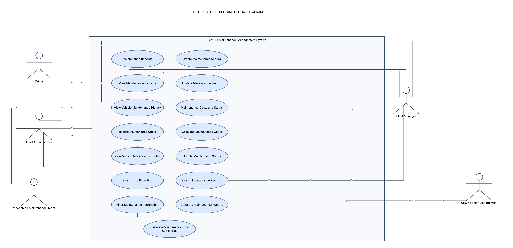

**Actors Represented**

| Actor | System Responsibilities |
|---|---|
| Driver | Views vehicle maintenance status and maintenance history. |
| Fleet Administrator | Creates, views and updates maintenance records, records maintenance costs and searches maintenance information. |
| Mechanic / Maintenance Team | Views maintenance records and history, updates permitted maintenance information and maintenance status. |
| Fleet Manager | Monitors maintenance information, reviews costs, searches and filters records, and generates reports and cost summaries. |
| CEO / Senior Management | Views generated maintenance reports and cost summaries when authorised. |

## 5.3 Detailed Use Cases

### UC-001 — Create a Maintenance Record

**Primary Actor:** Fleet Administrator

**Goal:** Create and save a maintenance record associated with the correct vehicle.

**Description:** The Fleet Administrator records a maintenance activity in the system so that the information can be retrieved and used for maintenance history and reporting.

**Preconditions**

- The user has access to the system.
- The user is authorised to create maintenance records.
- The relevant vehicle can be identified in the system.

**Trigger:** The Fleet Administrator needs to record a completed maintenance activity.

**Main Success Flow**

1. The Fleet Administrator opens the maintenance record creation function.
2. The system displays the maintenance record form.
3. The Fleet Administrator identifies the relevant vehicle.
4. The Fleet Administrator enters the maintenance date and description of the work performed.
5. The Fleet Administrator enters other required information available for the activity.
6. The Fleet Administrator submits the record.
7. The system validates the mandatory information.
8. The system assigns a unique identifier to the record.
9. The system saves the record and associates it with the selected vehicle.
10. The system confirms that the record has been saved successfully.

**Alternative and Exception Flows**

- **A1 — Missing required information:** The system identifies the missing fields and asks the user to correct them. The record is not saved as a complete record until validation succeeds.
- **A2 — Invalid information:** The system explains which fields need correction and allows the user to try again.
- **A3 — Vehicle cannot be identified:** The system informs the user and does not associate the record with an unrelated vehicle.
- **A4 — Save failure:** The system informs the user that saving was unsuccessful and does not report the record as successfully saved.

**Postconditions**

Success:
- The maintenance record is saved.
- The record has a unique identifier.
- The record is associated with the correct vehicle.
- The saved information is available for authorised retrieval.

Failure:
- No successful save is reported.
- The user is informed that the record could not be completed or saved.

**Related Requirements**

- US-001 — Create a Maintenance Record
- FR-001 — Create Maintenance Record
- FR-004 — Associate Maintenance Record with Vehicle
- FR-009 — Validate Required Maintenance Information
- FR-010 — Save Maintenance Record
- FR-011 — Identify Maintenance Record
- Business Rules: Vehicle Association, Unique Maintenance Record Identification and Required Maintenance Information.

---

### UC-002 — View Maintenance Records

**Primary Actors:** Fleet Administrator, Mechanic / Maintenance Team and Fleet Manager.

**Goal:** View existing maintenance records.

**Description:** Authorised users retrieve and review saved maintenance records to understand previously recorded maintenance activities.

**Preconditions**

- The user can access the system.
- The user is authorised to view maintenance records.
- Maintenance records are available in the system, or the system can display an empty result.

**Trigger:** The user needs to review recorded maintenance information.

**Main Success Flow**

1. The user opens the maintenance records section.
2. The system retrieves the records the user is permitted to view.
3. The system displays the available records.
4. The user selects a record for further details, if required.
5. The system displays the selected record's available information, including its vehicle association, maintenance date and description of work performed.

**Alternative and Exception Flows**

- **A1 — No records available:** The system displays an appropriate message indicating that no maintenance records are available.
- **A2 — Record unavailable:** The system informs the user that the selected record could not be retrieved.
- **A3 — Access denied:** The system prevents unauthorised access and displays an appropriate message.

**Postconditions**

- The user can review retrieved records.
- No maintenance information is changed by the viewing operation.

**Related Requirements**

- US-002 — View Maintenance Records
- FR-002 — View Maintenance Records
- FR-004 — Associate Maintenance Record with Vehicle
- FR-011 — Identify Maintenance Record.

---

### UC-003 — Update a Maintenance Record

**Primary Actors:** Fleet Administrator and Mechanic / Maintenance Team.

**Goal:** Correct or update an existing maintenance record.

**Description:** An authorised user updates permitted information in a maintenance record while preserving its association with the correct vehicle.

**Preconditions**

- The user is authorised to update maintenance records.
- The target record exists and can be retrieved.
- The user has identified the record to update.

**Trigger:** The user identifies information that requires correction or updating.

**Main Success Flow**

1. The user locates and opens the maintenance record.
2. The system displays the current record information.
3. The user changes the permitted fields.
4. The user submits the changes.
5. The system validates the updated information.
6. The system saves the changes.
7. The system confirms that the update was successful.

**Alternative and Exception Flows**

- **A1 — Invalid update:** The system identifies the invalid fields and requests correction.
- **A2 — Record not found:** The system informs the user that the record cannot be found.
- **A3 — Save failure:** The system reports that the update failed and does not claim that the changes were saved.
- **A4 — Unauthorised update:** The system prevents the user from making changes they are not permitted to make.

**Postconditions**

- On success, the permitted changes are saved.
- The record remains associated with the correct vehicle.
- On failure, the system informs the user of the unsuccessful update.

**Related Requirements**

- US-003 — Update a Maintenance Record
- FR-003 — Update Maintenance Record
- FR-004 — Associate Maintenance Record with Vehicle
- FR-009 — Validate Required Maintenance Information
- FR-010 — Save Maintenance Record.

---

### UC-004 — View Vehicle Maintenance History

**Primary Actors:** Driver, Mechanic / Maintenance Team and Fleet Manager.

**Goal:** Review the maintenance history of a selected vehicle.

**Description:** The user retrieves a vehicle's recorded maintenance history to understand previous maintenance activities, dates, descriptions of work performed and associated costs.

**Preconditions**

- The user is authorised to view the relevant vehicle's maintenance history.
- The relevant vehicle can be identified in the system.

**Trigger:** The user needs to review a vehicle's previous maintenance.

**Main Success Flow**

1. The user opens the vehicle maintenance history function.
2. The system allows the user to identify a vehicle.
3. The user selects the relevant vehicle.
4. The system retrieves the maintenance records associated with that vehicle.
5. The system displays the records in chronological order.
6. The user reviews the available maintenance dates, descriptions, supporting information and costs.

**Alternative and Exception Flows**

- **A1 — No maintenance history:** The system indicates that no maintenance history is recorded for the selected vehicle.
- **A2 — Vehicle not found:** The system informs the user that the vehicle could not be identified.
- **A3 — Retrieval failure:** The system reports that the maintenance history could not be retrieved.
- **A4 — Access denied:** The system prevents access if the user does not have permission to view the selected vehicle's history.

**Postconditions**

- The user can review the available maintenance history.
- The viewing operation does not change the maintenance records.

**Related Requirements**

- US-004 — View Vehicle Maintenance History
- FR-004 — Associate Maintenance Record with Vehicle
- FR-005 — View Vehicle Maintenance History
- FR-006 — Record Maintenance Date
- FR-007 — Record Maintenance Details
- FR-008 — Display Maintenance History Chronologically.

---

### UC-005 — Record Maintenance Costs

**Primary Actor:** Fleet Administrator

**Goal:** Record maintenance costs against the relevant vehicle and maintenance activity.

**Description:** The Fleet Administrator records available maintenance cost information and, where applicable, invoice details and supporting documents. This information supports expenditure tracking and reporting.

**Preconditions**

- The Fleet Administrator is authorised to record maintenance costs.
- The relevant vehicle and maintenance activity can be identified.
- Cost information is available or its status can be represented appropriately.

**Trigger:** The Fleet Administrator needs to record or update maintenance cost information for an activity.

**Main Success Flow**

1. The Fleet Administrator opens the relevant maintenance record or cost-entry function.
2. The system displays the vehicle and maintenance information.
3. The Fleet Administrator identifies the relevant maintenance activity.
4. The Fleet Administrator enters the available maintenance cost information.
5. Where applicable, the Fleet Administrator records the invoice details and associates the invoice with the relevant maintenance activity.
6. The Fleet Administrator attaches the relevant invoice or supporting document, where available.
7. If an activity has multiple invoices, the Fleet Administrator can associate each applicable invoice with that activity.
8. Where itemised cost details are available, the Fleet Administrator records the individual cost items and their relevant categories.
9. The Fleet Administrator submits the information.
10. The system validates the entered information.
11. The system saves the cost information and its relevant associations.
12. The system confirms that the information was saved successfully.

**Alternative and Exception Flows**

- **A1 — Invalid cost:** The system rejects invalid cost information and asks the user to correct it.
- **A2 — Missing maintenance activity:** The system informs the user that the cost cannot be associated with an unidentified activity.
- **A3 — Save failure:** The system reports that the cost information was not saved.
- **A4 — Cost not yet available:** The system does not treat an unknown or unconfirmed amount as a verified cost. Its representation must follow the agreed cost-handling rules.
- **A5 — Invoice unavailable:** The user can record available maintenance information without inventing invoice details that are not available.
- **A6 — Supporting document unavailable:** The system allows the user to proceed according to the permitted data-entry rules without falsely indicating that a document has been attached.

**Postconditions**

- On success, the cost information is stored against the relevant maintenance activity and vehicle.
- Available invoices and supporting documents are associated with the relevant activity.
- Itemised cost details remain associated with their applicable categories.
- On failure, the user is informed that the information was not saved.

**Related Requirements**

- US-005 — Record Maintenance Costs
- FR-004 — Associate Maintenance Record with Vehicle
- FR-012 — Record Maintenance Cost
- FR-014 — View Maintenance Cost Information.

---

### UC-006 — Calculate Maintenance Costs

**Primary Actor:** Fleet Manager

**Goal:** Calculate maintenance expenditure for selected vehicles and reporting periods.

**Description:** The Fleet Manager requests a calculation of recorded maintenance costs to support expenditure monitoring and financial review.

**Preconditions**

- The Fleet Manager is authorised to view maintenance cost information.
- Relevant maintenance cost records are available, if any.
- The reporting period and vehicle selection can be defined.

**Trigger:** The Fleet Manager needs to review maintenance expenditure.

**Main Success Flow**

1. The Fleet Manager opens the maintenance cost calculation function.
2. The system provides selection criteria for vehicles and reporting periods.
3. The Fleet Manager selects the relevant vehicles and reporting period.
4. The system retrieves the matching maintenance cost records.
5. The system identifies the applicable invoice amounts and associated itemised cost information.
6. The system calculates overall expenditure using the agreed financial calculation rules.
7. The system avoids counting an invoice amount and its associated itemised cost items twice.
8. The system displays the calculated total and identifies the selected period and vehicle scope.
9. The Fleet Manager reviews the results.

**Alternative and Exception Flows**

- **A1 — No matching costs:** The system indicates that no matching cost records were found.
- **A2 — Invalid reporting criteria:** The system asks the Fleet Manager to correct the selection.
- **A3 — Calculation failure:** The system informs the Fleet Manager that the calculation could not be completed.
- **A4 — Incomplete cost information:** The system makes the limitations of the available data clear rather than implying that unrecorded costs are included.
- **A5 — Invoice and itemised cost difference:** Where itemised costs do not equal the invoice amount, the system handles and presents the difference according to the agreed financial rules.

**Postconditions**

- The Fleet Manager can review the calculated total for the selected scope.
- The calculation does not change the underlying maintenance cost records.

**Related Requirements**

- US-006 — Calculate Maintenance Costs
- FR-013 — Calculate Maintenance Costs
- FR-020 — Generate Maintenance Cost Summary.

---

### UC-007 — View Vehicle Maintenance Status

**Primary Actors:** Driver and Fleet Manager.

**Goal:** View the current recorded maintenance status of a vehicle.

**Description:** The user checks a vehicle's maintenance status to understand its recorded maintenance position and support operational or fleet management decisions.

**Preconditions**

- The user is authorised to view the relevant vehicle's maintenance status.
- The vehicle can be identified in the system.

**Trigger:** The user needs to check a vehicle's maintenance status.

**Main Success Flow**

1. The user opens the vehicle status function.
2. The system displays the available vehicles or provides a way to select one.
3. The user selects the relevant vehicle.
4. The system retrieves the vehicle's recorded maintenance status.
5. The system displays the status and relevant available maintenance information.

**Alternative and Exception Flows**

- **A1 — Vehicle not found:** The system informs the user that the vehicle could not be identified.
- **A2 — Status unavailable:** The system indicates that no status has been recorded or that the status cannot be retrieved.
- **A3 — Retrieval failure:** The system reports that the status could not be loaded.
- **A4 — Access denied:** The system prevents access if the user does not have permission to view the selected vehicle.

**Postconditions**

- The user can review the available status information.
- The viewing operation does not change the vehicle's status.

**Related Requirements**

- US-007 — View Vehicle Maintenance Status
- FR-015 — View Vehicle Maintenance Status.

---

### UC-008 — Update Maintenance Status

**Primary Actor:** Mechanic / Maintenance Team.

**Goal:** Update the recorded maintenance status of a vehicle or maintenance activity.

**Description:** The Mechanic or Maintenance Team updates a maintenance status when a change has been confirmed and the user is permitted to make that change.

**Preconditions**

- The user is authorised to update the relevant status.
- The vehicle or maintenance activity exists.
- The new status is supported by the system's agreed status rules.

**Trigger:** A confirmed change in maintenance status needs to be recorded.

**Main Success Flow**

1. The Mechanic or Maintenance Team opens the relevant vehicle or maintenance activity.
2. The system displays its current recorded status.
3. The user selects the new status from the available options.
4. The user submits the update.
5. The system validates the status change.
6. The system saves the updated status.
7. The system confirms that the update was successful.

**Alternative and Exception Flows**

- **A1 — Invalid status:** The system rejects a status value that is not permitted.
- **A2 — Unauthorised update:** The system prevents the user from changing the status.
- **A3 — Record unavailable:** The system informs the user that the relevant vehicle or activity cannot be found.
- **A4 — Save failure:** The system reports that the update was unsuccessful.

**Postconditions**

- On success, the new status is saved.
- On failure, the previously saved status remains unchanged if the update was not committed, and the user is informed of the outcome.

**Related Requirements**

- US-008 — Update Maintenance Status
- FR-015 — View Vehicle Maintenance Status
- FR-016 — Update Maintenance Status.

---

### UC-009 — Search Maintenance Records

**Primary Actors:** Fleet Administrator and Fleet Manager.

**Goal:** Locate maintenance records using relevant search criteria.

**Description:** The Fleet Administrator or Fleet Manager searches recorded maintenance information to locate a particular record or a set of records.

**Preconditions**

- The user is authorised to search maintenance records.
- The system contains searchable maintenance information or can return an empty result.

**Trigger:** The user needs to locate specific maintenance information.

**Main Success Flow**

1. The user opens the maintenance search function.
2. The system provides the available search fields.
3. The user enters supported search criteria, such as vehicle registration number, VIN, make or model.
4. The user submits the search.
5. The system retrieves records matching the criteria.
6. The system displays the matching results.
7. The user opens a result, if required.

**Alternative and Exception Flows**

- **A1 — No matches:** The system informs the user that no records match the search.
- **A2 — Invalid search criteria:** The system asks the user to correct the criteria.
- **A3 — Search failure:** The system informs the user that the search could not be completed.
- **A4 — Access restriction:** The system excludes records that the user is not authorised to access.

**Postconditions**

- Matching records are displayed when available.
- The search does not change stored maintenance information.

**Related Requirements**

- US-009 — Search Maintenance Records
- FR-017 — Search Maintenance Records.

---

### UC-010 — Filter Maintenance Information

**Primary Actor:** Fleet Manager

**Goal:** Narrow displayed maintenance information using selected criteria.

**Description:** The Fleet Manager applies filters to maintenance information to focus on relevant vehicles, maintenance categories, suppliers, descriptions or reporting periods.

**Preconditions**

- The Fleet Manager is authorised to view the relevant maintenance information.
- The system has maintenance information to filter, or can return an empty result.

**Trigger:** The Fleet Manager needs to narrow a set of maintenance records or expenditure information to a relevant subset.

**Main Success Flow**

1. The Fleet Manager opens the maintenance information view.
2. The system displays the available filtering options.
3. The Fleet Manager selects one or more criteria, such as:
   - Vehicle.
   - Maintenance date or reporting period.
   - Maintenance category, such as tyres, brakes or engine.
   - Maintenance description or keyword.
   - Maintenance supplier or workshop.
4. The Fleet Manager applies the filters.
5. The system retrieves or filters the matching information.
6. The system displays the filtered results.
7. Where cost information is included, the system displays totals for the matching results according to the applicable financial calculation rules.

**Alternative and Exception Flows**

- **A1 — No matching results:** The system indicates that no records match the selected criteria.
- **A2 — Invalid filter values:** The system asks the Fleet Manager to correct the selected values.
- **A3 — Clear filters:** The Fleet Manager removes the filters and returns to the unfiltered view.
- **A4 — Filtering failure:** The system informs the Fleet Manager that the results could not be filtered.
- **A5 — Combined filters:** If multiple filters are selected, the system applies the supported criteria together and returns only matching information.

**Postconditions**

- The Fleet Manager can review the filtered information.
- Filtering does not alter the underlying records.
- Any displayed totals relate to the filtered results and follow the agreed calculation rules.

**Related Requirements**

- US-010 — Filter Maintenance Information
- FR-018 — Filter Maintenance Information.

---

### UC-011 — Generate Maintenance Reports

**Primary Actor:** Fleet Manager

**Secondary Actor:** CEO / Senior Management

**Goal:** Generate a report from recorded maintenance information for operational and management review.

**Description:** The Fleet Manager generates a maintenance report to review maintenance activity and support operational decision-making. The CEO / Senior Management can access the generated report for management-level review when authorised.

**Preconditions**

- The Fleet Manager is authorised to generate reports.
- The CEO / Senior Management is authorised to view the relevant reports.
- Relevant maintenance information is available.
- The reporting criteria can be specified.

**Trigger:** The Fleet Manager needs a report of maintenance activity, or the CEO / Senior Management needs to review an available report.

**Main Success Flow**

1. The Fleet Manager opens the maintenance reporting function.
2. The system presents the supported report criteria.
3. The Fleet Manager selects the required vehicles, reporting period or other available criteria.
4. The Fleet Manager requests the report.
5. The system retrieves the matching maintenance information.
6. The system compiles the report.
7. The system displays the generated report.
8. The report identifies its reporting period, selected filters and generation date.
9. The Fleet Manager reviews the report.
10. Where supported, the Fleet Manager exports the report in an available format, such as PDF or Excel.
11. The CEO / Senior Management accesses the generated report when required and authorised.

**Alternative and Exception Flows**

- **A1 — No matching data:** The system indicates that the selected criteria returned no maintenance information.
- **A2 — Invalid criteria:** The system asks the Fleet Manager to correct the selection.
- **A3 — Report generation failure:** The system informs the Fleet Manager that the report could not be generated.
- **A4 — Report access denied:** The system prevents the CEO / Senior Management from accessing reports they are not authorised to view.
- **A5 — Export failure:** The system informs the user that the requested export could not be completed.

**Postconditions**

- On success, the report is available for authorised review.
- The underlying maintenance records remain unchanged.
- The CEO / Senior Management can review the report if access is permitted.

**Related Requirements**

- US-011 — Generate Maintenance Reports
- FR-019 — Generate Maintenance Report
- FR-021 — Filter Maintenance Reports.

---

### UC-012 — Generate Maintenance Cost Summaries

**Primary Actor:** Fleet Manager

**Secondary Actor:** CEO / Senior Management

**Goal:** Generate a summary of recorded maintenance costs for selected vehicles and reporting periods.

**Description:** The Fleet Manager requests a cost summary to review recorded expenditure and compare maintenance costs across a selected scope. The CEO / Senior Management can access the generated cost summary to support financial and management decisions.

**Preconditions**

- The Fleet Manager is authorised to generate cost summaries.
- The CEO / Senior Management is authorised to view the relevant summaries.
- Relevant maintenance cost information is available, if any.
- The vehicle selection and reporting period can be specified.

**Trigger:** The Fleet Manager needs a summary of maintenance expenditure, or the CEO / Senior Management needs to review an available cost summary.

**Main Success Flow**

1. The Fleet Manager opens the maintenance cost summary function.
2. The system provides the available selection and filtering criteria.
3. The Fleet Manager selects the required vehicles, reporting period and other supported criteria, such as category, description or supplier/workshop.
4. The Fleet Manager requests the summary.
5. The system retrieves matching maintenance cost records.
6. The system identifies applicable invoice amounts and associated itemised cost items.
7. The system calculates totals using the agreed financial calculation rules.
8. The system avoids double-counting invoice amounts and their associated itemised cost items.
9. The system presents expenditure totals for the selected scope, including relevant totals by vehicle, category, supplier and reporting period where supported.
10. The system identifies any applicable unallocated invoice differences or cost discrepancies.
11. The system presents the cost summary and its reporting criteria.
12. The Fleet Manager reviews the results.
13. Where supported, the Fleet Manager exports the summary in an available format, such as PDF or Excel.
14. The CEO / Senior Management accesses the generated cost summary when required and authorised.

**Alternative and Exception Flows**

- **A1 — No matching cost records:** The system indicates that no cost records match the selection.
- **A2 — Invalid reporting period:** The system requests a valid reporting period.
- **A3 — Incomplete cost data:** The system identifies relevant data limitations rather than implying that missing costs have been included.
- **A4 — Invoice and itemised cost difference:** The system displays the applicable difference or discrepancy according to the agreed financial calculation rules.
- **A5 — Summary generation failure:** The system informs the Fleet Manager that the summary could not be generated.
- **A6 — Summary access denied:** The system prevents unauthorised access to the cost summary.
- **A7 — Export failure:** The system informs the user that the requested export could not be completed.

**Postconditions**

- On success, the cost summary is available for authorised review.
- The underlying maintenance records and cost information remain unchanged.
- The CEO / Senior Management can review the summary if access is permitted.

**Related Requirements**

- US-012 — Generate Maintenance Cost Summaries
- FR-013 — Calculate Maintenance Costs
- FR-020 — Generate Maintenance Cost Summary
- FR-021 — Filter Maintenance Reports.

## 5.4 Traceability

The use cases expand the user stories into detailed interaction flows and connect the proposed system behaviour to the functional requirements.

| Use Case | Related User Story | Main Functional Requirements |
|---|---|---|
| UC-001 — Create a Maintenance Record | US-001 | FR-001, FR-004, FR-009, FR-010, FR-011 |
| UC-002 — View Maintenance Records | US-002 | FR-002, FR-004, FR-011 |
| UC-003 — Update a Maintenance Record | US-003 | FR-003, FR-004, FR-009, FR-010 |
| UC-004 — View Vehicle Maintenance History | US-004 | FR-004, FR-005, FR-006, FR-007, FR-008 |
| UC-005 — Record Maintenance Costs | US-005 | FR-004, FR-012, FR-014 |
| UC-006 — Calculate Maintenance Costs | US-006 | FR-013, FR-020 |
| UC-007 — View Vehicle Maintenance Status | US-007 | FR-015 |
| UC-008 — Update Maintenance Status | US-008 | FR-015, FR-016 |
| UC-009 — Search Maintenance Records | US-009 | FR-017 |
| UC-010 — Filter Maintenance Information | US-010 | FR-018 |
| UC-011 — Generate Maintenance Reports | US-011 | FR-019, FR-021 |
| UC-012 — Generate Maintenance Cost Summaries | US-012 | FR-013, FR-020, FR-021 |

## 5.5 Outstanding Clarifications

The following details require confirmation before implementation. They should not be treated as final business decisions until agreed by the relevant stakeholders.

- **Record fields:** Which fields are mandatory when creating or updating a maintenance record?
- **Permissions:** Which roles may create, view, update, search and report on maintenance information? Should Drivers, Fleet Administrators, Mechanics, Fleet Managers and CEO / Senior Management have separate access permissions?
- **Status values:** Which vehicle and maintenance statuses will the system support, and which status transitions are permitted?
- **Cost handling:** How should missing, pending, corrected or unconfirmed maintenance costs be represented?
- **Search and filters:** Are there any additional search fields or filtering criteria required beyond those already identified?
- **Reporting periods:** How should the start and end of reporting periods be defined?
- **Reporting access:** Should CEO / Senior Management have read-only access to generated maintenance reports and cost summaries?
- **Reporting output:** Should reports and cost summaries support both PDF and Excel exports, and should printing also be available?
- **Audit history:** Should the system record who created or changed a maintenance record and when? This needs to be agreed as a requirement.

The financial calculation and invoice-handling rules have already been considered during requirements analysis. These rules should be carried forward into system design and verified during testing rather than treated as undecided requirements.

These outstanding clarifications should be resolved through stakeholder review and requirements validation before the system is implemented.

## 5.6 Conclusion

The use cases describe how the five proposed actor groups interact with the FleetPro Logistics Vehicle Maintenance Management System. They cover maintenance record creation, viewing and updating, vehicle maintenance history, cost tracking, status management, searching, filtering and reporting.

Each use case links user interactions to the documented user stories and functional requirements, providing a foundation for system design, development, activity diagrams and test-case development.

The documented flows represent the proposed system behaviour. Further stakeholder clarification is required for unresolved business rules, permissions, data validation and reporting details.

# Data Requirements Specification

## 1. Introduction

### 1.1 Purpose

The purpose of this document is to identify and define the data requirements for the proposed FleetPro Logistics Vehicle Maintenance Management System.

It establishes the information that the system must capture, store, manage, retrieve and maintain to support vehicle maintenance operations.

It defines the data required to maintain detailed vehicle maintenance histories, record maintenance expenditure, preserve supporting evidence and generate financial reports.

This document provides a foundation for the Data Dictionary, data modelling, database design and subsequent system development activities.

### 1.2 Scope

This document covers the data requirements associated with managing vehicle maintenance information within FleetPro Logistics.

The scope includes:

- Vehicle identification and information.
- Maintenance records and maintenance history.
- Repair and servicing details.
- Maintenance dates and status information.
- Maintenance costs and financial records.
- Invoice information and supporting documentation.
- Historical maintenance information.
- Maintenance providers and cost categories.
- System users and system roles.
- Data validation, integrity and security.
- Maintenance expenditure calculations and reporting.

This document defines the information the proposed system must manage. It does not specify the complete technical database implementation or final user interface design.

### 1.3 Objectives

The objectives of this document are to:

1. Identify the information required to support vehicle maintenance management.
2. Define the main data categories and entities.
3. Establish requirements for capturing and storing maintenance information.
4. Define how maintenance costs and invoice information must be recorded.
5. Establish requirements for retrieving detailed vehicle maintenance histories.
6. Identify data validation and integrity requirements.
7. Establish appropriate data security and access requirements.
8. Define the information required for maintenance expenditure calculations and reporting.
9. Provide a foundation for database modelling and subsequent system design.

---

## 2. Data Requirements Overview

The proposed FleetPro Logistics Vehicle Maintenance Management System must manage the information required to record, monitor and track maintenance activities across the vehicle fleet.

The system must provide a centralised method of maintaining vehicle information and associated maintenance records.

Each vehicle must have an accessible maintenance history containing detailed information about previous maintenance activities, including:

- The actual work performed.
- The date the maintenance was performed.
- Associated maintenance costs.
- The maintenance provider, where available.
- Supporting invoices and documentation.
- Relevant maintenance status and inspection findings.

The system must support the following main data categories:

- **Vehicle Information:** Information used to identify and manage individual vehicles within the fleet.
- **Maintenance Records:** Records of maintenance activities, including dates, work requested, work performed, inspection findings and status.
- **Repair and Service Information:** Detailed descriptions of repairs, servicing activities, replaced components and maintenance providers.
- **Maintenance Cost Information:** Individual maintenance expenses and the financial information required to calculate expenditure.
- **Invoice Information:** Manually captured invoice details and uploaded copies of original invoices.
- **Supporting Documentation:** Service reports, inspection records, photographs and other evidence associated with maintenance activities.
- **Historical Maintenance Information:** Available previous maintenance records required to maintain vehicle maintenance histories.
- **Maintenance Provider Information:** Details identifying workshops, suppliers and service providers.
- **Cost Category Information:** Standardised categories used to classify and report maintenance expenses.
- **System User and Role Information:** Information identifying authorised users and their assigned access roles.
- **Audit Information:** Information required to trace important user actions and changes.

The system must ensure that information is accurately captured, correctly associated with the relevant vehicle and maintained in a consistent and accessible manner.

---

## 3. Data Categories

### 3.1 Vehicle Information

This category contains information used to identify and manage individual vehicles within the FleetPro fleet.

The information must include:

- Vehicle identification number (VIN).
- Vehicle registration number.
- Vehicle make and model.
- Vehicle type.
- Vehicle status.
- Internal system identifier.

Each vehicle must have a unique system identifier. Vehicle registration numbers and VINs must be validated to reduce duplicate vehicle records.

### 3.2 Maintenance Records

This category contains detailed information about maintenance activities associated with individual vehicles.

Each maintenance record must capture:

- Associated vehicle.
- Maintenance record reference.
- Actual maintenance date, where known.
- Scheduled maintenance date, where applicable.
- Date and time the record was created.
- Maintenance type, such as servicing, repair or inspection.
- Description of the work requested.
- Detailed written description of the actual work performed.
- Inspection findings and identified problems.
- Parts or components repaired, replaced or installed, where applicable.
- Maintenance status.
- Maintenance provider or service centre, where applicable.
- Responsible technician, where available.
- Additional maintenance notes.
- Associated maintenance costs.
- Supporting documentation and evidence.

The system must distinguish between the work originally requested and the actual work performed.

A detailed written description of the actual work performed must be mandatory before a maintenance record can be marked as Completed.

### 3.3 Repair and Service Information

This category contains detailed information about repairs, servicing activities and inspections performed on individual vehicles.

The information must include:

- Description of the repair or service requested.
- Specific work and procedures completed.
- Parts and components repaired or replaced.
- Materials used during maintenance, where applicable.
- Inspection findings and identified faults.
- Additional problems discovered during maintenance.
- Recommendations for future maintenance or repairs.
- Maintenance provider or service centre.
- Responsible technician, where available.
- Actual date the work was performed.

This information must allow authorised users to understand exactly what work was carried out without relying exclusively on an attached invoice or service report.

### 3.4 Maintenance Cost Information

The system must capture and manage maintenance expenditure associated with individual vehicles, maintenance activities, cost categories, maintenance providers and the overall fleet.

Cost information must include:

- Associated maintenance record.
- Associated vehicle, through the maintenance record.
- Cost category.
- Description of the specific expense.
- Individual cost amount.
- Associated invoice, where applicable.
- Supplier or provider information, where applicable.

The system must support cost categories such as:

- Tyres.
- Brakes.
- Engine repairs.
- Labour.
- Parts.
- Materials.
- Additional expenses.
- Unallocated or unitemised expenses, where applicable.

The system must support expenditure calculations by vehicle, maintenance activity, cost category, supplier, month, year and selected date range.

The system must prevent the same financial expense from being counted more than once.

The financial calculation rules are defined in Section 7.7.

### 3.5 Invoice Information

This category contains manually captured invoice information and the original uploaded invoice documents associated with maintenance activities.

The information must include:

- Invoice reference number, where available.
- Invoice date, where available.
- Supplier or service provider.
- Invoice amount.
- Description of services, repairs or expenses.
- Associated maintenance record.
- Uploaded invoice document.
- Date and time of upload.
- User responsible for uploading the invoice.

The system must support multiple invoices associated with a single maintenance activity.

Invoice information must be captured manually by authorised users. Automatic invoice scanning, OCR and automatic information extraction are not included in the initial system requirements.

### 3.6 Supporting Documentation and Evidence

This category contains documents and evidence that support the information recorded in maintenance records.

Supporting documentation may include:

- Supplier or service provider invoices.
- Service reports.
- Vehicle inspection checklists.
- Photographs of completed repairs.
- Photographs of damaged or replaced components.
- Maintenance assessments.
- Other relevant maintenance documentation.

Each document must be associated with the relevant maintenance record.

The system must allow multiple supporting documents to be uploaded and retrieved for one maintenance activity.

Supporting evidence must supplement the written maintenance description and must not replace the mandatory written description of actual work performed.

### 3.7 Historical Maintenance Information

This category contains available previous maintenance information required to maintain a continuous maintenance history for each vehicle.

The information may include:

- Previous maintenance dates.
- Historical repair and service descriptions.
- Previous inspection findings.
- Historical maintenance costs.
- Previous maintenance providers.
- Available invoice references.
- Historical invoices and supporting documentation.
- Information identifying incomplete or unverified historical records.

Historical information must be preserved accurately. Missing information must not be invented or presented as confirmed.

The system must distinguish between verified information, unverified information and unavailable information.

### 3.8 Maintenance Provider Information

This category contains information about external service providers, workshops, suppliers or companies responsible for carrying out maintenance activities or supplying maintenance-related services and parts.

The information may include:

- Provider identification.
- Provider or business name.
- Contact information.
- Address.
- Other relevant provider details.

Provider information must support the retrieval and reporting of expenditure associated with individual suppliers or workshops.

### 3.9 Cost Category Information

This category contains the standardised categories used to classify maintenance expenses.

The information may include:

- Cost category identification.
- Category name.
- Category description.
- Category status, where applicable.

Cost categories must allow authorised users to classify expenses consistently and retrieve expenditure by category.

### 3.10 System User and Role Information

This category contains information about individuals authorised to access and use FleetPro and the roles assigned to those users.

User information must include:

- User identification.
- Full name.
- Username.
- Email address, where applicable.
- Securely stored authentication credentials.
- Assigned system role.
- Account status.
- Account creation date.

System role information must identify the role assigned to each user and the permissions associated with that role.

The system must associate relevant actions with the user responsible for performing them.

---

## 4. Data Entities

The system will use structured data entities to organise and manage vehicle information, maintenance activities, financial information, supporting documentation and system users.

Each entity represents a distinct category of information. Relationships between entities will allow FleetPro to retrieve complete maintenance histories, calculate expenditure and maintain accurate records.

The following nine core entities have been identified for the Data Dictionary and database design.

### 4.1 Vehicle

The Vehicle entity will store information about each truck registered in the fleet.

It will include:

- Vehicle ID.
- Vehicle registration number.
- Vehicle identification number.
- Make and model.
- Vehicle type.
- Vehicle status.

Each vehicle may be associated with multiple maintenance records.

### 4.2 Maintenance Record

The Maintenance Record entity will store information about individual maintenance activities performed or scheduled for a vehicle.

It will include:

- Maintenance Record ID.
- Associated Vehicle ID.
- Actual maintenance date, where known.
- Scheduled maintenance date, where applicable.
- Date and time the record was created.
- Maintenance type.
- Description of work requested.
- Detailed description of actual work performed.
- Inspection findings.
- Maintenance status.
- Associated Maintenance Provider ID, where applicable.
- Responsible technician, where available.
- Additional maintenance notes.

Each maintenance record must belong to one vehicle. A vehicle may have multiple maintenance records.

A completed maintenance record must contain a detailed written description of the actual work performed.

### 4.3 Maintenance Provider

The Maintenance Provider entity will store information about external service providers, workshops or companies responsible for carrying out maintenance activities.

It may include:

- Provider ID.
- Provider or business name.
- Contact information.
- Address.
- Other relevant provider details.

A maintenance provider may be associated with multiple maintenance records and invoices.

### 4.4 Maintenance Cost Item

The Maintenance Cost Item entity will store individual expenses associated with a maintenance activity.

It will include:

- Cost Item ID.
- Associated Maintenance Record ID.
- Associated Invoice ID, where applicable.
- Cost Category ID.
- Description of the expense.
- Amount.

A maintenance record may contain multiple cost items.

Cost items must be manually entered by authorised users. The system must support detailed itemisation where information is available and a single unitemised amount where a breakdown is unavailable.

Cost items linked to an invoice must not be counted again in overall expenditure when that invoice amount is already being used as the authoritative amount.

### 4.5 Cost Category

The Cost Category entity will store the standardised categories used to classify maintenance cost items.

It will include:

- Cost Category ID.
- Category name.
- Category description, where applicable.
- Category status, where applicable.

A cost category may be associated with multiple maintenance cost items.

### 4.6 Invoice

The Invoice entity will store invoice information and the associated uploaded invoice document.

It will include:

- Invoice ID.
- Associated Maintenance Record ID.
- Associated Maintenance Provider ID, where available.
- Invoice reference number, where available.
- Invoice date, where available.
- Invoice total amount.
- Uploaded invoice file.
- Date and time the invoice was uploaded.
- User responsible for uploading the invoice.

A maintenance record may have multiple associated invoices.

An invoice may be associated with multiple cost items where its expenses are itemised.

The invoice total must be retained as invoice information. Its associated cost items must not be counted again in overall expenditure calculations.

Where only the invoice total is available, the system must still be able to record the invoice without inventing an itemised breakdown.

### 4.7 Supporting Document

The Supporting Document entity will store other documentation and evidence associated with maintenance activities.

It may include:

- Document ID.
- Associated Maintenance Record ID.
- Document type.
- Document description.
- Uploaded file.
- Date and time of upload.
- User responsible for uploading the document.

Supporting documents may include service reports, inspection checklists, photographs, repair documentation and other relevant maintenance evidence.

A maintenance record may have multiple supporting documents.

### 4.8 System User

The System User entity will store information about individuals authorised to access FleetPro.

It will include:

- User ID.
- Full name.
- Username.
- Email address, where applicable.
- Securely stored authentication credentials.
- Associated System Role ID.
- Account status.
- Account creation date.

A system user may create or update multiple records and upload multiple documents.

Relevant user actions must be traceable.

### 4.9 System Role

The System Role entity will store the roles used to manage user permissions within FleetPro.

It may include:

- System Role ID.
- Role name.
- Role description.
- Associated permissions.

A system role may be assigned to multiple system users.

Final role permissions will be confirmed during system design.

### 4.10 Entity Relationship Summary

The main relationships between the nine core entities are:

- One Vehicle can have multiple Maintenance Records.
- One Maintenance Record belongs to one Vehicle.
- One Maintenance Provider can be associated with multiple Maintenance Records.
- One Maintenance Record can have multiple Maintenance Cost Items.
- One Cost Category can be associated with multiple Maintenance Cost Items.
- One Maintenance Record can have multiple Invoices.
- One Invoice can be associated with multiple Maintenance Cost Items where its expenses are itemised.
- One Maintenance Provider can be associated with multiple Invoices.
- One Maintenance Record can have multiple Supporting Documents.
- One System Role can be assigned to multiple System Users.

User accountability and audit history are also required. The detailed technical implementation of audit information will be addressed during system design and database design.

These relationships will form the foundation of the Data Dictionary and Entity Relationship Diagram (ERD).

---

## 5. Data Capture Requirements

The proposed FleetPro Logistics Vehicle Maintenance Management System must provide a consistent method for capturing vehicle and maintenance-related information.

All captured information must be associated with the correct vehicle and relevant maintenance activity.

The initial system must use manual data entry for maintenance costs and invoice information. Uploaded invoices and supporting documents will serve as evidence for the information recorded by authorised users.

### 5.1 Vehicle Information Capture

The system must allow authorised users to register vehicles and capture the information required to identify and manage each vehicle within the fleet.

The captured information must include:

- Vehicle registration number.
- Vehicle identification number.
- Vehicle make and model.
- Vehicle type.
- Vehicle status.

Each vehicle must have a unique system identifier.

The system must validate vehicle identification information to reduce the risk of duplicate vehicle records.

### 5.2 Maintenance Record Capture

The system must allow authorised users to create and capture detailed maintenance records for individual vehicles.

Each maintenance record must capture:

- Associated vehicle.
- Actual maintenance date, where work has been performed.
- Scheduled maintenance date, where applicable.
- Maintenance type.
- Description of the work requested.
- Detailed description of the actual work performed.
- Inspection findings and identified problems.
- Parts or components repaired or replaced, where applicable.
- Maintenance status.
- Maintenance provider or service centre, where applicable.
- Responsible technician, where available.
- Additional maintenance notes.

The system must automatically generate and store the date and time when a maintenance record is created.

The actual maintenance date and record creation date and time must be stored separately.

For example, maintenance performed on one date may only be entered into FleetPro several days later. The system must preserve both dates accurately.

The system must support maintenance records for newly completed activities and historical activities entered at a later date.

A detailed written description of the actual work performed must be mandatory before a maintenance record can be marked as Completed.

The system must allow authorised users to update maintenance records according to their assigned permissions.

Relevant changes must be traceable.

Where information is unavailable, particularly when capturing historical maintenance records, the system must allow users to identify the information as unavailable rather than entering assumed or fabricated details.

### 5.3 Repair and Service Information Capture

The system must allow authorised users to capture detailed information about repair and servicing activities performed on individual vehicles.

The captured information must include:

- Description of the repair or service requested.
- Detailed description of the actual work performed.
- Specific repairs, servicing procedures or inspections completed.
- Parts and components repaired, replaced or installed, where applicable.
- Materials used during the maintenance activity, where applicable.
- Inspection findings and identified faults.
- Additional problems discovered during maintenance.
- Recommendations for future maintenance or repairs.
- Maintenance provider or service centre.
- Responsible technician, where available.
- Actual date the work was performed.

The system must distinguish between the work originally requested and the work actually completed.

Authorised users must be able to record additional findings and recommendations when maintenance identifies problems that were not part of the original request.

A detailed written description of the actual work performed must be provided before the maintenance record can be marked as Completed.

### 5.4 Maintenance Cost Capture

The system must allow authorised users to manually capture maintenance expenses associated with individual maintenance activities.

Each cost entry must include:

- Associated maintenance record.
- Cost category.
- Description of the specific expense.
- Individual cost amount.
- Associated invoice, where applicable.

The system must allow multiple cost entries to be recorded against a single maintenance activity.

Authorised users must be able to enter individual expense amounts or record an overall unitemised amount when a breakdown is unavailable.

The system must allow authorised users to capture detailed expense descriptions so that individual expenses can be searched and identified.

The system must support consistent cost categories while allowing users to search using words or phrases contained in cost descriptions.

The system must use the recorded information to calculate expenditure according to the financial rules defined in Section 7.7.

Cost information must support reporting by:

- Vehicle.
- Maintenance activity.
- Cost category.
- Cost description or search term.
- Maintenance provider or supplier.
- Month.
- Year.
- Selected date range.
- Overall fleet.

The system must ensure that the same expense is not included more than once in expenditure calculations.

Where cost information is unavailable, the system must allow authorised users to identify it as unavailable rather than entering an assumed amount.

### 5.5 Invoice Information Capture

The system must allow authorised users to manually capture invoice information and upload supporting invoice documents associated with maintenance activities.

The captured invoice information must include:

- Associated maintenance record.
- Invoice reference number, where available.
- Invoice date, where available.
- Supplier or service provider, where available.
- Invoice amount.
- Description of the services, repairs or expenses.
- Date and time the invoice was uploaded.
- User responsible for uploading the invoice.

The system must allow authorised users to upload multiple invoices against a single maintenance activity.

Users must be able to upload digital invoice documents, scanned copies or photographs of physical invoices.

Invoice information must be entered manually by authorised users. Automatic invoice extraction, OCR and automatic information capture are not included in the initial system requirements.

The system must retain the original uploaded invoice document and associate it with the relevant maintenance record.

Authorised users must be able to retrieve, view and review uploaded invoices when accessing a maintenance record or vehicle maintenance history.

Where invoice information is unclear or unavailable, the system must allow users to indicate that the information is unavailable rather than entering assumed or fabricated details.

Invoice amounts and associated cost entries must be recorded in a way that prevents the same expense from being included more than once in overall expenditure calculations.

### 5.6 Supporting Document Capture

The system must allow authorised users to upload and associate supporting documents with individual maintenance records.

Supporting documentation may include:

- Service reports.
- Vehicle inspection checklists.
- Photographs of completed repairs.
- Photographs of damaged or replaced components.
- Maintenance assessments.
- Other relevant maintenance documentation.

Each uploaded document must be associated with its relevant maintenance record.

The system must capture the following information for each supporting document:

- Document ID.
- Associated maintenance record.
- Document type.
- Document description.
- Uploaded file.
- Date and time of upload.
- User responsible for uploading the document.

The system must allow multiple supporting documents to be uploaded against one maintenance activity.

Authorised users must be able to view, retrieve and review supporting documents when accessing the relevant maintenance record or vehicle maintenance history.

The system must preserve uploaded documents and ensure that they remain associated with the correct maintenance activity.

The system must allow maintenance records to exist when supporting documentation is unavailable, while clearly indicating that evidence has not been provided.

Supporting documents must supplement the written maintenance description and must not replace the mandatory written description of actual work performed.

### 5.7 Historical Maintenance Information Capture

The system must support the manual recording of available historical vehicle maintenance information.

Historical records should capture relevant details such as:

- Vehicle identification.
- Actual historical maintenance dates.
- Date and time the historical information was entered into FleetPro.
- Maintenance type.
- Available descriptions of work performed.
- Historical inspection findings, where available.
- Historical maintenance costs.
- Available maintenance provider information.
- Available invoice references.
- Supporting documentation and evidence.

The system must distinguish between the actual historical maintenance date and the date the information was entered into FleetPro.

Where historical information is incomplete or unavailable, the system must allow users to record the available information without requiring them to invent or assume missing details.

Historical maintenance descriptions, costs and supporting documents must be preserved accurately as supplied by the available records.

The system must allow authorised users to identify historical information that is incomplete, unavailable or unverified.

Historical costs must be included in expenditure reporting only where reliable financial information is available. Incomplete or unverified financial information must be clearly identified and must not be presented as confirmed expenditure.

### 5.8 Data Capture Responsibility

Data capture must be performed by authorised users according to their assigned responsibilities.

The system must support the following responsibilities:

**Fleet Administrator**

- Register and maintain vehicle information.
- Create and update maintenance records.
- Capture detailed descriptions of maintenance work performed.
- Record maintenance dates and relevant service information.
- Manually enter maintenance costs and invoice information.
- Upload invoices and supporting documentation.
- Capture available historical maintenance information.
- Review records for completeness and accuracy.

**Fleet Manager**

- Review vehicle maintenance records.
- Monitor maintenance activities and outstanding work.
- Review maintenance costs and expenditure reports.
- Identify missing or incomplete maintenance information.
- Oversee the accuracy and completeness of maintenance records.

**Senior Management**

- Access authorised maintenance and financial reports.
- Review overall fleet maintenance expenditure.
- Monitor monthly and annual maintenance costs.
- Use maintenance information to support operational and financial decisions.

**Mechanics and Maintenance Service Providers**

- Supply accurate information about maintenance work performed.
- Provide repair descriptions and inspection findings.
- Supply details of parts and components repaired or replaced.
- Provide relevant invoices, service reports and supporting evidence to the responsible Fleet Administrator.

Mechanics and external maintenance providers are not required to have FleetPro user accounts for the initial system. Their information may be captured by an authorised Fleet Administrator.

The system must restrict data capture, modification and access according to assigned user permissions.

The system must record which authorised user created or modified information to maintain accountability and traceability.

Final user roles and permissions will be refined during system design.

---

## 6. Data Storage Requirements

The proposed FleetPro Logistics Vehicle Maintenance Management System must provide a centralised and organised method of storing vehicle maintenance information.

All captured information must be stored in a structured manner to support accurate record management, efficient retrieval and long-term preservation of vehicle maintenance history.

### 6.1 Centralised Data Storage

The system must store vehicle and maintenance-related information within a centralised data storage environment.

This will reduce reliance on disconnected spreadsheets, physical filing systems and separate communication channels as the primary sources of maintenance information.

### 6.2 Structured Data Organisation

The system must organise stored information according to its relevant data categories and relationships.

Vehicle information, maintenance records, repair details, maintenance costs, cost categories, invoices, supporting documents, providers and user information must be maintained in an organised structure.

### 6.3 Record Relationships

The system must maintain relationships between related records.

For example:

- Each vehicle must have a unique identifier.
- Maintenance records must be associated with the relevant vehicle.
- Maintenance cost items must be associated with the relevant maintenance activity.
- Cost items must reference their associated cost category.
- Invoices must be linked to their corresponding maintenance records.
- Cost items must reference their associated invoice where applicable.
- Invoices must be associated with their relevant supplier or provider where available.
- Supporting documents must be linked to the relevant maintenance records.
- User accounts must maintain their assigned roles and access information.

These relationships must support accurate record tracking and reduce the risk of information being associated with the wrong vehicle or maintenance activity.

### 6.4 Document Storage

The system must support the storage of electronic invoices and other relevant maintenance documentation.

Supporting documents must be linked to the appropriate vehicle and maintenance record to ensure that authorised users can retrieve evidence associated with a maintenance activity.

The system must preserve uploaded original documents for future review.

### 6.5 Historical Data Storage

The system must retain previous maintenance records to maintain a continuous maintenance history for each vehicle.

New maintenance activities must not overwrite existing historical records.

Historical information must remain available for authorised users to review and retrieve.

The system must preserve the distinction between historical maintenance dates and the dates on which historical information was entered into FleetPro.

### 6.6 Data Backup and Recovery

The system must support appropriate data backup procedures to reduce the risk of permanent information loss.

Backup and recovery arrangements must allow stored information and supporting documents to be restored following an unexpected system failure or data-loss incident.

### 6.7 Duplicate Record Prevention

The system must implement appropriate controls to reduce the creation of duplicate vehicle, maintenance, invoice and cost records.

Unique identifiers must be used to distinguish individual records and support accurate record management.

Where invoice reference numbers are available, the system should use the supplier and invoice reference information to help identify possible duplicate invoices.

### 6.8 Data Retention

The system must retain vehicle maintenance records, invoices and supporting documentation in accordance with FleetPro's applicable business, operational and record-retention requirements.

Historical information must remain accessible to authorised users for the required retention period.

---

## 7. Data Retrieval Requirements

The proposed FleetPro Logistics Vehicle Maintenance Management System must allow authorised users to retrieve stored information efficiently and accurately.

Users must be able to access relevant vehicle and maintenance information without relying on separate spreadsheets, physical filing systems or informal communication channels.

### 7.1 Vehicle Information Retrieval

The system must allow authorised users to search for and retrieve vehicle information.

Users must be able to locate vehicles using relevant identification details, such as:

- Vehicle registration number.
- Vehicle identification number.
- Vehicle make and model.

The system must display the relevant vehicle information when a matching record is found.

### 7.2 Maintenance Record Retrieval

The system must allow authorised users to retrieve individual maintenance records associated with a vehicle.

The retrieved record must display meaningful and readable information, including:

- Vehicle registration number.
- Actual maintenance date, where known.
- Date and time the record was created.
- Maintenance type.
- Work originally requested.
- Detailed description of actual work performed.
- Inspection findings.
- Parts or components repaired or replaced.
- Maintenance status.
- Maintenance provider.
- Associated costs.
- Uploaded invoices.
- Supporting documentation.

Internal record identifiers may be used by the system to manage relationships, but users must not have to rely on maintenance IDs alone to understand a maintenance activity.

### 7.3 Maintenance History Retrieval

The system must allow authorised users to view the complete available maintenance history of individual vehicles.

Maintenance history must be presented in chronological order, using the actual maintenance date where known.

Each maintenance activity must be displayed in a clear and readable format.

Users must be able to review:

- The exact day, date, month and year of maintenance, where known.
- The type of maintenance performed.
- The work originally requested.
- The detailed description of actual work performed.
- Inspection findings and recommendations.
- Maintenance provider information.
- Recorded maintenance costs.
- Associated invoices.
- Available supporting documents.
- Any relevant indication that information is incomplete or unverified.

Users must be able to open an individual maintenance record to view its full details and associated evidence.

### 7.4 Invoice and Supporting Document Retrieval

The system must allow authorised users to retrieve invoices and supporting documents associated with maintenance records.

Users must be able to access the relevant documents through the associated vehicle or maintenance record.

Where multiple invoices or supporting documents exist for one maintenance activity, the system must make all associated documents available for review.

### 7.5 Maintenance Cost Retrieval

The system must allow authorised users to retrieve maintenance cost information for individual vehicles and maintenance activities.

Users must be able to review:

- Individual cost entries.
- Cost categories and descriptions.
- Associated invoice information.
- Relevant provider information.
- Calculated maintenance expenditure totals.
- Any unallocated invoice differences or identified discrepancies.

The system must provide sufficient information to understand how a maintenance total was calculated.

### 7.6 Search and Filtering

The system must provide search and filtering capabilities to help authorised users locate specific vehicle maintenance information and review maintenance expenditure.

Users must be able to filter maintenance information using applicable criteria, including:

- Vehicle registration number.
- Vehicle identification number.
- Vehicle make and model.
- Maintenance date or date range.
- Maintenance type.
- Maintenance status.
- Maintenance provider or supplier.
- Cost category.
- Cost description or keyword.
- Cost amount.

The system must allow users to search maintenance cost descriptions using words or phrases entered into the search function.

For example, a user searching for "tyres" must be able to retrieve matching maintenance cost entries whose descriptions contain that search term.

The system must allow users to combine multiple filters to narrow down search results.

For example, users must be able to select a particular vehicle, cost category, supplier and reporting period to retrieve matching maintenance expenses.

The system must display matching records and relevant cost information without changing the original stored records.

Where no records match the selected filters, the system must inform the user that no matching results were found.

### 7.7 Maintenance Cost Reporting and Calculations

The system must automatically calculate and present maintenance expenditure using recorded invoice and cost-item information according to the agreed financial rules.

All expenditure calculations must use the actual maintenance date by default. Invoice dates must be stored separately and must not automatically replace the maintenance date for maintenance reporting.

The initial system currency must be South African Rand (ZAR).

**Overall Expenditure Calculation**

Where an invoice exists, its recorded invoice amount must be used as the authoritative amount for overall expenditure calculations.

Where multiple invoices are associated with a maintenance activity, each invoice amount must be counted once.

Where no invoice exists, the system must use the total of the available recorded cost items for that maintenance activity.

Cost items associated with an invoice must not be added again to the invoice amount in overall expenditure calculations.

**Maintenance Cost per Vehicle**

The system must calculate total recorded maintenance expenditure for an individual vehicle across its available maintenance history.

**Maintenance Cost per Activity**

The system must calculate the overall recorded expenditure associated with an individual maintenance activity using the invoice-based or cost-item-based rules described above.

**Cost Category Expenditure**

The system must calculate expenditure for a selected maintenance cost category using the actual itemised cost amounts recorded under that category.

The system must allow users to view the matching expense records and their combined total.

An invoice amount that has not been itemised must not be assigned to an invented cost category.

**Invoice Differences and Discrepancies**

Where the total of itemised cost items is lower than the associated invoice amount, the difference must be identified separately as an unallocated invoice difference.

Where the total of itemised cost items is higher than the associated invoice amount, the system must identify the discrepancy for review.

The system must not silently change recorded amounts or allocate differences to categories without supporting information.

**Search-Based Cost Calculations**

When users search for a specific word or phrase within maintenance cost descriptions, the system must retrieve matching cost entries and calculate their combined expenditure using the relevant financial calculation rules.

**Maintenance Provider Expenditure**

The system must calculate total maintenance expenditure associated with a selected maintenance provider, workshop or supplier.

Where an invoice exists, the invoice provider must receive the full invoice amount once in provider expenditure calculations.

Where no invoice exists, available provider information recorded against the cost items must be used for provider attribution.

Where provider information is unavailable, the expenditure must be identified as unassigned rather than attributed to an assumed provider.

Users must be able to determine how much was spent with a particular supplier during a selected month, calendar year or date range, and optionally for a selected vehicle.

**Monthly Maintenance Expenditure**

The system must calculate recorded maintenance expenditure across the fleet for a selected calendar month.

**Annual Maintenance Expenditure**

The system must calculate recorded maintenance expenditure for a selected calendar year.

**Overall Fleet Maintenance Expenditure**

The system must calculate recorded maintenance expenditure across all vehicles for a selected period or across the available maintenance history.

**Vehicle Cost Comparison**

The system must allow authorised users to compare recorded maintenance expenditure between individual vehicles.

**Combined Filtering and Calculations**

The system must allow authorised users to combine multiple filtering criteria when reviewing maintenance expenditure.

For example, users must be able to select:

- A particular vehicle.
- A maintenance cost category, such as tyres or brakes.
- A specific maintenance provider or supplier.
- A selected month, year or date range.
- A cost description or search term.

The system must retrieve matching records and calculate expenditure using the agreed invoice and cost-item rules.

The system must ensure that individual expenses are not counted more than once.

Where cost information is incomplete or unavailable, the system must clearly identify the limitations of the available records rather than presenting the calculated amount as a complete account of all expenditure.

### 7.8 Retrieval Permissions

The system must ensure that users can only retrieve information permitted by their assigned access roles.

Sensitive information, including financial records and supporting documentation, must only be accessible to appropriately authorised users.

---

## 8. Data Validation Requirements

The proposed FleetPro Logistics Vehicle Maintenance Management System must implement data validation controls to ensure that information entered into the system is accurate, complete and consistent.

Validation must be performed when users create or update records to reduce incorrect, incomplete or invalid information.

### 8.1 Mandatory Field Validation

The system must identify fields that require information before a record can be saved or moved to a particular status.

Examples include:

- Vehicle registration number when registering a vehicle.
- Vehicle selection when creating a maintenance record.
- Maintenance type when creating a maintenance record.
- Maintenance date when recording completed maintenance.
- Detailed written description of actual work performed before marking maintenance as Completed.
- Valid cost amount when creating a cost entry.

Fields that may legitimately be unavailable, particularly in historical records, must be handled according to the historical data requirements.

### 8.2 Data Format Validation

The system must validate information according to the expected data format.

Examples include:

- Dates must follow an accepted date format.
- Maintenance costs must contain valid numerical values.
- Email addresses must follow a valid email format where applicable.
- Vehicle identification information must follow the required format.
- Invoice reference information must be stored in an appropriate format.

### 8.3 Unique Value Validation

The system must prevent duplicate values where information is required to be unique.

For example:

- Vehicle registration numbers must be unique within the active vehicle records.
- Vehicle identification numbers must not be duplicated.
- User login identifiers must be unique.
- Internal record identifiers must be unique.

Where invoice reference numbers are available, the system should check supplier and invoice reference information to identify possible duplicate invoices.

### 8.4 Relationship Validation

The system must verify that records are associated with valid existing records.

For example:

- A maintenance record must reference an existing vehicle.
- An invoice must be associated with a valid maintenance record.
- Maintenance cost items must be linked to the relevant maintenance activity.
- A cost item must reference a valid cost category.
- A supporting document must be associated with a valid maintenance record.
- User actions must be associated with an identifiable system user.

### 8.5 Numerical Value Validation

The system must validate numerical information to prevent invalid financial values from being recorded.

Maintenance cost entries and invoice amounts must accept valid non-negative monetary amounts and reject invalid numerical entries.

The system must ensure that calculated totals are based on valid recorded financial information.

Where invoice totals and itemised expense amounts do not agree, the system must identify the difference for user review rather than silently changing the recorded values.

### 8.6 Date Validation

The system must validate maintenance dates and other date-related information to ensure that they are entered correctly.

The system must distinguish between:

- Scheduled maintenance dates.
- Actual maintenance dates.
- Invoice dates.
- Record creation dates.
- Document upload dates.

The system must not automatically treat the date a record is created or uploaded as the actual maintenance date.

Where historical information is entered at a later date, the actual historical maintenance date must be preserved separately from the system entry date.

### 8.7 Completed Maintenance Validation

The system must prevent a maintenance record from being marked as Completed unless the actual work performed has been described in writing.

An uploaded invoice or service report must not replace this mandatory description.

The system must provide clear feedback when the required description has not been entered.

### 8.8 Error Messages and User Feedback

The system must provide clear validation messages when information is missing, incorrectly formatted or invalid.

Users must be informed of the issue and guided towards correcting the information before submitting the record.

### 8.9 Historical Data Validation

The system must support the validation of available historical maintenance information when it is entered.

Where historical information is incomplete or cannot be verified, the system must identify the missing or unverified information rather than treating it as confirmed data.

The system must not require users to invent missing historical dates, descriptions, invoice details or costs.

---

## 9. Data Integrity Requirements

The proposed FleetPro Logistics Vehicle Maintenance Management System must maintain the accuracy, consistency and reliability of stored information throughout its lifecycle.

Data integrity controls must ensure that vehicle information, maintenance records, financial details and supporting documentation remain correctly associated and are not unintentionally altered or lost.

### 9.1 Record Accuracy

The system must maintain accurate vehicle and maintenance information.

Users must be able to correct incorrect information through authorised system functions while ensuring that changes do not compromise the accuracy of existing records.

### 9.2 Record Consistency

The system must maintain consistent information across related records.

For example, vehicle identification details associated with maintenance records must correspond to the correct vehicle registered in the system.

Maintenance expenditure totals must be consistent with the invoice and cost-item information used to calculate them.

### 9.3 Referential Integrity

The system must maintain valid relationships between related data records.

For example:

- Maintenance records must reference existing vehicles.
- Invoices must reference the appropriate maintenance records.
- Maintenance cost items must be associated with the relevant maintenance activities.
- Cost items must reference valid cost categories.
- Supporting documents must reference valid maintenance records.
- System users must reference valid system roles.

The system must prevent invalid references that could result in disconnected or incorrectly associated records.

### 9.4 Prevention of Unauthorised Changes

The system must restrict changes to stored information according to assigned user permissions.

Only authorised users must be permitted to modify or manage records.

### 9.5 Historical Record Preservation

The system must preserve previous maintenance records when new maintenance information is added.

Existing historical records must not be unintentionally overwritten or deleted during the recording of new maintenance activities.

The original maintenance date must remain distinguishable from the date on which information was entered into the system.

### 9.6 Controlled Record Updates and Audit Trail

The system must support the controlled updating of stored information.

Changes to important maintenance and financial information must be traceable.

The audit trail must identify, where applicable:

- The user who made the change.
- The date and time the change occurred.
- The record affected.
- The information changed.
- The previous value.
- The new value.
- The reason for a significant correction, where required.

This will allow authorised users to review changes and maintain accountability.

### 9.7 Maintenance Cost Integrity

The system must maintain accurate maintenance cost information.

Each cost item must be associated with the correct maintenance activity.

Invoice totals and associated cost items must be handled according to the agreed financial calculation rules.

The system must prevent invoice amounts and their associated itemised cost entries from being counted twice in overall expenditure.

Where a cost entry is corrected, the change must be traceable.

### 9.8 Data Completeness

The system must maintain complete records wherever the required information is available.

Missing or unavailable historical information must be identified appropriately rather than replaced with assumed or fabricated values.

The system must distinguish between:

- Information that is available and verified.
- Information that is available but unverified.
- Information that is unavailable.

### 9.9 Transaction Reliability

The system must ensure that data operations are completed reliably.

Where a record involves related information, the system should prevent incomplete updates from leaving related records in an inconsistent state.

---

## 10. Data Security and Access Requirements

The proposed FleetPro Logistics Vehicle Maintenance Management System must implement appropriate security controls to protect stored vehicle, maintenance, financial and supporting documentation information.

Access to system information and functionality must be controlled according to assigned user roles and responsibilities.

### 10.1 User Authentication

The system must require users to authenticate before accessing protected system functionality.

Each user must have an individual account with unique login credentials.

Authentication credentials must be stored securely and must not be accessible to unauthorised users.

### 10.2 Role-Based Access Control

The system must implement role-based access control to restrict access according to assigned user responsibilities.

Different user roles must have appropriate permissions for viewing, creating, updating and managing system information.

### 10.3 Data Access Permissions

The system must restrict access to sensitive information according to user permissions.

For example:

- Fleet Administrators may be permitted to create and update vehicle and maintenance records, capture costs and upload documents.
- Fleet Managers may be permitted to view maintenance information, monitor vehicle maintenance history and access maintenance reports.
- Senior Management may be permitted to access relevant maintenance summaries and cost reports.
- Other authorised users must only access functionality appropriate to their assigned responsibilities.

Final permissions will be confirmed during system design.

### 10.4 Protection of Maintenance Records

The system must prevent unauthorised users from modifying or deleting vehicle maintenance records.

Changes to important maintenance information must be restricted to authorised users.

The system must maintain traceability of relevant changes.

### 10.5 Protection of Financial Information

Maintenance costs, invoice details and expenditure reports must be protected against unauthorised access or modification.

Only users with appropriate permissions must be able to manage financial information.

### 10.6 Protection of Supporting Documentation

Invoices, service reports and other supporting maintenance documents must be protected against unauthorised access, modification or deletion.

Access to supporting documentation must follow the permissions associated with the relevant system records.

### 10.7 Secure Data Transmission

The system must use appropriate security measures to protect information transmitted between users and the system.

### 10.8 User Activity and Audit Logging

The system must maintain an audit trail of important user activities.

Audit information must identify, where applicable:

- The user who performed the activity.
- The action performed.
- The date and time of the activity.
- The record affected.
- Relevant details of changes made.

This will support accountability and help FleetPro investigate changes to important maintenance information.

### 10.9 User Account Management

The system must support the controlled creation, updating, disabling and management of user accounts.

Access must be removed or disabled when a user is no longer authorised to use the system.

### 10.10 Data Confidentiality

The system must protect confidential business information, including vehicle maintenance records, financial information and supporting documentation.

Only authorised users must be permitted to access such information.

---

## 11. Historical Data Requirements

The proposed FleetPro Logistics Vehicle Maintenance Management System must support the preservation, recording and retrieval of available historical vehicle maintenance information.

Historical maintenance information is important for understanding previous vehicle repairs, identifying recurring maintenance issues, reviewing maintenance expenditure and supporting future maintenance decisions.

### 11.1 Historical Record Preservation

The system must support the preservation of available historical vehicle maintenance records.

Existing maintenance information must be retained when entered into the proposed system to prevent the loss of relevant historical information.

New maintenance activities must not overwrite previous historical records.

### 11.2 Historical Data Sources

The system must support the recording of available historical maintenance information from existing business records, including:

- Maintenance spreadsheets.
- Physical vehicle files.
- Maintenance invoices.
- Repair and service documentation.
- Other available maintenance records.

### 11.3 Historical Data Entry

Historical maintenance information must be capable of being entered manually by authorised users.

The system must allow historical information to be associated with the correct vehicle wherever sufficient identification information is available.

The actual historical maintenance date must be recorded separately from the date and time the information is entered into FleetPro.

### 11.4 Historical Maintenance Details

Where available, historical records should include:

- Vehicle registration number.
- Date maintenance was performed.
- Description of work completed.
- Type of repair or service.
- Inspection findings.
- Maintenance provider.
- Recorded maintenance costs.
- Invoice references.
- Supporting invoices or documentation.

The system must preserve the available details without requiring users to reconstruct or assume information that cannot be verified.

### 11.5 Incomplete and Unverified Historical Records

The system must accommodate historical records containing incomplete or unavailable information.

Missing information must be identified appropriately and must not be replaced with assumed or fabricated details.

Where the original maintenance date, work performed, costs or supporting evidence cannot be verified, the record must indicate that the information is unavailable or unverified.

The system must distinguish between missing financial information and a confirmed maintenance cost of zero.

### 11.6 Historical Document Association

Available historical invoices and supporting documentation must be linked to their corresponding vehicle and maintenance records wherever possible.

This will allow authorised users to retrieve supporting evidence when reviewing previous maintenance activities.

A historical maintenance record must remain accessible even when supporting documentation is unavailable.

### 11.7 Historical Record Retrieval

The system must allow authorised users to retrieve historical maintenance information associated with individual vehicles.

Users must be able to review previous maintenance activities, recorded costs and available supporting documentation.

Historical records must appear in the relevant vehicle maintenance history in chronological order using the actual maintenance date where known.

### 11.8 Historical Data Accuracy and Reporting

Historical information must be preserved as accurately as possible during the recording process.

The system must distinguish between verified historical information and information that is incomplete or has not been independently confirmed.

Historical maintenance costs may be included in expenditure reports where reliable cost information is available.

Reports must identify incomplete historical cost information so that missing information is not mistaken for confirmed zero expenditure.

---

## 12. Data Requirements Summary

The Data Requirements Specification has identified the information that the proposed FleetPro Logistics Vehicle Maintenance Management System must capture, store, manage and retrieve.

The system must support the following key data requirements:

1. **Vehicle Information:** Maintain accurate identification and operational information for individual fleet vehicles.
2. **Maintenance Records:** Record maintenance activities, including actual maintenance dates, requested work, detailed descriptions of work performed, inspection findings and maintenance status.
3. **Repair and Service Information:** Maintain detailed information about repairs, servicing activities, replaced components and maintenance providers.
4. **Maintenance Cost Information:** Manually record individual maintenance expenses and calculate expenditure using the agreed invoice and cost-item rules.
5. **Invoice Information:** Support manual invoice information capture and multiple invoice uploads against a single maintenance activity.
6. **Supporting Documentation:** Store and associate invoices, service reports, inspection records, photographs and other relevant maintenance evidence with the appropriate records.
7. **Historical Information:** Preserve available previous maintenance records and clearly identify incomplete or unverified information.
8. **Data Storage and Relationships:** Maintain structured relationships between vehicles, maintenance records, cost items, cost categories, invoices, providers, supporting documents and users.
9. **Data Validation and Integrity:** Ensure that information is accurate, consistent, correctly associated and protected against unintended changes and duplicate financial entries.
10. **Data Security:** Protect stored information through authentication, access controls and appropriate security measures.
11. **Data Retrieval and Reporting:** Allow authorised users to retrieve detailed maintenance histories and generate expenditure reports.
12. **Auditability:** Maintain traceability of important user actions and changes to maintenance and financial information.

These requirements will guide the subsequent data modelling, database design and system development activities.

---

## 13. Conclusion

This document establishes the data requirements for the proposed FleetPro Logistics Vehicle Maintenance Management System.

It identifies the information required to support vehicle maintenance management and defines the requirements for capturing, storing, retrieving, validating, protecting and maintaining that information.

The requirements establish the need for detailed and readable vehicle maintenance histories, accurate maintenance cost records, manually captured invoice information, supporting evidence and reliable financial reporting.

The system must allow authorised users to understand exactly what maintenance work was performed on each vehicle, when it was performed, what it cost and what supporting evidence is available.

It must also calculate recorded maintenance expenditure per vehicle and across the fleet while maintaining the accuracy and traceability of financial information.

The Data Requirements Specification will serve as a foundation for the Data Dictionary, data modelling, Entity Relationship Diagram and subsequent database design.

These deliverables will translate the identified data requirements into a structured technical solution that supports FleetPro Logistics' vehicle maintenance management needs.

# Data Dictionary

## 1. Introduction

### 1.1 Purpose

The purpose of this document is to define the data fields required by the proposed FleetPro Logistics Vehicle Maintenance Management System.

The Data Dictionary provides detailed descriptions of the information stored within the system, including field names, data types, descriptions, mandatory requirements, relationships and validation rules.

It establishes a consistent definition of the data used throughout the system and provides a reference for database design, development and testing.

### 1.2 Scope

This document covers the data entities and fields required to support the FleetPro vehicle maintenance management system.

It includes:

- Vehicle information.
- Maintenance records.
- Maintenance provider information.
- Maintenance cost items.
- Cost category information.
- Invoice information.
- Supporting documentation.
- System user information.
- System role information.
- Calculated maintenance expenditure and reporting.

The document defines the logical data requirements and proposed database structure. Detailed technical implementation decisions will be addressed during database design and development.

### 1.3 Objectives

The objectives of the Data Dictionary are to:

- Define the data fields required by each system entity.
- Specify appropriate database data types.
- Identify mandatory, optional and conditionally mandatory fields.
- Establish consistent naming conventions.
- Define data validation and integrity requirements.
- Explain the relationships between entities.
- Support accurate maintenance history and financial reporting.
- Provide a reference for database development and testing.

## 2. Data Dictionary Conventions

### 2.1 Field Naming Conventions

The system will use consistent naming conventions for database fields to improve readability, maintainability and consistency.

The following conventions will apply:

- Field names will use lowercase letters.
- Multiple words will be separated using underscores (snake_case).
- Field names will clearly describe the information being stored.
- Duplicate or unclear field names will be avoided.
- Primary key fields will use the entity name followed by `_id`.

Examples include:

- `vehicle_id`
- `registration_number`
- `maintenance_date`
- `work_performed`
- `cost_category_id`
- `cost_description`
- `total_cost`
- `provider_id`

### 2.2 Data Types

Each field will be assigned an appropriate data type based on the information it stores.

The proposed database will use MySQL-compatible data types.

| Data Type | Purpose |
|---|---|
| INT | Whole numbers and record identifiers |
| BIGINT | Large whole numbers, such as file sizes |
| VARCHAR(n) | Text with a defined maximum length |
| CHAR(n) | Fixed-length text, such as three-letter currency codes |
| TEXT | Longer descriptions and detailed written information |
| DATE | Calendar dates |
| DATETIME | Date and time information |
| YEAR | Stores a calendar year |
| DECIMAL(10,2) | Numeric values requiring two decimal places, such as quantities |
| DECIMAL(12,2) | Monetary values requiring two decimal places |
| BOOLEAN | True or false values |

Data types will be selected according to the purpose and expected contents of each field.

### 2.3 Primary Keys

Each database entity must have a primary key (PK) that uniquely identifies every record.

Primary keys must:

- Contain a unique value.
- Never contain NULL values.
- Be automatically generated where appropriate.
- Provide a reliable way to identify and reference records.

Examples include:

- `vehicle_id`
- `maintenance_id`
- `provider_id`
- `cost_item_id`
- `invoice_id`

Internal identifiers will support database relationships. However, the system interface must display meaningful information, such as vehicle registration numbers, maintenance dates and work descriptions, rather than relying on internal IDs alone.

### 2.4 Foreign Keys

Foreign keys (FK) establish relationships between database entities and maintain referential integrity.

Examples include:

- A maintenance record references its vehicle through `vehicle_id`.
- A maintenance record may reference a maintenance provider through `provider_id`.
- A maintenance cost item references its maintenance record through `maintenance_id`.
- A maintenance cost item references its cost category through `cost_category_id`.
- A maintenance cost item may reference a provider through `provider_id`.
- An invoice references its associated maintenance record.
- A supporting document references its associated maintenance record.
- A system user references an assigned system role through `role_id`.

Foreign keys must reference valid records in their respective entities whenever a value is provided.

### 2.5 Mandatory, Optional and Conditional Fields

Fields will be identified according to their data requirements.

**Mandatory fields** must contain valid information before a record can be saved.

**Optional fields** may remain NULL when information is unavailable or not applicable.

**Conditionally mandatory fields** are required only when a particular business condition applies.

For example:

- A vehicle identification field is required when creating a vehicle record.
- A historical maintenance date may remain NULL when the original date is unavailable.
- A detailed description of actual work performed is required before a maintenance record can be marked as Completed.

Historical records may contain incomplete information. The system must allow unavailable historical details to be identified without requiring users to invent or assume information.

### 2.6 NULL Values

NULL will represent information that is unknown, unavailable or not applicable.

NULL must not be treated as equivalent to:

- Zero.
- An empty text value.
- An assumed value.

For example:

- An unknown historical maintenance cost must not automatically be recorded as R0.
- An unknown maintenance provider must not be assigned an invented provider.
- An unavailable historical maintenance date must not be replaced with the date the information was entered.
- An unavailable work description must not be replaced with an assumed description.

This distinction is important for maintaining accurate historical records and financial reports.

### 2.7 Unique Constraints

Unique constraints will be applied to fields that must not contain duplicate values.

Examples include:

- System usernames or email addresses.
- Vehicle identification numbers where available.
- Fleet numbers where FleetPro uses them as unique internal identifiers.
- Other identifiers that must remain unique within the system.

Vehicle registration numbers must be handled carefully because a vehicle's registration may change over time. The database design must preserve the accuracy of historical vehicle information rather than assuming that a registration number will remain unchanged.

### 2.8 Auto-Increment Fields

Primary key fields will generally use auto-increment functionality where appropriate.

This allows the database to generate a unique identifier whenever a new record is created.

Examples include:

- `vehicle_id`
- `maintenance_id`
- `provider_id`
- `cost_item_id`
- `invoice_id`

These identifiers will be used internally to establish relationships between records.

The system must still present meaningful maintenance and financial information to users.

### 2.9 Monetary Values and Calculations

All monetary fields will use an appropriate `DECIMAL` data type to support accurate financial calculations.

The system must follow a consistent approach to recording and calculating maintenance expenditure to prevent duplicate counting.

**Invoice-Based Expenditure**

- When an invoice exists, the recorded `invoice_amount` must be treated as the authoritative expenditure amount for that invoice.
- Individual maintenance cost items associated with the invoice must be retained to provide a detailed breakdown of the work, parts, labour and other expenses.
- The invoice total and its associated itemised cost items must never be added together as separate expenditure.
- The system must compare the sum of the itemised cost items against the invoice amount and identify any differences for review.
- Differences must not be silently adjusted or allocated to cost categories.

**Expenditure Without an Invoice**

- Where no invoice exists, the system must use the recorded `total_cost` values of the applicable maintenance cost items.
- Each expense must be counted only once.
- Missing cost information must not be estimated or automatically recorded as zero.

**Invoice Reconciliation**

The system must distinguish between the following situations:

1. Where the sum of itemised cost items is lower than the invoice amount, the difference must be displayed separately as an **unallocated invoice difference**.
2. Where the sum of itemised cost items is higher than the invoice amount, the difference must be identified as a **discrepancy requiring review**.

The system must not automatically change the invoice amount or the individual cost item amounts.

An unallocated invoice difference must not be assigned to an ordinary cost category unless the difference is subsequently verified and an authorised user records the relevant expense information.

**Expenditure Reporting**

The system must support expenditure calculations by:

- Vehicle.
- Maintenance activity.
- Cost category.
- Maintenance provider.
- Month.
- Year.
- Selected date range.
- Overall fleet.

The system must also support combined filters, such as calculating tyre expenditure for a specific vehicle and maintenance provider during a selected year.

Overall expenditure reports must use invoice totals where invoices exist and cost item totals where no invoice exists.

Category-based reports must use actual recorded itemised cost amounts. Unallocated invoice differences and unresolved discrepancies must remain separately identifiable.

Provider-based reports must use the Maintenance Provider recorded on the invoice when an invoice exists. The full invoice amount must be attributed to that provider and counted only once.

Where no invoice exists, provider attribution must use the provider recorded against the relevant maintenance cost item.

Where provider information is missing, the expenditure must remain identifiable as an unassigned provider amount rather than being attributed to an assumed provider.

All expenditure reports must avoid double counting and preserve the original recorded financial information.

### 2.10 Date and Time Conventions

The system must distinguish between the actual date maintenance work took place and the date a record was entered into the system.

The following fields will be used where appropriate:

- `maintenance_date`: The actual date the maintenance work was performed.
- `invoice_date`: The date shown on the original invoice.
- `created_at`: The date and time the record was created in the system.
- `updated_at`: The date and time the record was last updated.
- `uploaded_at`: The date and time a supporting document was uploaded.

Historical maintenance information must retain its original maintenance date where available, even when entered into the system at a later date.

Maintenance expenditure reports must use the actual maintenance date as the default reporting date.

The invoice date and record creation date must not automatically replace the actual maintenance date.

Where the actual date of a historical maintenance activity is unknown, the system must preserve that uncertainty. Records without a verified maintenance date must not be assigned to an assumed reporting period.

### 2.11 Data Validation and Integrity

All stored information must comply with the applicable validation and integrity rules.

Examples include:

- Required fields must contain valid information.
- Monetary amounts must use the correct numeric format.
- Dates must be valid.
- Foreign keys must reference existing records.
- Cost categories must follow a consistent controlled list.
- Cost descriptions must provide meaningful details about the expense.
- Maintenance provider information must be linked correctly to the relevant maintenance, invoice and cost records.
- Duplicate cost entries must be prevented where possible.
- Historical information must be distinguishable from current records and must not be presented as verified when its accuracy is unknown.
- Invoice totals and associated itemised costs must not be double-counted.

These conventions will guide the definition of individual entities and fields in the following sections.

## 3. Vehicle Entity

### 3.1 Purpose

The Vehicle entity stores identifying and operational information about each vehicle managed by FleetPro Logistics.

Each vehicle must have a unique database record. The entity provides the information required to identify vehicles, link maintenance records and retrieve vehicle-specific maintenance histories and expenditure reports.

### 3.2 Vehicle Fields

| Field Name | Data Type | Key | Mandatory | Description |
|---|---|---|---|---|
| `vehicle_id` | INT | PK | Yes | Unique identifier automatically generated for each vehicle. |
| `registration_number` | VARCHAR(20) | Unique where applicable | Yes | Official vehicle registration number. |
| `make` | VARCHAR(100) | - | Yes | Manufacturer of the vehicle. |
| `model` | VARCHAR(100) | - | Yes | Model of the vehicle. |
| `vehicle_year` | YEAR | - | No | Year the vehicle was manufactured. |
| `vin_number` | VARCHAR(50) | Unique where available | No | Vehicle Identification Number used to identify the vehicle. |
| `fleet_number` | VARCHAR(50) | Unique where applicable | No | Internal fleet reference assigned to the vehicle by FleetPro. |
| `vehicle_type` | VARCHAR(50) | - | No | Classification of the vehicle, such as truck, trailer or other fleet vehicle. |
| `current_status` | VARCHAR(30) | - | Yes | Current operational status of the vehicle, such as Active, Inactive, Under Maintenance or Retired. |
| `date_added` | DATETIME | - | Yes | Date and time the vehicle was registered in the system. |
| `updated_at` | DATETIME | - | No | Date and time the vehicle record was last updated. |

### 3.3 Field Validation Rules

The following validation rules will apply:

1. Each vehicle must have a unique `vehicle_id`.
2. Registration numbers must be recorded in a consistent format.
3. A registration number must not be assigned to multiple active vehicle records.
4. VIN numbers must be unique where provided.
5. Fleet numbers must be unique where FleetPro uses them as internal identifiers.
6. Vehicle year must contain a valid year when provided.
7. Current status must be selected from an approved list of statuses.
8. Mandatory identifying information must be provided before a vehicle record can be saved.
9. The system must retain the vehicle's maintenance history when its operational status changes.
10. A vehicle linked to historical maintenance records must not be physically deleted through normal system operations.

### 3.4 Data Relationships

The Vehicle entity will have a one-to-many relationship with the Maintenance Record entity.

This means:

- One vehicle can have multiple maintenance records.
- Each maintenance record must belong to one vehicle.

The relationship will be established through `vehicle_id` in the Maintenance Record entity.

This relationship will allow FleetPro to retrieve the complete maintenance history and calculate the total maintenance expenditure associated with an individual vehicle.

### 3.5 Vehicle Entity Diagram

The following diagram provides a visual representation of the Vehicle entity within the proposed FleetPro Logistics Vehicle Maintenance Management System.

It illustrates the vehicle fields identified in this Data Dictionary, including the primary key, field names and associated data types.

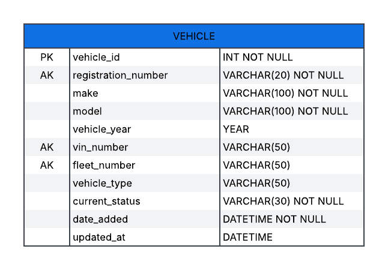

**Diagram: Vehicle Entity – FleetPro Logistics**

## 4. Maintenance Record Entity

### 4.1 Purpose

The Maintenance Record entity stores detailed information about maintenance, servicing, inspections and repairs performed on FleetPro Logistics vehicles.

Each maintenance record must be linked to a specific vehicle and must preserve a clear history of the maintenance activity.

The entity must capture the actual maintenance date where available, the reason for maintenance, inspection findings, detailed work performed, maintenance status and relevant record-management information.

The system must display maintenance information in a human-readable format so that authorised users can understand what work was carried out without relying only on internal record identifiers.

### 4.2 Maintenance Record Fields

| Field Name | Data Type | Key | Mandatory | Description |
|---|---|---|---|---|
| `maintenance_id` | INT | PK | Yes | Unique identifier automatically assigned to each maintenance record. |
| `vehicle_id` | INT | FK | Yes | Identifies the vehicle associated with the maintenance activity. References the Vehicle entity. |
| `provider_id` | INT | FK | No | References the main maintenance provider associated with the maintenance activity. May be NULL if the provider is unknown or not recorded. |
| `maintenance_date` | DATE | - | Conditional | Actual date on which maintenance, inspection, servicing or repair took place. Required for new records when the actual date is known. May be NULL for historical records where the original date is unavailable or cannot be verified. |
| `maintenance_type` | VARCHAR(100) | - | Yes | Identifies the general type of maintenance, such as scheduled service, repair, inspection, emergency repair or preventative maintenance. |
| `work_requested` | TEXT | - | Conditional | Describes the problem reported or the maintenance work initially requested. Required for new records where this information is available. May be NULL for incomplete historical records. |
| `inspection_findings` | TEXT | - | No | Records issues, defects or observations identified during inspection or assessment. |
| `work_performed` | TEXT | - | Conditional | Detailed description of the actual work completed, including repairs, replacements, servicing and other maintenance activities. Required before a record can be marked as Completed. |
| `maintenance_status` | VARCHAR(30) | - | Yes | Indicates the current progress of the maintenance activity, such as Pending, In Progress, Completed or Cancelled. |
| `record_source` | VARCHAR(50) | - | No | Identifies the source of the information, such as a new system entry, historical spreadsheet, paper invoice or other historical document. |
| `verification_status` | VARCHAR(30) | - | Yes | Indicates whether the maintenance information is Verified, Unverified or Requires Review. |
| `created_at` | DATETIME | - | Yes | Date and time when the maintenance record was first entered into the system. |
| `updated_at` | DATETIME | - | No | Date and time when the maintenance record was last updated. |

### 4.3 Field Validation Rules

The following validation rules must apply to the Maintenance Record entity:

1. Each maintenance record must have a unique `maintenance_id`.
2. Every maintenance record must reference an existing vehicle through `vehicle_id`.
3. The `provider_id` field must reference an existing Maintenance Provider record when a provider is specified.
4. The `provider_id` field may remain NULL when the maintenance provider is unknown or has not been recorded.
5. `maintenance_date` must contain a valid date when provided.
6. The actual maintenance date must be stored separately from the date and time the record was entered into the system.
7. A new maintenance record must contain the actual maintenance date when the date is known and applicable.
8. Historical maintenance records may have a NULL `maintenance_date` when the original date is unavailable or cannot be verified.
9. `maintenance_type` must contain a recognised maintenance type.
10. `work_requested` should describe the reason for the maintenance activity when that information is available.
11. `inspection_findings` may remain empty when no inspection findings are available or applicable.
12. `work_performed` must contain a meaningful description before the maintenance status can be changed to Completed.
13. A maintenance record must not be marked as Completed solely because a cost or invoice has been recorded.
14. `maintenance_status` must contain an accepted status value.
15. `verification_status` must contain an accepted verification value.
16. Historical maintenance information must retain its original maintenance date where that date is available.
17. Missing historical information must be identified as unavailable or unverified rather than estimated or invented.
18. Changes to a maintenance record must update the `updated_at` field.

### 4.4 Data Relationships

The Maintenance Record entity has the following relationships with the Vehicle and Maintenance Provider entities:

- One Vehicle can have multiple Maintenance Records.
- Each Maintenance Record must belong to one Vehicle.
- The `vehicle_id` field acts as a foreign key referencing the Vehicle entity.
- A maintenance record must remain associated with its vehicle so that the vehicle's maintenance history can be retrieved.
- One Maintenance Provider can be associated with multiple Maintenance Records.
- Each Maintenance Record may reference one main Maintenance Provider through the optional `provider_id` foreign key.
- The `provider_id` field references the Maintenance Provider entity and may remain empty when the provider is unknown or has not been recorded.

The Maintenance Record entity will also be connected to other entities in the overall database design:

- One Maintenance Record can have multiple Maintenance Cost Items.
- One Maintenance Record can have multiple Invoice records.
- One Maintenance Record can have multiple Supporting Documents.

### 4.5 Maintenance Record Entity Diagram

The following diagram provides a visual representation of the Maintenance Record entity within the proposed FleetPro Logistics Vehicle Maintenance Management System.

It illustrates the fields required to capture detailed vehicle maintenance information, including the primary key, foreign key, field names and associated data types.

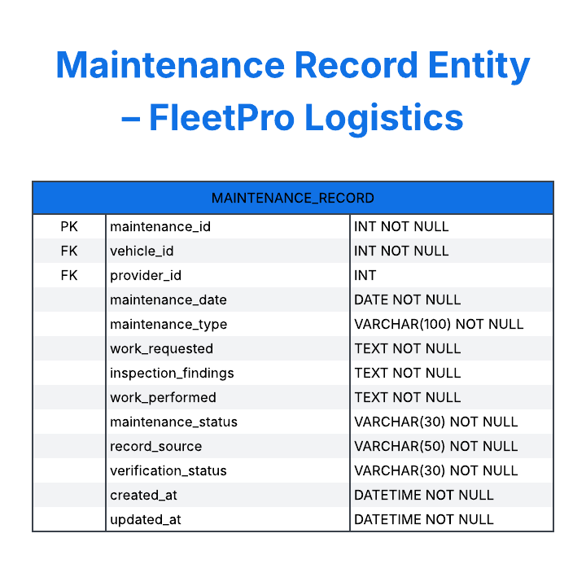

**Diagram: Maintenance Record Entity – FleetPro Logistics**

## 5. Maintenance Provider Entity

### 5.1 Purpose

The Maintenance Provider entity stores information about external businesses or individuals that provide maintenance, repair, servicing, inspection or other vehicle-related services to FleetPro Logistics.

Each provider must have a unique record so that maintenance activities and associated costs can be consistently linked to the correct provider.

This entity will support provider-based maintenance history, supplier expenditure reporting and the identification of maintenance providers used by FleetPro Logistics.

### 5.2 Maintenance Provider Fields

| Field Name | Data Type | Key | Mandatory | Description |
|---|---|---|---|---|
| `provider_id` | INT | PK | Yes | Unique identifier automatically assigned to each maintenance provider. |
| `provider_name` | VARCHAR(150) | - | Yes | Registered or commonly used name of the maintenance provider. |
| `provider_type` | VARCHAR(50) | - | Yes | Identifies the type of provider, such as Workshop, Service Centre, Tyre Supplier, Parts Supplier or Independent Mechanic. |
| `contact_person` | VARCHAR(100) | - | No | Name of the main contact person at the provider. |
| `phone_number` | VARCHAR(30) | - | No | Provider's contact telephone number. |
| `email_address` | VARCHAR(150) | - | No | Provider's contact email address. |
| `physical_address` | TEXT | - | No | Physical address of the provider. |
| `is_active` | BOOLEAN | - | Yes | Indicates whether the provider is currently active and available for selection in new records. |
| `created_at` | DATETIME | - | Yes | Date and time when the provider record was created. |
| `updated_at` | DATETIME | - | No | Date and time when the provider record was last updated. |

### 5.3 Field Validation Rules

The following validation rules must apply to the Maintenance Provider entity:

1. Each provider must have a unique `provider_id`.
2. `provider_name` is mandatory and must not be left blank.
3. `provider_type` must contain a recognised provider type.
4. Phone numbers must be stored as text to accommodate different formats and international dialing codes.
5. Email addresses must follow a valid email address format when provided.
6. Optional contact details may remain empty when they are unavailable.
7. `is_active` must contain a valid Boolean value.
8. Inactive providers must remain available in historical maintenance records and expenditure reports.
9. A provider must not be deleted if historical maintenance cost records refer to it. It should instead be marked as inactive.
10. Changes to provider information must update the `updated_at` field.

### 5.4 Data Relationships

The Maintenance Provider entity will be associated with maintenance and cost information.

The proposed relationships are:

- One Maintenance Provider can be associated with multiple Maintenance Records.
- Each Maintenance Record may reference one main Maintenance Provider through the optional `provider_id` foreign key.
- One Maintenance Provider can be associated with multiple Maintenance Cost Items.
- Each Maintenance Cost Item may reference one provider where the provider responsible for that cost is known.
- One Maintenance Provider can be associated with multiple Invoice records.
- Each Invoice may reference one Maintenance Provider where the provider that issued the invoice is known.

The provider linked to an individual cost item will allow FleetPro to identify the provider responsible for expenses that are not associated with an invoice.

Where a cost item is linked to an invoice, provider-based expenditure reporting must use the Maintenance Provider recorded on the invoice and count the invoice amount once. The provider recorded on the individual cost item may still be retained for detailed cost information but must not cause the expense to be counted again or attributed to a different provider in overall expenditure calculations.

The `provider_id` field will act as the primary key in the Maintenance Provider entity and as a foreign key in the Maintenance Record, Maintenance Cost Item and Invoice entities.

### 5.5 Maintenance Provider Entity Diagram

The following diagram provides a visual representation of the Maintenance Provider entity within the proposed FleetPro Logistics Vehicle Maintenance Management System.

It illustrates the provider information required by the system, including the primary key, field names and associated data types.

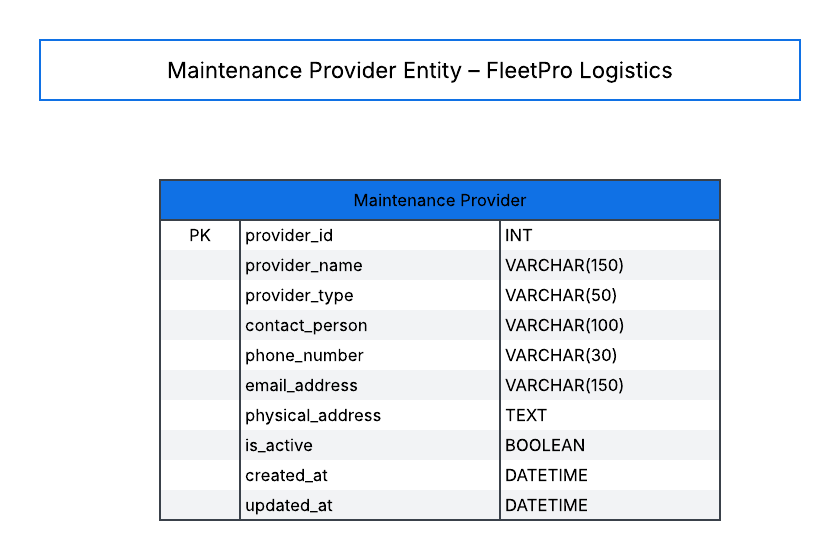

**Diagram: Maintenance Provider Entity – FleetPro Logistics**

## 6. Maintenance Cost Item Entity

### 6.1 Purpose

The Maintenance Cost Item entity stores individual expenses associated with vehicle maintenance, servicing, inspections and repairs.

Each cost item must be recorded separately and linked to the relevant Maintenance Record. This allows FleetPro Logistics to maintain detailed expenditure information instead of relying only on a single combined maintenance amount.

The entity will support cost calculations and reporting by vehicle, maintenance activity, cost category, maintenance provider and selected date range.

It will also support searching and filtering cost descriptions so that users can identify specific expenses and calculate the total expenditure associated with matching items.

### 6.2 Maintenance Cost Item Fields

| Field Name | Data Type | Key | Mandatory | Description |
|---|---|---|---|---|
| `cost_item_id` | INT | PK | Yes | Unique identifier automatically assigned to each maintenance cost item. |
| `maintenance_id` | INT | FK | Yes | Identifies the maintenance record to which the cost item belongs. |
| `cost_category_id` | INT | FK | Yes | Identifies the category assigned to the expense, such as tyres, brakes, engine repairs, labour, parts or materials. |
| `provider_id` | INT | FK | No | Identifies the maintenance provider or supplier responsible for the expense, where known. |
| `invoice_id` | INT | FK | No | References the invoice associated with the cost item, where applicable. |
| `cost_description` | TEXT | - | Yes | Describes the specific expense, such as replacement of two tyres, engine oil purchase or mechanic labour. |
| `quantity` | DECIMAL(10,2) | - | No | Records the quantity of items, units or services associated with the expense, where applicable. |
| `unit_cost` | DECIMAL(12,2) | - | No | Records the cost per unit where quantity-based pricing applies. |
| `total_cost` | DECIMAL(12,2) | - | Yes | Records the total monetary value of the individual cost item. |
| `created_at` | DATETIME | - | Yes | Date and time when the cost item was entered into the system. |
| `updated_at` | DATETIME | - | No | Date and time when the cost item was last updated. |

### 6.3 Field Validation Rules

The following validation rules must apply to the Maintenance Cost Item entity:

1. Each cost item must have a unique `cost_item_id`.
2. Every cost item must reference an existing Maintenance Record through `maintenance_id`.
3. Every cost item must be assigned a valid cost category through `cost_category_id`.
4. `provider_id` may remain empty when the responsible supplier or provider is unknown or unavailable.
5. `invoice_id` may remain empty when no invoice is available or applicable.
6. `cost_description` must contain a meaningful description of the expense.
7. `quantity`, where provided, must be greater than zero.
8. `unit_cost`, where provided, must not be negative.
9. `total_cost` must be a valid monetary value and must not be negative.
10. Monetary values must be stored using an appropriate decimal data type to preserve currency accuracy.
11. Where both `quantity` and `unit_cost` are provided, the system must validate the relationship between them and `total_cost`, allowing for appropriate rounding.
12. Every cost item must be counted only once in expenditure calculations.
13. Invoice totals must not be added to itemised costs when those same expenses have already been recorded as individual cost items.
14. Cost items associated with an invoice must remain available for detailed breakdowns and reconciliation.
15. Changes to a cost item must update the `updated_at` field.

### 6.4 Data Relationships

The Maintenance Cost Item entity has the following relationships:

- One Maintenance Record can have multiple Maintenance Cost Items.
- Each Maintenance Cost Item must belong to one Maintenance Record.
- One Cost Category can be assigned to multiple Maintenance Cost Items.
- Each Maintenance Cost Item must reference one Cost Category.
- One Maintenance Provider can be associated with multiple Maintenance Cost Items.
- Each Maintenance Cost Item may reference one Maintenance Provider where known.
- One Invoice can be associated with multiple Maintenance Cost Items.
- Each Maintenance Cost Item may reference one Invoice where applicable.

The following foreign keys will be used:

- `maintenance_id` references the Maintenance Record entity.
- `cost_category_id` references the Cost Category entity.
- `provider_id` references the Maintenance Provider entity.
- `invoice_id` references the Invoice entity.

These relationships will allow FleetPro to retrieve detailed expenditure information and calculate totals using the relevant vehicle, maintenance activity, category, provider and maintenance date.

### 6.5 Maintenance Cost Item Entity Diagram

The following diagram provides a visual representation of the Maintenance Cost Item entity within the proposed FleetPro Logistics Vehicle Maintenance Management System.

It illustrates the fields required to capture individual maintenance expenses, including the primary key, foreign keys, field names and associated data types.

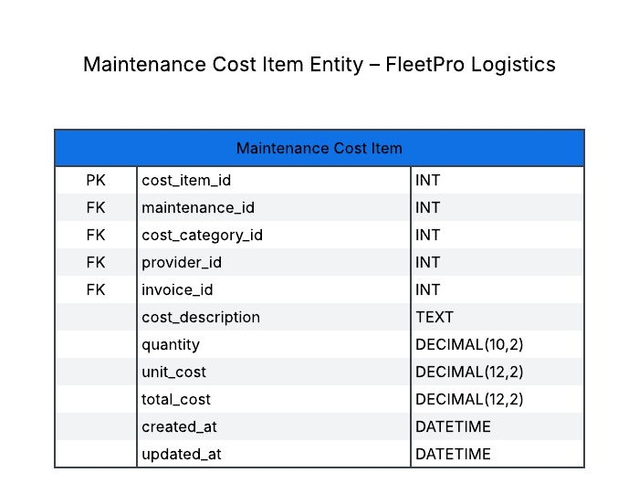

**Diagram: Maintenance Cost Item Entity – FleetPro Logistics**

## 7. Cost Category Entity

### 7.1 Purpose

The Cost Category entity stores the standard categories used to classify individual vehicle maintenance expenses within the FleetPro Logistics Vehicle Maintenance Management System.

Each maintenance cost item must be assigned to an appropriate category. This will allow the system to group, filter and calculate expenditure consistently.

The entity will support reporting on expenditure categories such as tyres, brakes, engine repairs, labour, parts, materials and additional expenses.

Using a controlled list of categories will prevent inconsistent category names and improve the accuracy of maintenance expenditure reports.

### 7.2 Cost Category Fields

| Field Name | Data Type | Key | Mandatory | Description |
|---|---|---|---|---|
| `cost_category_id` | INT | PK | Yes | Unique identifier automatically assigned to each cost category. |
| `category_name` | VARCHAR(100) | - | Yes | Name of the cost category, such as Tyres, Brakes, Engine Repairs, Labour, Parts or Materials. |
| `category_description` | TEXT | - | No | Explains which types of maintenance expenses belong to the category. |
| `is_active` | BOOLEAN | - | Yes | Indicates whether the category is currently available for selection when capturing new cost items. |
| `created_at` | DATETIME | - | Yes | Date and time when the category was created. |
| `updated_at` | DATETIME | - | No | Date and time when the category was last updated. |

### 7.3 Suggested Cost Categories

The system should initially support the following cost categories:

| Category | Description |
|---|---|
| Tyres | Purchase, replacement, repair and related tyre expenses. |
| Brakes | Brake pads, brake discs, brake repairs and related components. |
| Engine Repairs | Engine repairs, engine components and related maintenance work. |
| Labour | Mechanic labour, technician charges and other maintenance service fees. |
| Parts | Replacement vehicle parts and mechanical components. |
| Materials | Engine oil, lubricants, fluids and other maintenance materials. |
| Additional Expenses | Other maintenance-related expenses that do not fall under the existing categories. |

The category list should be maintained by authorised users so that new categories can be introduced when necessary.

An unallocated invoice difference is not an ordinary cost category. It must be maintained separately as a reconciliation value and must not be assigned to a category without verification.

### 7.4 Field Validation Rules

The following validation rules must apply to the Cost Category entity:

1. Each cost category must have a unique `cost_category_id`.
2. `category_name` is mandatory and must not be left blank.
3. Category names must be unique to prevent duplicate categories.
4. Category names must follow consistent naming conventions.
5. `category_description` may remain empty where no additional explanation is required.
6. `is_active` must contain a valid Boolean value.
7. Inactive categories must remain associated with historical cost records.
8. A category must not be deleted if existing Maintenance Cost Items reference it. It should instead be marked as inactive.
9. Only authorised users may create, update or deactivate cost categories.
10. Changes to category information must update the `updated_at` field.

### 7.5 Data Relationships

The Cost Category entity has the following relationship with the Maintenance Cost Item entity:

- One Cost Category can be associated with multiple Maintenance Cost Items.
- Each Maintenance Cost Item must belong to one Cost Category.
- The `cost_category_id` field acts as the primary key in the Cost Category entity.
- The `cost_category_id` field in the Maintenance Cost Item entity acts as a foreign key referencing the Cost Category entity.

This relationship allows FleetPro to group maintenance expenses by category and calculate expenditure for individual categories across vehicles, maintenance activities and selected reporting periods.

### 7.6 Cost Category Entity Diagram

The following diagram provides a visual representation of the Cost Category entity within the proposed FleetPro Logistics Vehicle Maintenance Management System.

It illustrates the standard cost categories used to classify maintenance expenses, including the primary key, field names and associated data types.

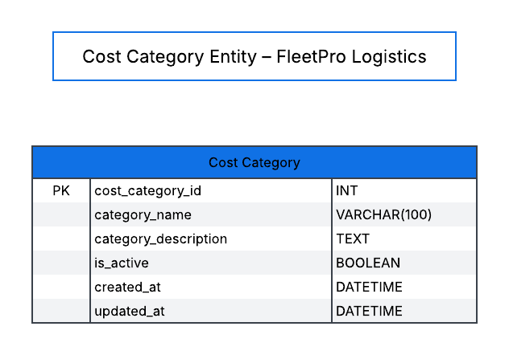

**Diagram: Cost Category Entity – FleetPro Logistics**

## 8. Invoice Entity

### 8.1 Purpose

The Invoice entity stores information about invoices received from maintenance providers and suppliers for vehicle-related maintenance, repairs, servicing, parts and other expenses.

Each invoice must be associated with the relevant maintenance activity and, where known, the provider that issued it.

The entity will allow FleetPro Logistics to maintain a digital record of invoice references, invoice dates and invoice amounts.

Invoices will provide supporting financial evidence for recorded maintenance expenses and assist with reviewing and reconciling cost information.

The system must support multiple invoices for a single maintenance activity.

Invoice information must be captured manually by authorised users. Automatic invoice scanning, OCR and automatic information extraction are not included in the initial system requirements.

The original invoice document must be uploaded and associated with the relevant maintenance activity through the Supporting Document entity.

### 8.2 Invoice Fields

| Field Name | Data Type | Key | Mandatory | Description |
|---|---|---|---|---|
| `invoice_id` | INT | PK | Yes | Unique identifier automatically assigned to each invoice record. |
| `maintenance_id` | INT | FK | Yes | Identifies the maintenance activity associated with the invoice. |
| `provider_id` | INT | FK | No | Identifies the provider or supplier that issued the invoice, where known. |
| `invoice_number` | VARCHAR(100) | - | No | Invoice number or reference printed on the original invoice. |
| `invoice_date` | DATE | - | No | Date shown on the original invoice. |
| `invoice_amount` | DECIMAL(12,2) | - | Yes | Total amount shown on the invoice. |
| `currency_code` | CHAR(3) | - | Yes | Three-letter currency code identifying the invoice currency, such as ZAR. |
| `created_at` | DATETIME | - | Yes | Date and time when the invoice record was entered into the system. |
| `updated_at` | DATETIME | - | No | Date and time when the invoice record was last updated. |

### 8.3 Field Validation Rules

The following validation rules must apply to the Invoice entity:

1. Each invoice record must have a unique `invoice_id`.
2. Every invoice must reference an existing Maintenance Record through `maintenance_id`.
3. `provider_id` may remain empty when the issuing provider cannot be identified from the available information.
4. `invoice_number` may remain empty when the original invoice does not contain a readable or available reference number.
5. `invoice_date` must contain a valid date when provided.
6. `invoice_amount` must contain a valid monetary value and must not be negative.
7. `currency_code` must contain a valid three-letter currency code.
8. Historical invoice information must retain the original invoice date where available.
9. The invoice amount must be stored separately from individual Maintenance Cost Item amounts.
10. The system must not add the invoice amount to itemised cost totals when the same expenses have already been captured as individual cost items.
11. Where invoice details and recorded cost items are available, the system must support comparison between the invoice amount and the total of its linked cost items.
12. Where the itemised total is lower than the invoice amount, the difference must be displayed separately as an unallocated invoice difference.
13. Where the itemised total is higher than the invoice amount, the difference must be flagged as a discrepancy requiring review.
14. Missing historical invoice information must remain unidentified or unavailable rather than being estimated.
15. Changes to an invoice record must update the `updated_at` field.

### 8.4 Data Relationships

The Invoice entity has the following relationships:

- One Maintenance Record can have multiple Invoices.
- Each Invoice must belong to one Maintenance Record.
- One Maintenance Provider can issue multiple Invoices.
- Each Invoice may reference one Maintenance Provider where known.
- One Invoice can be associated with multiple Maintenance Cost Items.
- Each Maintenance Cost Item may reference one Invoice where applicable.
- One Invoice can have multiple associated Supporting Documents.
- Each Supporting Document may reference one Invoice where applicable.

The following foreign keys will be used:

- `maintenance_id` references the Maintenance Record entity.
- `provider_id` references the Maintenance Provider entity.

The `invoice_id` field acts as the primary key in the Invoice entity and is referenced as a foreign key by the Maintenance Cost Item entity where a cost item is associated with a particular invoice.

These relationships will allow FleetPro to retrieve invoice information alongside maintenance activities and their individual recorded expenses.

### 8.5 Invoice Entity Diagram

The following diagram provides a visual representation of the Invoice entity within the proposed FleetPro Logistics Vehicle Maintenance Management System.

It illustrates the information required to maintain invoice records, including the primary key, foreign keys, field names and associated data types.

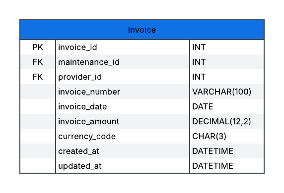

**Diagram: Invoice Entity – FleetPro Logistics**

## 9. Supporting Document Entity

### 9.1 Purpose

The Supporting Document entity stores information about digital files uploaded to the FleetPro Logistics Vehicle Maintenance Management System as evidence of vehicle maintenance activities.

Documents may include invoices, receipts, service reports, inspection checklists, repair reports, photographs and historical maintenance records.

Each supporting document must be associated with the relevant maintenance activity. Where applicable, a document may also be linked to a specific invoice.

The entity will allow authorised users to retrieve and review supporting evidence alongside the relevant maintenance history.

The system must support multiple supporting documents for a single maintenance record.

Supporting evidence must supplement the written maintenance description and must not replace the mandatory written description of actual work performed before a record can be marked as Completed.

### 9.2 Supporting Document Fields

| Field Name | Data Type | Key | Mandatory | Description |
|---|---|---|---|---|
| `document_id` | INT | PK | Yes | Unique identifier automatically assigned to each supporting document record. |
| `maintenance_id` | INT | FK | Yes | Identifies the maintenance record associated with the document. |
| `invoice_id` | INT | FK | No | Identifies the invoice associated with the document, where applicable. |
| `document_name` | VARCHAR(255) | - | Yes | Original or assigned name of the uploaded document. |
| `document_type` | VARCHAR(50) | - | Yes | Identifies the document category, such as Invoice, Receipt, Service Report, Inspection Checklist, Repair Report or Photograph. |
| `file_path` | VARCHAR(500) | - | Yes | Stores the file location or storage reference used by the system to retrieve the uploaded document. |
| `file_extension` | VARCHAR(20) | - | Yes | Records the file extension, such as PDF, JPG, PNG or DOCX. |
| `file_size` | BIGINT | - | No | Records the size of the uploaded file in bytes. |
| `uploaded_at` | DATETIME | - | Yes | Date and time when the document was uploaded to the system. |
| `uploaded_by` | INT | FK | Yes | Identifies the system user who uploaded the document. |

### 9.3 Field Validation Rules

The following validation rules must apply to the Supporting Document entity:

1. Each supporting document must have a unique `document_id`.
2. Every supporting document must reference an existing Maintenance Record through `maintenance_id`.
3. `invoice_id` may remain empty when the document is not associated with a specific invoice.
4. `document_name` must not be left blank.
5. `document_type` must contain a recognised document category.
6. Only permitted file formats should be accepted for upload.
7. The system must enforce appropriate file-size limits.
8. `file_path` must reference a valid stored file location.
9. `file_extension` must correspond to the uploaded file format.
10. `uploaded_at` must record the actual date and time of upload.
11. `uploaded_by` must reference an existing system user.
12. Documents associated with historical maintenance records must remain accessible to authorised users.
13. The system must apply appropriate access controls to uploaded documents.
14. Supporting documents must not be treated as a replacement for required written maintenance descriptions.

### 9.4 Data Relationships

The Supporting Document entity has the following relationships:

- One Maintenance Record can have multiple Supporting Documents.
- Each Supporting Document must belong to one Maintenance Record.
- One Invoice can have multiple associated Supporting Documents.
- Each Supporting Document may reference one Invoice where applicable.
- One System User can upload multiple Supporting Documents.
- Each Supporting Document must identify the System User who uploaded it.

The following foreign keys will be used:

- `maintenance_id` references the Maintenance Record entity.
- `invoice_id` references the Invoice entity.
- `uploaded_by` references the System User entity.

These relationships will allow FleetPro to retrieve relevant documents alongside maintenance records and invoice information, while maintaining a record of which system user uploaded each document.

### 9.5 Supporting Document Entity Diagram

The following diagram provides a visual representation of the Supporting Document entity within the proposed FleetPro Logistics Vehicle Maintenance Management System.

It illustrates the information required to manage uploaded maintenance evidence, including the primary key, foreign keys, field names and associated data types.

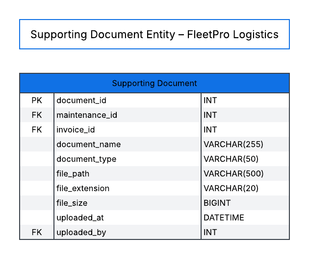

**Diagram: Supporting Document Entity – FleetPro Logistics**

## 10. System User Entity

### 10.1 Purpose

The System User entity stores information about individuals authorised to access the FleetPro Logistics Vehicle Maintenance Management System.

Each user must have a unique account and an assigned role that determines which system functions and information they are permitted to access.

The entity will support user identification, account management, role-based access control and accountability for activities performed within the system.

The proposed system will support the following user roles:

- **Fleet Administrator:** Responsible for capturing and maintaining vehicle maintenance records, cost items, invoices, supporting documents and historical maintenance information.
- **Fleet Manager:** Responsible for reviewing maintenance records, monitoring vehicle maintenance activities and accessing relevant fleet information.
- **Senior Management:** Responsible for accessing authorised management reports and reviewing maintenance expenditure.

### 10.2 System User Fields

| Field Name | Data Type | Key | Mandatory | Description |
|---|---|---|---|---|
| `user_id` | INT | PK | Yes | Unique identifier automatically assigned to each system user. |
| `full_name` | VARCHAR(150) | - | Yes | Full name of the individual using the system. |
| `email_address` | VARCHAR(150) | Unique | Yes | Unique email address used to identify the user's account. |
| `password_hash` | VARCHAR(255) | - | Yes | Stores the securely hashed password rather than the original password. |
| `role_id` | INT | FK | Yes | Identifies the role assigned to the user and determines their access permissions. |
| `account_status` | VARCHAR(30) | - | Yes | Indicates whether the user account is Active, Inactive or Suspended. |
| `created_at` | DATETIME | - | Yes | Date and time when the user account was created. |
| `updated_at` | DATETIME | - | No | Date and time when the user account was last updated. |
| `last_login` | DATETIME | - | No | Records the date and time of the user's most recent successful login. |

### 10.3 Field Validation Rules

The following validation rules must apply to the System User entity:

1. Each system user must have a unique `user_id`.
2. `full_name` is mandatory and must not be left blank.
3. `email_address` is mandatory and must follow a valid email address format.
4. Each email address must be unique within the system.
5. Passwords must never be stored as readable plain text.
6. `password_hash` must contain the securely generated password hash.
7. Every system user must be assigned a valid role through `role_id`.
8. `account_status` must contain an accepted status value.
9. Inactive or suspended accounts must not be permitted to access protected system functions.
10. `last_login` must be updated following a successful login.
11. User account information must be protected from unauthorised access or modification.
12. Changes to user information must update the `updated_at` field.

### 10.4 Data Relationships

The System User entity will have the following relationships:

- One System User can upload multiple Supporting Documents.
- Each Supporting Document must identify the System User who uploaded it.
- One System Role can be assigned to multiple System Users.
- Each System User must be assigned one System Role.

The following foreign keys will be used:

- `role_id` references the System Role entity.
- `uploaded_by` in the Supporting Document entity references the System User entity.

These relationships will support role-based access control and provide accountability for documents uploaded to the system.

The system must also maintain appropriate accountability for important user actions and changes to maintenance and financial information. The detailed technical implementation of audit-history storage will be addressed during database and system design. It is not defined as an additional core business entity in this Data Dictionary.

### 10.5 System User Entity Diagram

The following entity diagram provides a visual representation of the System User entity and its database structure.

It illustrates the attributes associated with each system user, including the primary key used to uniquely identify user accounts and the foreign key used to associate each user with a system role.

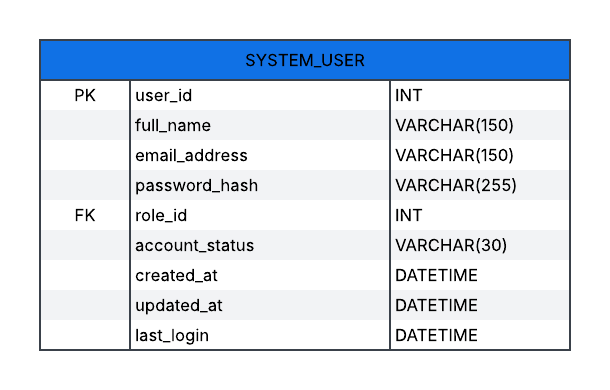

**Diagram: System User Entity Diagram – FleetPro Logistics**

## 11. System Role Entity

### 11.1 Purpose

The System Role entity stores the different roles available within the FleetPro Vehicle Maintenance Management System.

Each role defines a user's general responsibilities and determines which system functions and information the user is authorised to access.

Separating system roles from user accounts allows roles to be managed centrally and assigned to multiple users without duplicating role information.

The initial system roles are:

- **Fleet Administrator:** Responsible for capturing and maintaining vehicle maintenance records, cost information, invoices, supporting documents and historical maintenance information.
- **Fleet Manager:** Responsible for reviewing maintenance records, monitoring fleet maintenance activities and accessing relevant operational information.
- **Senior Management:** Responsible for accessing authorised management reports and reviewing maintenance expenditure and overall fleet maintenance performance.

The system must apply role-based access control to ensure that users can only access functions and information permitted by their assigned role.

### 11.2 Entity Fields

| Field Name | Data Type | Key | Mandatory | Description |
|---|---|---|---|---|
| `role_id` | INT | PK | Yes | Unique identifier assigned to each system role. |
| `role_name` | VARCHAR(100) | Unique | Yes | Name of the role, such as Fleet Administrator, Fleet Manager or Senior Management. |
| `role_description` | TEXT | - | No | Description of the role's responsibilities and purpose. |
| `is_active` | BOOLEAN | - | Yes | Indicates whether the role is active and available for assignment. |
| `created_at` | DATETIME | - | Yes | Date and time when the role was created. |
| `updated_at` | DATETIME | - | No | Date and time when the role was last updated. |

### 11.3 Data Validation Rules

The following validation rules apply to the System Role entity:

1. Each role must have a unique `role_id`.
2. A role name must be provided.
3. Each `role_name` must be unique to prevent duplicate role definitions.
4. A role description may be provided to explain its responsibilities.
5. The `is_active` field must contain a valid Boolean value.
6. Inactive roles must not be available for assignment to new users.
7. Existing user accounts must retain their role references unless an authorised role reassignment takes place.
8. The `updated_at` field must be updated when an existing role is modified.

### 11.4 Entity Relationships

The System Role entity has the following relationships:

- One System Role can be assigned to many System Users.
- Each System User must be assigned one System Role.
- The `role_id` field in the System User entity references the `role_id` primary key in the System Role entity.

**Relationship Type:** One-to-Many (System Role to System User).

### 11.5 System Role Entity Diagram

The following entity diagram provides a visual representation of the System Role entity and its database structure.

It illustrates the attributes used to identify and manage system roles, including the primary key that uniquely identifies each role.

The diagram complements the System User entity diagram by representing the entity referenced through the `role_id` foreign key in the System User table.

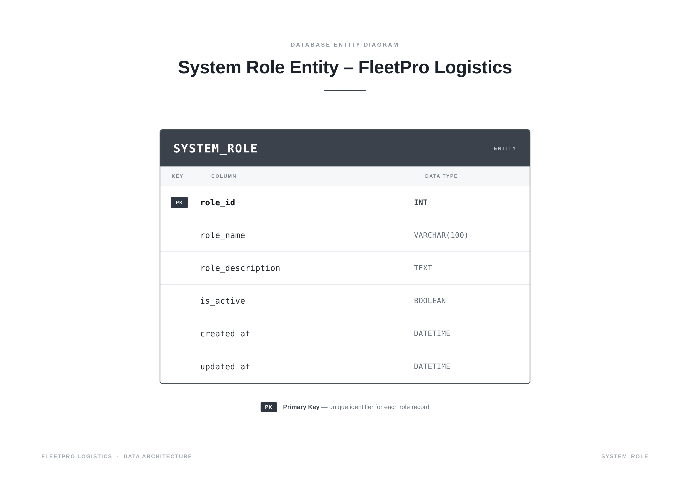

**Diagram: System Role Entity Diagram – FleetPro Logistics**

## 12. Data Relationships and Constraints

### 12.1 Introduction

This section describes the relationships between the entities within the proposed FleetPro Logistics Vehicle Maintenance Management System database.

It explains how the different entities are connected through primary keys and foreign keys, and how these relationships support the storage, retrieval and management of vehicle maintenance information.

The section also defines the relationship types, optional and mandatory associations, and data integrity constraints required to maintain accurate and consistent information across the system.

The overall Entity Relationship Diagram (ERD) provides a visual representation of how the database entities are connected.

### 12.2 Entity Relationships Overview

The FleetPro database consists of nine main entities that work together to store and manage vehicle maintenance information.

The entities are connected through primary keys and foreign keys to maintain relationships between vehicles, maintenance activities, providers, costs, invoices, supporting documentation and system users.

The following relationships are proposed:

| Parent Entity | Related Entity | Relationship | Description |
|---|---|---|---|
| Vehicle | Maintenance Record | One-to-Many | One vehicle can have multiple maintenance records, while each maintenance record belongs to one vehicle. |
| Maintenance Provider | Maintenance Record | One-to-Many (Optional) | One provider can be associated with multiple maintenance records. Each maintenance record may reference one main provider. |
| Maintenance Record | Maintenance Cost Item | One-to-Many | One maintenance record can contain multiple cost items, while each cost item belongs to one maintenance record. |
| Cost Category | Maintenance Cost Item | One-to-Many | One cost category can be assigned to multiple cost items, while each cost item must reference one category. |
| Maintenance Provider | Maintenance Cost Item | One-to-Many (Optional) | One provider can be associated with multiple cost items. Each cost item may reference one provider. |
| Invoice | Maintenance Cost Item | One-to-Many (Optional) | One invoice can be associated with multiple cost items. Each cost item may reference one invoice. |
| Maintenance Record | Invoice | One-to-Many | One maintenance record can have multiple invoices, while each invoice belongs to one maintenance record. |
| Maintenance Provider | Invoice | One-to-Many (Optional) | One provider can issue multiple invoices. Each invoice may reference one provider. |
| Maintenance Record | Supporting Document | One-to-Many | One maintenance record can have multiple supporting documents, while each document belongs to one maintenance record. |
| Invoice | Supporting Document | One-to-Many (Optional) | One invoice can have multiple supporting documents. Each supporting document may reference one invoice. |
| System User | Supporting Document | One-to-Many | One system user can upload multiple supporting documents, while each document must identify its uploader. |
| System Role | System User | One-to-Many | One system role can be assigned to multiple users, while each user must have one system role. |

These relationships provide a structured connection between the system's operational data and user account information.

They also support the retrieval of complete maintenance histories, detailed expenditure records, supplier information and supporting evidence.

### 12.3 Primary Key and Foreign Key Constraints

Primary keys and foreign keys are used to establish and maintain relationships between the entities within the FleetPro database.

**Primary Key Constraints**

Each entity must have a primary key that uniquely identifies every record stored in that entity.

The following primary keys are defined:

| Entity | Primary Key |
|---|---|
| Vehicle | `vehicle_id` |
| Maintenance Record | `maintenance_id` |
| Maintenance Provider | `provider_id` |
| Maintenance Cost Item | `cost_item_id` |
| Cost Category | `cost_category_id` |
| Invoice | `invoice_id` |
| Supporting Document | `document_id` |
| System User | `user_id` |
| System Role | `role_id` |

Primary key constraints must ensure that:

- Each primary key value is unique.
- Primary key values cannot be NULL.
- Every record can be identified independently.

**Foreign Key Constraints**

Foreign keys establish connections between related entities by referencing the primary key of another entity.

The following foreign key relationships are defined:

| Entity | Foreign Key | References |
|---|---|---|
| Maintenance Record | `vehicle_id` | Vehicle.`vehicle_id` |
| Maintenance Record | `provider_id` | Maintenance Provider.`provider_id` |
| Maintenance Cost Item | `maintenance_id` | Maintenance Record.`maintenance_id` |
| Maintenance Cost Item | `cost_category_id` | Cost Category.`cost_category_id` |
| Maintenance Cost Item | `provider_id` | Maintenance Provider.`provider_id` |
| Maintenance Cost Item | `invoice_id` | Invoice.`invoice_id` |
| Invoice | `maintenance_id` | Maintenance Record.`maintenance_id` |
| Invoice | `provider_id` | Maintenance Provider.`provider_id` |
| Supporting Document | `maintenance_id` | Maintenance Record.`maintenance_id` |
| Supporting Document | `invoice_id` | Invoice.`invoice_id` |
| Supporting Document | `uploaded_by` | System User.`user_id` |
| System User | `role_id` | System Role.`role_id` |

Foreign key constraints must ensure that:

- A foreign key must reference an existing record in the related entity when a value is provided.
- Mandatory foreign keys cannot be NULL.
- Optional foreign keys may contain NULL when the relationship is not available or applicable.
- Foreign key values must reference valid primary key values.
- Related records must maintain referential integrity.

These constraints help prevent invalid relationships, disconnected records and inconsistent information within the FleetPro database.

### 12.4 Relationship Cardinality and Optionality

Relationship cardinality defines the number of records that can be associated between two entities. Optionality determines whether a relationship is mandatory or optional.

The FleetPro database uses one-to-many relationships. This means that one record in a parent entity can be associated with multiple records in a related child entity.

The following rules define the cardinality and optionality of each relationship:

| Relationship | Parent-to-Child | Child-to-Parent | Optionality |
|---|---|---|---|
| Vehicle to Maintenance Record | One vehicle can have zero or many maintenance records. | Each maintenance record must belong to exactly one vehicle. | Mandatory for Maintenance Record. |
| Maintenance Provider to Maintenance Record | One provider can be associated with zero or many maintenance records. | Each maintenance record may reference zero or one provider. | Optional for Maintenance Record. |
| Maintenance Record to Maintenance Cost Item | One maintenance record can contain zero or many cost items. | Each cost item must belong to exactly one maintenance record. | Mandatory for Maintenance Cost Item. |
| Cost Category to Maintenance Cost Item | One category can be assigned to zero or many cost items. | Each cost item must reference exactly one category. | Mandatory for Maintenance Cost Item. |
| Maintenance Provider to Maintenance Cost Item | One provider can be associated with zero or many cost items. | Each cost item may reference zero or one provider. | Optional for Maintenance Cost Item. |
| Invoice to Maintenance Cost Item | One invoice can be associated with zero or many cost items. | Each cost item may reference zero or one invoice. | Optional for Maintenance Cost Item. |
| Maintenance Record to Invoice | One maintenance record can have zero or many invoices. | Each invoice must belong to exactly one maintenance record. | Mandatory for Invoice. |
| Maintenance Provider to Invoice | One provider can issue zero or many invoices. | Each invoice may reference zero or one provider. | Optional for Invoice. |
| Maintenance Record to Supporting Document | One maintenance record can have zero or many supporting documents. | Each supporting document must belong to exactly one maintenance record. | Mandatory for Supporting Document. |
| Invoice to Supporting Document | One invoice can have zero or many supporting documents. | Each supporting document may reference zero or one invoice. | Optional for Supporting Document. |
| System User to Supporting Document | One system user can upload zero or many supporting documents. | Each supporting document must identify exactly one uploading user. | Mandatory for Supporting Document. |
| System Role to System User | One system role can be assigned to zero or many users. | Each system user must be assigned exactly one system role. | Mandatory for System User. |

**Important Design Considerations**

- A parent record does not have to have child records immediately after creation. For example, a newly registered vehicle may not yet have any maintenance history.
- Mandatory relationships require the child record to reference an existing parent record.
- Optional relationships allow the foreign key to remain NULL when the related information is unknown or not applicable.
- Optional relationships must not result in invented information. For example, a historical maintenance record can be captured without a provider if the original provider cannot be established.
- Historical maintenance dates and descriptions may be unavailable without preventing the system from preserving the remaining available information.
- The database must enforce mandatory and optional relationships through appropriate foreign key and NULL constraints.

These rules ensure that the database supports incomplete historical information where necessary while maintaining valid relationships between records.

### 12.5 Referential Integrity Rules

Referential integrity ensures that relationships between entities remain accurate and consistent.

The FleetPro database must enforce rules that prevent invalid references, accidental loss of important maintenance information and inconsistent records.

The following rules must be applied:

**1. Valid Foreign Key References**

- Every non-NULL foreign key must reference an existing primary key in the related entity.
- Mandatory foreign keys must contain valid references and cannot be NULL.
- Optional foreign keys may contain NULL when the relationship is unknown or not applicable.
- The system must prevent records from referencing entities that do not exist.

**2. Record Deletion Rules**

- Vehicle records linked to maintenance history must not be physically deleted. Vehicles should instead be marked as inactive or assigned an appropriate status.
- Maintenance records containing historical maintenance information must not be physically deleted through normal system operations.
- Maintenance providers linked to historical records should be marked as inactive rather than deleted.
- Cost categories already used by maintenance cost items should not be deleted. They should be marked as inactive when no longer required.
- System roles assigned to existing users should not be deleted until the affected users have been reassigned to valid roles.
- Supporting documents and invoices associated with maintenance history must be protected from accidental deletion.

**3. Foreign Key Update Rules**

- Primary key values should remain stable and should not normally be changed after records have been created.
- Changes to descriptive information, such as vehicle details or provider contact information, must not break existing relationships.
- Foreign key references must remain valid whenever related records are updated.

**4. Historical Information Protection**

- Historical maintenance dates and recorded work descriptions must be preserved where available.
- Missing historical information must remain identifiable as unavailable or unverified rather than being replaced with assumed information.
- Updating a vehicle, provider or other related record must not automatically overwrite historical maintenance information.
- Records containing supporting evidence must retain their relationships to the relevant maintenance activity.
- Historical records must retain their original recorded financial information.

**5. Database Deletion Behaviour**

The database should use restrictive deletion rules for important historical records.

Where an optional relationship is removed, the system may allow the relevant foreign key to be set to NULL, provided the record remains meaningful and its history is preserved.

Automatic cascading deletion should not be used for maintenance records, cost items, invoices or supporting documents because deleting one record could unintentionally remove important historical and financial information.

These referential integrity rules will help protect the accuracy, reliability and traceability of FleetPro's maintenance history and financial records.

### 12.6 Overall Entity Relationship Diagram (ERD)

The overall Entity Relationship Diagram (ERD) provides a visual representation of the FleetPro Logistics Vehicle Maintenance Management System database structure.

It combines all nine entities into one diagram and illustrates how they are connected through primary keys and foreign keys.

The diagram shows the one-to-many relationships between entities, including mandatory and optional associations. It also demonstrates how vehicle maintenance records connect to maintenance providers, cost items, cost categories, invoices, supporting documents and system users.

This ERD provides an overall view of the proposed database design and serves as a reference during database development and implementation.

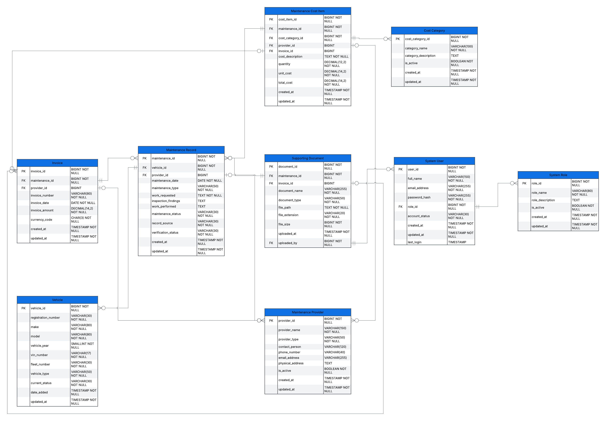

**FleetPro - Overall Entity Relationship Diagram**

## 13. Maintenance Expenditure Calculations and Reporting

### 13.1 Introduction and Calculation Principles

The FleetPro Logistics Vehicle Maintenance Management System must calculate and report vehicle maintenance expenditure using recorded invoice totals and detailed maintenance cost information.

Each invoice must be captured with its relevant information, including the invoice number, invoice date, maintenance provider, invoice amount and associated maintenance activity.

The system must also support the detailed capture of individual expenses listed on each invoice. These may include labour, replacement parts, tyres, materials, repairs and additional charges.

The invoice total must be recorded separately from its individual cost items. The invoice total will be used for overall financial expenditure calculations, while individual cost items will provide a detailed breakdown of how the expenditure was incurred.

The following calculation principles must be applied:

- The system must use the recorded `invoice_amount` for overall expenditure calculations when an invoice is available.
- Individual maintenance cost items must provide a detailed breakdown of the expenses associated with each invoice.
- Individual cost items associated with an invoice must not be added to the invoice total when calculating overall expenditure.
- The system must compare the combined cost items against the recorded invoice amount and identify differences for review.
- Expenses without an associated invoice must be included in expenditure calculations using their recorded `total_cost` values.
- Each expense must only be counted once.
- Maintenance expenditure must be linked to the correct vehicle through its associated maintenance record.
- The system must support monthly, yearly and selected date-range expenditure reporting.
- All financial calculations must retain the recorded currency, with South African Rand (ZAR) as the initial system currency.

The calculated expenditure information must support financial reporting at individual vehicle level as well as across the entire fleet.

### 13.2 Maintenance Expenditure Calculations

The system must automatically calculate maintenance expenditure using recorded invoice totals or individual maintenance cost items, depending on whether an expense is associated with an invoice.

The following calculation rules must be applied:

**1. Expenditure per Invoice**

- The system must use the recorded `invoice_amount` as the overall expenditure amount for an invoice.
- Individual cost items associated with that invoice must not be added to the invoice total.
- Detailed cost items must be retained for expenditure breakdowns and reconciliation purposes.

**2. Expenditure per Maintenance Activity**

The system must calculate the total expenditure associated with a maintenance activity using:

- The invoice totals associated with the maintenance activity.
- Individual `total_cost` values for expenses that are not associated with an invoice.

Each expense must only be counted once.

**3. Expenditure per Vehicle**

The system must calculate total maintenance expenditure for each vehicle using the expenditure recorded against all its maintenance activities.

**4. Monthly Expenditure per Vehicle**

The system must calculate total maintenance expenditure for each vehicle within a selected month and year.

**5. Yearly Expenditure per Vehicle**

The system must calculate total maintenance expenditure for each vehicle within a selected calendar year.

**6. Overall Fleet Expenditure**

The system must calculate total maintenance expenditure across all vehicles within a selected reporting period.

**7. Expenditure by Selected Date Range**

The system must allow authorised users to select a start date and end date to calculate expenditure for a specific reporting period.

The default reporting date must be based on the actual `maintenance_date` recorded against the maintenance activity.

Where the actual maintenance date is unavailable, the record must remain identifiable as undated for reporting purposes. The system must not automatically use the invoice date or record creation date as a replacement.

**8. Calculation Accuracy and Reconciliation**

- Invoice totals must be used instead of their associated individual cost items when calculating overall expenditure.
- Individual cost items must be used for overall expenditure calculations only when they are not associated with an invoice.
- The system must never add an invoice total and its associated cost items together.
- The system must compare the sum of detailed cost items against the invoice total.
- Where the itemised total is lower than the invoice amount, the difference must be displayed separately as an unallocated invoice difference.
- Where the itemised total is higher than the invoice amount, the difference must be flagged as a discrepancy requiring review.
- Neither the invoice amount nor the recorded cost items may be automatically changed to eliminate a difference.
- Calculations must update when authorised users add or correct financial records.

**9. Category-Based Expenditure**

Category-based expenditure must use the actual recorded itemised cost items assigned to each category.

An unallocated invoice difference must not be distributed across cost categories.

Where an itemised total is higher than the invoice amount, the discrepancy must be flagged for review and must not be silently treated as an additional confirmed expenditure amount.

### 13.3 Vehicle Financial Reports

The FleetPro Logistics Vehicle Maintenance Management System must allow authorised users to generate financial reports for individual vehicles.

These reports must provide a detailed overview of maintenance expenditure associated with a selected vehicle over a specified reporting period.

The following information must be included in vehicle financial reports:

**1. Vehicle Information**

- Vehicle registration number.
- Fleet number, where available.
- Vehicle make and model.
- Reporting period.

**2. Maintenance Expenditure Summary**

- Total maintenance expenditure for the selected reporting period.
- Total expenditure for the selected month or year.
- Total number of maintenance activities recorded.
- Total number of invoices associated with the vehicle.
- Overall maintenance expenditure for the vehicle across its recorded history.

**3. Detailed Maintenance and Invoice Information**

The report must provide a breakdown of maintenance activities and their associated financial information, including:

- Actual maintenance date, where available.
- Maintenance type.
- Description of work performed, where available.
- Maintenance provider or supplier, where recorded.
- Invoice number, where available.
- Invoice date, where available.
- Invoice total.
- Individual cost breakdowns, where available.
- Itemised cost total, where available.
- Any difference between the invoice amount and the itemised cost total, clearly identified for review.
- Historical information that is incomplete, unverified or unavailable, where applicable.

**4. Monthly Financial Reports**

The system must allow authorised users to generate a financial report for an individual vehicle for a selected month and year.

The report must display the maintenance expenditure recorded during that month, together with the associated maintenance activities and invoice information.

**5. Yearly Financial Reports**

The system must allow authorised users to generate a financial report for an individual vehicle for a selected calendar year.

The report must display total maintenance expenditure for the year, together with a breakdown of monthly expenditure and the associated maintenance activities.

**6. Historical Financial Reports**

The system must allow authorised users to view and generate financial reports covering the available historical maintenance information for a selected vehicle.

Historical reports must reflect the information recorded in the system, including any incomplete or unverified historical records.

**7. Report Generation**

- Authorised users must be able to select a vehicle and reporting period.
- The system must automatically calculate the relevant expenditure totals.
- Users must be able to generate and view the financial report when required.
- Reports must present financial totals separately from detailed cost breakdowns to prevent double-counting.
- Reports must clearly identify the reporting period and the vehicle to which the information relates.
- Records with unavailable maintenance dates must be identified separately rather than assigned to an assumed reporting period.

### 13.4 Fleet-Wide Financial Reports

The FleetPro Logistics Vehicle Maintenance Management System must allow authorised users to generate financial reports covering the entire vehicle fleet.

These reports must provide an overview of total maintenance expenditure across all registered vehicles within a selected reporting period.

The following information must be included:

**1. Overall Fleet Expenditure**

- Total maintenance expenditure across the fleet.
- Total expenditure for a selected month.
- Total expenditure for a selected calendar year.
- Total number of vehicles with recorded maintenance expenditure.
- Total number of maintenance activities recorded.
- Total number of invoices recorded.

**2. Monthly Fleet Expenditure**

The system must allow authorised users to generate monthly financial reports showing:

- Total maintenance expenditure for the selected month.
- Expenditure per vehicle.
- Maintenance activities recorded during the month.
- Invoice totals associated with each vehicle.
- Monthly expenditure comparisons between vehicles.

**3. Yearly Fleet Expenditure**

The system must allow authorised users to generate yearly financial reports showing:

- Total maintenance expenditure for the selected calendar year.
- Total expenditure per vehicle.
- Monthly expenditure breakdowns across the year.
- Total maintenance activities recorded.
- Total invoices recorded.
- Comparisons of maintenance expenditure between vehicles.

**4. Vehicle Expenditure Comparison**

The system must allow authorised users to compare maintenance expenditure across vehicles.

This must help management identify vehicles with higher maintenance expenditure and understand how maintenance costs are distributed across the fleet.

**5. Report Generation**

- Authorised users must be able to select a reporting period.
- The system must automatically calculate expenditure across the selected fleet.
- Reports must include relevant financial summaries and supporting maintenance information.
- Users must be able to generate and view reports when required.
- Financial summaries and detailed cost breakdowns must remain separate to prevent double-counting.
- Where invoice discrepancies exist, reports must identify the affected invoices and display the invoice amount, itemised cost total and difference for review.
- Reports must clearly identify the reporting period and the vehicles included.
- Records with unknown maintenance dates must remain identifiable and must not be assigned to an assumed reporting period.

### 13.5 Expenditure Filtering and Search

The FleetPro Logistics Vehicle Maintenance Management System must provide filtering and search functionality to help authorised users locate maintenance expenditure and analyse financial information.

Users must be able to filter and search maintenance cost information using relevant criteria.

**1. Cost Category Filtering**

The system must allow users to filter expenditure by maintenance cost category, including:

- Tyres.
- Brakes.
- Engine Repairs.
- Labour.
- Parts.
- Materials.
- Additional Expenses.

The system must calculate the total expenditure for the selected category within the chosen reporting period.

Category-based expenditure totals must be calculated using the actual recorded itemised cost items associated with the selected category.

Where the itemised total is lower than the invoice amount, the difference must be displayed separately as an unallocated invoice difference. It must not be included in any specific cost category unless the difference is subsequently verified and recorded against that category.

Where the itemised total is higher than the invoice amount, the difference must be flagged as a discrepancy requiring review. It must not be automatically assigned to an unallocated invoice difference or any cost category.

The system must retain the full invoice amount in overall expenditure calculations while preventing the invoice total and its associated itemised cost items from being counted twice.

**2. Maintenance Description Search**

The system must allow users to search maintenance cost descriptions using relevant keywords.

For example, users must be able to search for terms such as:

- Tyre replacement.
- Brake repairs.
- Engine servicing.
- Oil replacement.
- Parts replacement.

The system must display matching records and calculate the total expenditure associated with the matching cost items.

The results must retain their associated maintenance, vehicle and invoice information so that users can understand where the expenses originated.

**3. Maintenance Provider Filtering**

The system must allow users to filter expenditure by a selected maintenance provider, supplier or workshop.

The system must calculate the total expenditure associated with the selected provider within a specified reporting period.

Provider-based expenditure reports must use the recorded provider information associated with the relevant maintenance cost items and invoices.

Where an invoice exists, its full invoice amount must be counted only once and attributed to the Maintenance Provider recorded on the invoice. Its associated itemised cost items must be used for detailed breakdowns and must not be added again to the invoice total.

Where no invoice exists, expenditure must be attributed using the provider recorded against the relevant maintenance cost item.

Where provider information is missing, the expenditure must be identified as an unassigned provider amount rather than attributed to an assumed provider.

**4. Vehicle Filtering**

The system must allow users to filter expenditure by an individual vehicle using its registration number or fleet number, where available.

The system must display the relevant maintenance activities, invoices and expenditure totals for the selected vehicle.

**5. Date and Reporting Period Filtering**

Users must be able to filter expenditure using:

- A selected month and year.
- A selected calendar year.
- A custom start date and end date.
- The available historical maintenance period.

Date-based expenditure reports must use the actual maintenance date as the default reporting date.

Invoice dates and record creation dates must remain separate from the actual maintenance date.

Historical records without a verified maintenance date must not be assigned to an assumed reporting period.

**6. Combined Filtering**

The system must support multiple filters at the same time.

For example, users must be able to select:

- A specific vehicle.
- A maintenance category such as tyres.
- A particular maintenance provider.
- A selected month or date range.

The system must display records matching all selected criteria and automatically calculate the corresponding expenditure total.

**7. Filtered Results and Reporting**

- Search results must display relevant maintenance descriptions, dates, providers, invoices and cost information.
- The system must calculate expenditure totals based on the records matching the selected filters.
- Users must be able to adjust or clear filters.
- Filtered expenditure results must be available for reporting.
- Invoice totals and their associated detailed cost items must not be counted twice in filtered expenditure calculations.
- Where filtered results include invoices with differences between invoice totals and itemised costs, the system must identify the affected invoices and display their invoice amounts, itemised cost totals and differences for review.
- Unallocated invoice differences and unresolved discrepancies must remain distinguishable from ordinary cost category totals.

### 13.6 Financial Report Export and Record Retention

The FleetPro Logistics Vehicle Maintenance Management System must allow authorised users to generate, view and export financial reports for record-keeping, financial analysis and management purposes.

**1. Financial Report Export**

The system should support exporting generated financial reports into commonly used formats, including:

- PDF for formal financial reports and record-keeping.
- Excel (XLSX) for further financial analysis and spreadsheet-based reporting.

**2. Report Content**

Exported financial reports must retain the relevant information displayed in the system, including:

- Vehicle identification details, where applicable.
- Selected reporting period.
- Maintenance expenditure summaries.
- Invoice information and totals.
- Detailed maintenance cost breakdowns, where available.
- Invoice reconciliation information, including invoice amounts, itemised cost totals and differences requiring review, where applicable.
- Monthly and yearly expenditure summaries.
- Relevant filter criteria applied when generating the report.
- Incomplete or unverified historical information, where applicable.

**3. Report Identification**

Each generated report must clearly identify:

- The report type.
- The vehicle or fleet covered by the report.
- The reporting period.
- The date and time the report was generated.

**4. Historical Record Retention**

The system must preserve recorded maintenance and financial information so that authorised users can access historical records and generate reports when required.

Previously generated reports must not replace or override the underlying maintenance and financial records.

Historical maintenance information must remain accessible even when the associated vehicle, provider or cost category is no longer active.

**5. Access and Security**

- Only authorised users must be able to generate and export financial reports.
- Access to financial reports must follow the user's assigned system role and permissions.
- Exported reports must contain only information the requesting user is authorised to access.

## 14. Conclusion

This Data Dictionary defines the proposed database structure for the FleetPro Logistics Vehicle Maintenance Management System.

It provides a detailed specification of the nine database entities, their attributes, data types, primary keys, foreign keys, validation rules and relationships.

The document establishes how vehicle information, maintenance records, maintenance providers, cost items, cost categories, invoices, supporting documents, system users and system roles will be organised and connected within the database.

It also defines the data requirements necessary to maintain accurate maintenance histories, preserve supporting financial information and ensure that historical records remain accessible, including when some historical details are incomplete or unavailable.

The financial calculation and reporting requirements establish how the system will determine maintenance expenditure at individual vehicle level and across the entire fleet. This includes invoice-based expenditure, itemised cost breakdowns, invoice reconciliation, monthly and yearly financial reporting, expenditure filtering and financial report generation.

The Data Dictionary will serve as a reference during the database design and development stages. It will help ensure that the database structure supports the previously documented business requirements, functional requirements, use cases and system specifications.

Together, these definitions provide a foundation for developing a structured, consistent and reliable Vehicle Maintenance Management System for FleetPro Logistics.